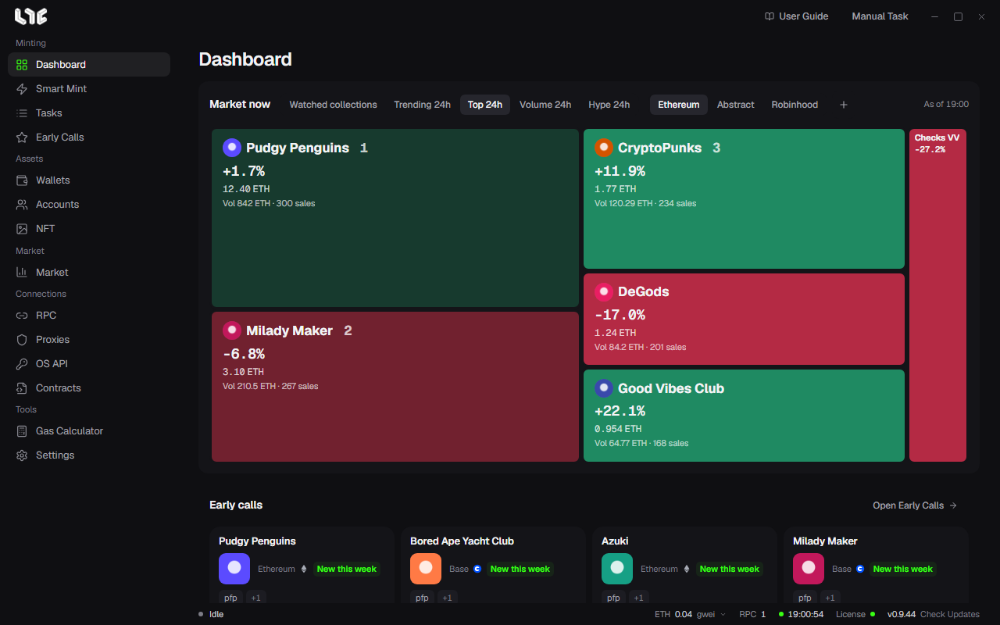

# Nogada Guide

Nogada is an NFT minting app for Windows PCs. It mints the same drop from many wallets at once, lists or sends what you minted, and shows the market and your P&L, all in one app. It supports Ethereum and other EVM chains.

## What you can do with it

| You want to | Use |
|---|---|
| Make a task from just a mint link | [Smart Mint](tasks/smart-mint.md) |
| Pick the contract and function yourself | [Tasks](tasks/task-form.md) |
| Fire on time, retry until it works, raise gas | [Running tasks and Boost](tasks/running.md) |
| Mint from many wallets in one transaction | [Bundles and contracts](tasks/bundles.md) |
| List, unlist, send NFTs, accept offers | [The NFT menu](after/nft-menu.md) |
| Collection prices, charts, alerts | [Market](after/market.md) |
| Upcoming mints | [Mint Calendar](after/mint-calendar.md), [Early Calls](tasks/early-calls.md) |

## New here?

Read these in order and you will get from launching the app to your first task without getting stuck.

1. [Download and first launch](getting-started/install.md)
2. [License](getting-started/license.md)
3. [Your first mint, step by step](getting-started/first-setup.md)
4. [Smart Mint](tasks/smart-mint.md)

## How the guide is laid out

The guide follows the order you use the app in.

- **Getting started**: installing, the license, reading the screen, the short path to a first task.
- **Before you mint**: wallets, funds, RPCs, proxies and OpenSea API keys to have ready.
- **Minting**: every way to make and run tasks.
- **NFTs and market**: the screens you use after minting.
- **Social**, **Tools and settings**, **Help**: look things up when you need them.

## Good to know first

- Private keys are stored only on this PC, encrypted with your Windows account. Transactions are always signed on this PC.
- Tasks run inside the app. Close the app and scheduled tasks do not run.
- A successful mint depends on gas, competition and the project, so the app cannot promise one.
- The app's text can be English, Korean or Chinese. Pick it in **Settings → General → Language**.
