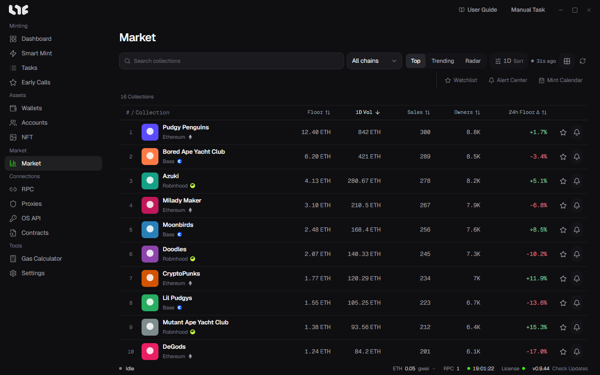
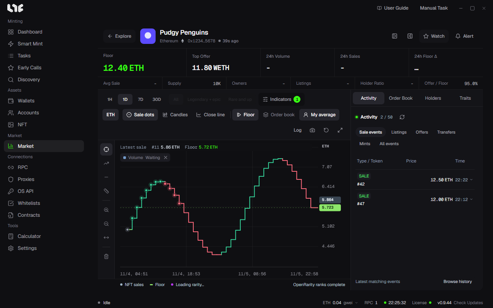

# Market

**Market** is where you see collection rankings, each collection's chart and trade history, and price alerts. Prices come from the Nogada server's Market Hub, so no OpenSea API key is needed. Transactions are always signed on this PC.

The **Watchlist**, **Alert Center** and **Mint Calendar** buttons at the top right of Market open those screens.

## Rankings

Choose the kind of list with the tabs at the top.

| Button | List |
|---|---|
| Top | OpenSea's top collections, sorted by the basis you pick. |
| Trending | Collections trending on OpenSea. You can pick the trending window. |
| Radar | Top and Trending shown together. |

- Find a collection in the search field and filter chains with **All chains**.
- The period and sort button right of the tabs (**1D** at first) picks the period and the sort basis. Only one sort applies at a time. Clicking a column title sorts by that column too.
- The dot and time next to it show when the list was last fetched. The grid button switches to card view and the arrow refreshes.

The columns are floor, 1-day volume, sales, owners and 24-hour floor change. The star at the end of a row is **Watch** and the bell is **Create alert**. Click a row to open that collection.

## Watchlist

Collections you starred collect in the **Watchlist**. It holds up to 10 collections; to add another, remove one first. It has search, a chain filter and refresh, and the Dashboard's **Watched collections** tab uses this list.

## A collection

The top shows the name, chain and contract, with figures.

- Large: floor, top offer, 24-hour volume, 24-hour sales, 24-hour floor change
- Small: average sale price, total supply, owners, listings, holder ratio, offer / floor

### The chart

- Period: **1H**, **1D**, **7D**, **30D**
- Rarity filter: all, **Legendary + epic**, **Rare and up**. Locked while rarity is being read.
- **Indicators**: SMA 20, EMA 50, Bollinger Bands, RSI 14, volume. If there are too few sale candles, it tells you how many it needs.
- Shape: **Sale dots**, **Candles**, **Close line**
- Overlays: **Floor**, **Order book** (listings and offers), **My average** (if you calculated P&L in the NFT menu)
- Top right: **Auto** (fit the price range automatically), **Log** price axis, zoom in, zoom out, copy chart image, reset view, enlarge
- Left tools: crosshair, trend line, ray, price line, vertical line, rectangle, Fibonacci retracement, price and time measure. Below them are the **magnet** (snaps to the nearest sale dot or candle value), undo, delete the picked drawing and clear drawings.
- Legend: the readout line and the indicator chips do not float over the chart; they sit on their own lines above it. The readout also shows the candle's change. So the top dots are not covered and can be clicked.
- Strip under the chart: when there are sales outside the range, it shows **N outliers** with **Show all**.

How to work it:

- **Move**: drag the chart in any direction and it moves that way, up and down too (once you drag 4 px or more in a direction, that direction moves). The Up and Down keys move the prices.
- **Price range**: it is automatic until you move or stretch it. Dragging the price axis stretches or shrinks the range. Double-clicking the price axis, the **Auto** button, changing the period, switching **Log** and reset view make it automatic again. The automatic range leaves out sales far off the floor.
- **Sales outside the range**: sale dots and candles that fall outside show as an arrow on the edge with their price. Clicking the arrow on a sale dot opens that sale. **Show all** puts them in the range; **Fold outliers** puts them back.
- **Time zoom**: scroll to zoom. Dragging the time axis zooms about its right edge, and double-clicking the time axis refits the time range. The zoom in and zoom out buttons at the top right work about the middle of the time range you see. **Shift** + wheel, or sideways scrolling on a touchpad, moves left and right.
- **Back to the latest trade**: when the latest trade is out of view, a button to go back to it appears. The width you were viewing stays.
- **Back to the first view**: double-click or press Home.
- **Sale dots**: clicking a sale dot on the chart opens that token's card.

Drawings:

- Click a drawing to pick it and press **Delete** to remove it.
- **Ctrl+Z** undoes, also after **Clear drawings**.
- Drawings stay on this PC, per collection and per currency.

### The right panel

| Tab | Content |
|---|---|
| Activity | Sales, listings, offers, transfers and mints. It keeps updating live; **Browse history** loads more. |
| Order Book | Orders per price level. |
| Holders | Top holders and the share of the top 10. |
| Traits | Floor, supply, 24-hour trades and share per trait. |

## Alert Center

In the **Alert Center** you make alerts for changes in a collection or a wallet. They work while the app is open, without the detail screen open. The app decides when to alert, so nothing comes while it is closed. Alerts arrive on Telegram. Open **Market Telegram connection** in the Alert Center, click **Generate connection code**, and send the command it shows to the bot chat signed in with the same license as the app. The code expires in 5 minutes. Once connected, the license end notice and a task's site step notices come to the same chat. The same connection card is also in **Settings → General**, right under Updates. To end the connection, use **Disconnect Market alerts**; to connect again, make a new code and send it.

The Alert Center's tabs are **Collection**, **Wallet** and **History**. The numbers next to the Collection and Wallet tabs are how many alerts you have made.

### Collection alerts

Click **New alert** and fill it in. Collection alerts can be on up to 10 collections.

| Field | What goes in |
|---|---|
| Collection identifier | The OpenSea collection slug (for example `pudgypenguins`). Opening it from the bell in the rankings fills it in. |
| Chain | The collection's chain. |
| Metric | Floor price, Floor change %, Volume change %, Sales change %, Listings change %, Top offer / Floor %, Top 10 holder concentration %, RSI |
| Condition | **At / below** or **At / above** |
| Threshold | The value to alert at. Percent metrics take a percent. |
| Price currency | Only for floor price. Enter the currency shown next to the collection's floor. |
| Alert interval | Alert **Once**, or **Repeat** while the condition holds. |

### Wallet alerts

**New wallet alert** on the **Wallet** tab watches the OpenSea account events of an EVM address.

- Wallet alerts work only with your own OpenSea API key on the OS API page. Without one, there is no **Wallet** tab and wallet alerts do not run. Saved wallet alerts are not deleted; they come back when you add a key again.
- They can be on up to 5 wallets. To add another wallet, delete the alerts of one first.
- The fields are **Wallet address**, **Label**, **Cooldown**, events and chains. The events are Mint, Received, Buy and Sell.
- **Cooldown** is 1 min, 5 min, 15 min, 1 hour or 6 hours, 1 min by default. When an event comes for a wallet that was quiet, the first one is sent at once. Events found within the cooldown after that are held and go together as one alert when the cooldown ends.
- A bundled alert gives the count of each kind of event and lists the events one per line, up to 10 lines; the rest are counted as "N more". Every event stays one by one in the **History** tab.

### History

The **History** tab keeps the alerts sent and how they were delivered. **Clear history** empties it.
