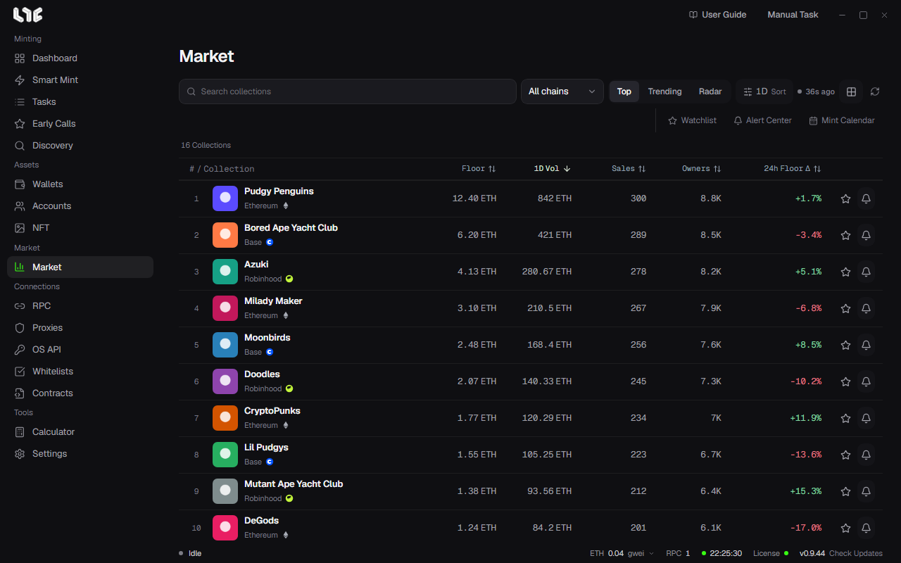
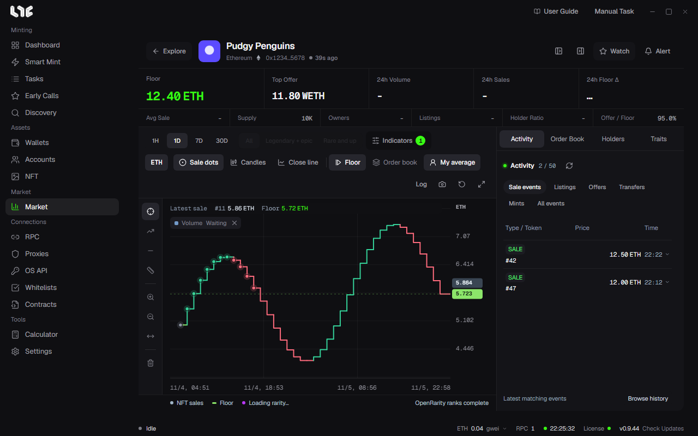

# Market

**Market** is where you see collection rankings, each collection's chart and trade history, and price alerts. Prices come from the Nogada server's Market Hub, so no OpenSea API key is needed. Transactions are always signed on this PC.

## Rankings

Choose the kind of list with the buttons at the top.

| Button | List |
|---|---|
| Top | OpenSea's top collections, sorted by the basis you pick. |
| Trending | Collections trending on OpenSea. You can pick the trending window. |
| Radar | Top and Trending shown together. |

- Find a collection in the search field and filter chains with **All chains**.
- The **1D Sort** button picks the period and the sort basis. Only one sort applies at a time. Clicking a column title sorts by that column too.
- The dot and time next to it show when the list was last fetched. The grid button switches to card view and the arrow refreshes.

The columns are floor, 1-day volume, sales, owners and 24-hour floor change. The star at the end of a row is **Watch** and the bell is **Create alert**. Click a row to open that collection.

## Watchlist

Collections you starred collect in the **Watchlist**. It has search, a chain filter and refresh, and the Dashboard's **Watched collections** tab uses this list.

## A collection

The top shows the name, chain and contract, with figures.

- Large: floor, top offer, 24-hour volume, 24-hour sales, 24-hour floor change
- Small: average sale price, total supply, owners, listings, holder ratio, offer / floor

### The chart

- Period: **1H**, **1D**, **7D**, **30D**
- Rarity filter: all, **Legendary + epic**, **Rare and up**. Locked while rarity is being read.
- **Indicators**: SMA 20, EMA 50, Bollinger Bands, RSI 14, volume. If there are too few sale candles, it tells you how many it needs.
- Shape: **Sale dots**, **Candles**, **Close line**
- Overlays: **Floor**, **Order book** (listings and offers), **My average** (if you calculated P&L in the NFT menu)
- Top right: **Log** price axis, copy chart image, reset view, enlarge
- Left tools: crosshair, trend line, price line, price and time measure, zoom in, zoom out, clear drawings

Scroll to zoom and drag to move. Double-click or press Home to get back to the first view. Clicking a sale dot opens that token's card.

### The right panel

| Tab | Content |
|---|---|
| Activity | Sales, listings, offers, transfers and mints. It keeps updating live; **Browse history** loads more. |
| Order Book | Orders per price level. |
| Holders | Top holders and the share of the top 10. |
| Traits | Floor, supply, 24-hour trades and share per trait. |

## Alert Center

In the **Alert Center** you make alerts for changes in a collection or a wallet. They work while the app is open, without the detail screen open. Alerts arrive as Windows notifications.

### Collection alerts

Click **New alert** and fill it in.

| Field | What goes in |
|---|---|
| Collection identifier | The OpenSea collection slug (for example `pudgypenguins`). Opening it from the bell in the rankings fills it in. |
| Metric | Floor price, Floor change %, Volume change %, Sales change %, Listings change %, Top offer / Floor %, Top 10 holder concentration %, RSI |
| Condition | **At / below** or **At / above** |
| Threshold | The value to alert at. Percent metrics take a percent. |
| Price currency | Only for floor price. Enter the currency shown next to the collection's floor. |
| Alert interval | Alert **Once**, or **Repeat** while the condition holds. |

### Wallet alerts

A new alert on the **Wallets** tab watches the OpenSea account events of an EVM address. Pick the address, a label, chains and events (mint, received, buy, sell).

### History

The **History** tab keeps the alerts sent and how they were delivered. **Clear history** empties it.
