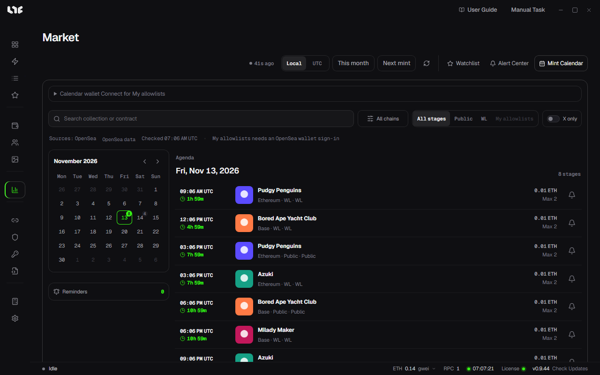

# Mint Calendar

**Market → Mint Calendar** shows upcoming mints on a calendar. For now it uses the schedule OpenSea provides.

## Reading the screen

- Calendar on the left: the small number by a date is the number of mint stages that day. Click a date and its stages appear under **Agenda** on the right. The arrows change the month.
- Buttons at the top: switch times between **Local** and **UTC**, and jump with **This month** and **Next mint**. The arrow at the right refreshes.
- Source line: where the schedule came from and when it was checked.

## Filtering

- Search field: find by collection name or contract.
- **All chains**: filter by chain.
- Stages: **All stages**, **Public**, **WL**, **My allowlists**
- **X only**: keep only projects with an X address.

## Drop details

Click an item in the agenda to see each stage's start and end, price, wallet cap, supply, contract, and website and X links. It also shows whether values were checked on chain.

**Set reminder** chooses how long before the stage opens you are notified. Reminders arrive as Windows notifications. The number of reminders shows under **Reminders** below the calendar.

## Seeing your own allowlists

Expand **Calendar wallet Connect for My allowlists** and connect a wallet; then **My allowlists** keeps only the stages that wallet is on.

- Connecting needs your own OpenSea API key on the OS API page. Without one, it tells you to add a key on the OS API page first.
- Connecting means signing an OpenSea login message. It is not a transaction, so there is no gas.
- By connecting you agree to OpenSea's Terms of Service and Privacy Policy.
- Closing the app disconnects it, and the login expires after a day.
