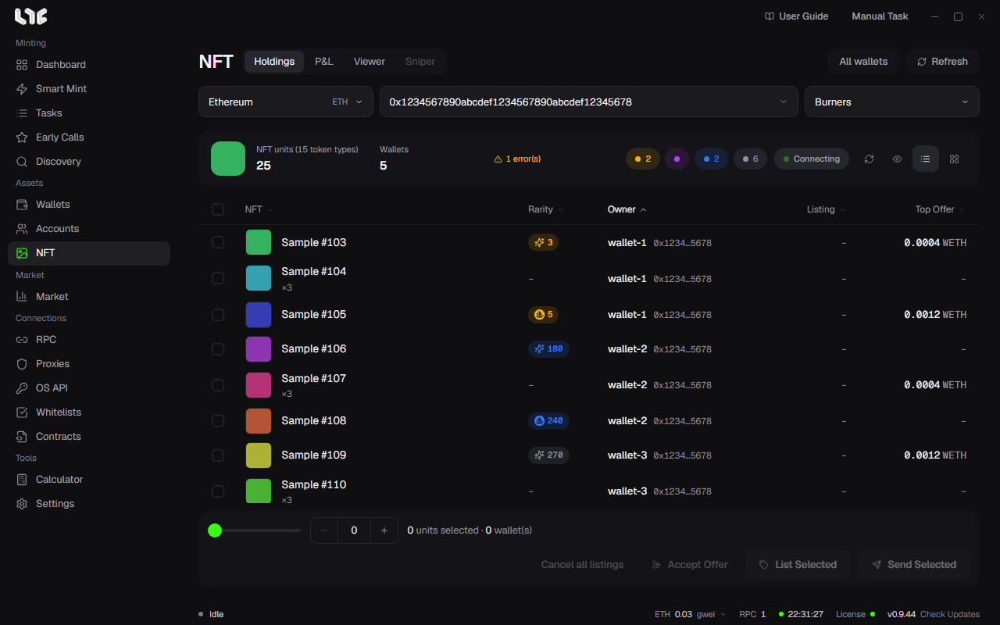
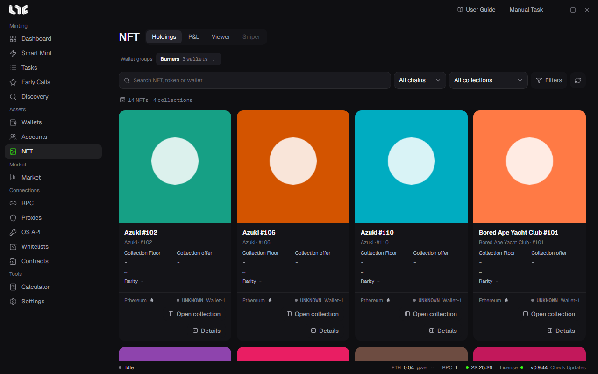
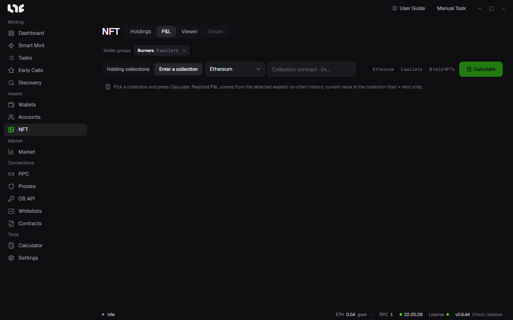
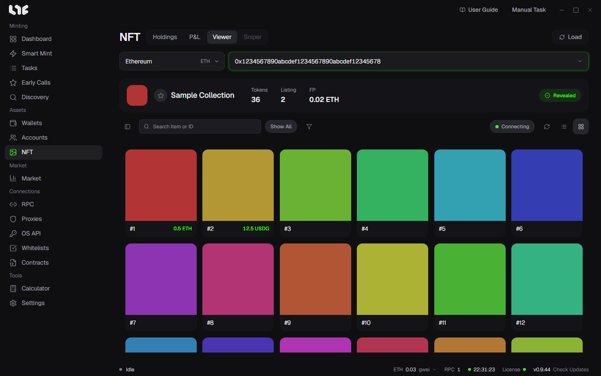

# The NFT menu

**NFT** is where you go after minting. The tabs at the top are **Holdings**, **P&L**, **Viewer** and **Sniper**; Sniper is not open yet (**Soon**).

## Holdings

After a mint, this is where you sell or move the NFTs. Enter the collection and the table lists every one of its NFTs your wallets hold, ready to list, unlist, send or accept offers on.

1. Pick the chain.
2. Enter the collection contract in **0x… NFT collection**.
3. Pick a group in **Select wallet group(s)**.

Above the table you see the number of NFTs and token types, the number of wallets, **N error(s)** if some wallets could not be read, and counts per rarity tier. **Connecting** means listing and offer changes are coming in live.

| Column | Meaning |
|---|---|
| NFT | Name and image. For ERC-1155 the amount held (×3 and so on) shows too. |
| Rarity | The rank inside the collection. Each tier has its own color. |
| Owner | The wallet that holds it. |
| Listing | The price it is listed at now. |
| Top offer | The highest offer you can take now. |

### The bottom bar

Tick NFTs, or set how many to select at once with the slider and **−/+** on the left. Then click a button.

| Button | What it does |
|---|---|
| List Selected | Lists the selected NFTs on OpenSea. Set the price and expiry; **Adjust for fees** raises the price so that what you receive after creator and platform fees equals the number you entered. A collection's first listing sends an approval transaction first. |
| Send Selected | Sends the selected NFTs to other addresses, either gathered to one (**Consolidate**) or split across several (**Disperse**). One transaction goes out per NFT. |
| Accept Offer | For each selected NFT, takes the highest offer standing on it. The first accept per wallet and collection also sends a one-time approval. NFTs with no offer, or only your own, are skipped. |
| Cancel all listings | Takes the selected NFTs' OpenSea listings down on chain. |

Listing, accepting offers and cancelling listings need an [OpenSea API key](../prepare/opensea-keys.md). These go on chain, so they cost gas and cannot be undone once sent.

### All wallets

**All wallets** at the top right reads the NFTs of every wallet on every chain and shows them as cards. It reads only when you click it.

Find NFTs by name, token ID or wallet in the search field, and narrow them by chain, collection and **Filters** (sort, traits, listing state). Each card shows the collection floor, collection offer, rarity, chain, listing state and the wallet that holds it; **Open collection** opens that collection in Market.

## P&L

Works out your wallets' profit and loss on one collection.

1. Pick the group to count in the wallet group chip at the top.
2. Pick from **Holding collections**, or enter the chain and contract with **Enter a collection**. A collection you have sold out of can still be entered and counted.
3. Click **Calculate**.

Realized P&L comes from the selected wallets' on-chain history; unrealized P&L is the amount you hold now times the latest collection floor. On chains Alchemy supports, the history is read through an Alchemy address from the RPC menu or **Settings → Integrations → PnL Alchemy URLs**.

Once the full result is in, **Share card** makes a P&L card. Pick a **Card style**, optionally add a background with **Upload image** (PNG, JPG, WebP, up to 10MB), then click **Copy image** or **Save PNG**. A partial result cannot be copied or saved.

Once P&L is calculated, you can turn on the **My average** line on the collection chart in Market.

## Viewer

Lays out a whole collection on one screen. Pick the chain, enter the collection contract and click **Load**. Star it to add it to your favorite collections and pick it from the list next time.

- The top shows the number of tokens, listings, the floor and the reveal state (**Revealed** or not yet).
- Tiles show the token number and the listed price. Enter an item name or ID in the search field and filter by trait with the funnel. The buttons on the right switch between list and tile views.
- With the rarity ranks alongside, you can spot rare tokens near the floor.

### Buying in the Viewer

Tick listed tokens and click **Buy Selected Listings**. Right before each purchase the app looks the listing up again, then buys that NFT in a transaction of its own. It needs a **Buy Wallet**, set in **Settings → Fire Engine → NFT Buying**; **Buy Max Fee** there caps the gas. Listings priced in a token other than the chain's own coin cannot be bought yet.

### Watching for a reveal

On a collection that has not revealed yet, set how many minutes to watch and click **Monitor Reveal**. During that time the app keeps an eye on chain events and metadata; once it sees the reveal, it stops and says so in its status.
