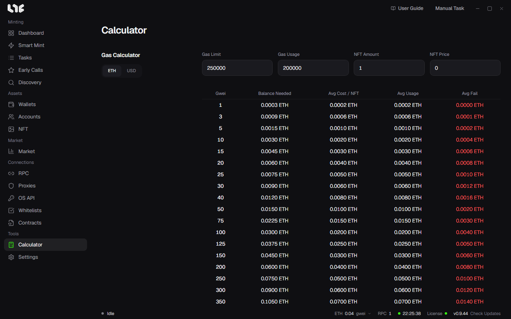

# Calculator

**Calculator** has a gas calculator and a Unix time converter. Neither sends anything to a chain.

## Gas Calculator

Fill in four fields and you get a cost table per gas price (gwei), in rows from 1 to 1000 gwei.

| Field | What goes in |
|---|---|
| Gas Limit | The gas limit you will put on the task. |
| Gas Usage | The gas the mint transaction actually uses. Open a mint transaction of the same drop in an explorer to find it. |
| NFT Amount | How many one wallet mints. |
| NFT Price | The mint price per NFT. |

The table's columns are worked out like this.

| Column | Formula |
|---|---|
| Balance Needed | NFT amount × NFT price + 1.2 × price × gas limit. The wallet needs at least this much for the transaction to go in. |
| Avg Usage | NFT amount × NFT price + price × gas usage. What actually leaves the wallet when it succeeds. |
| Avg Cost / NFT | Avg Usage ÷ NFT amount |
| Avg Fail | price × 40,000 gas. A rough figure for the gas lost when a transaction fails. |

When the ETH price is available, an **ETH / USD** switch appears on the left to show dollars too.

To decide how much to put in each wallet, read **Balance Needed** on the row for the gas price you will use and enter it as **Target Balance Per Wallet** in [Manage Funds](../prepare/funding.md).

## Unix Time Converter

A task's **Timestamp** field takes Unix time. In the converter below, pick **Local Date & Time** to get the **Unix Timestamp**, or enter a number to get the date. **Set to now** fills in the current time, and the copy button copies the number.
