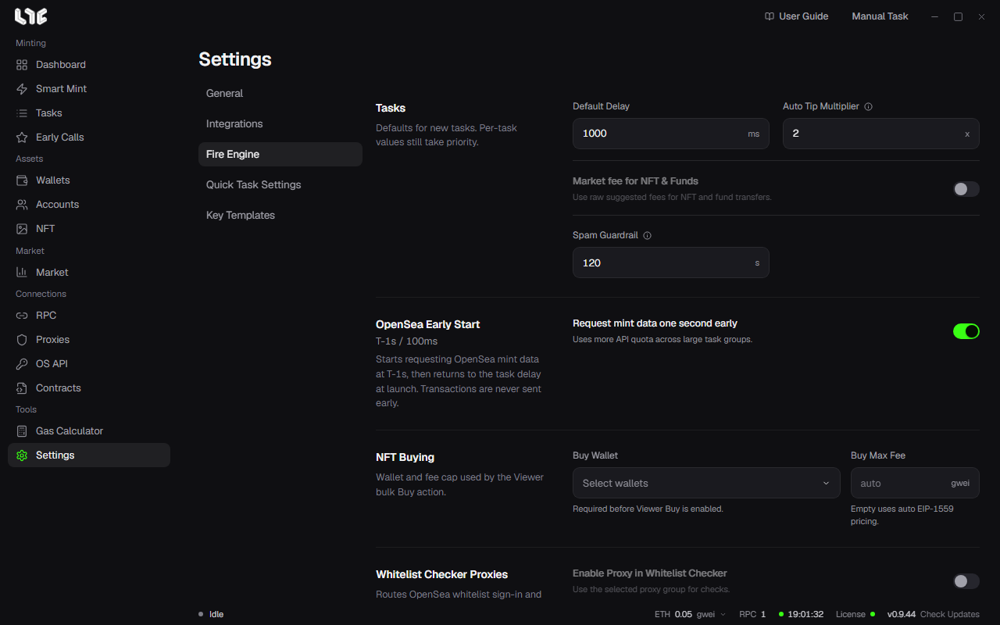
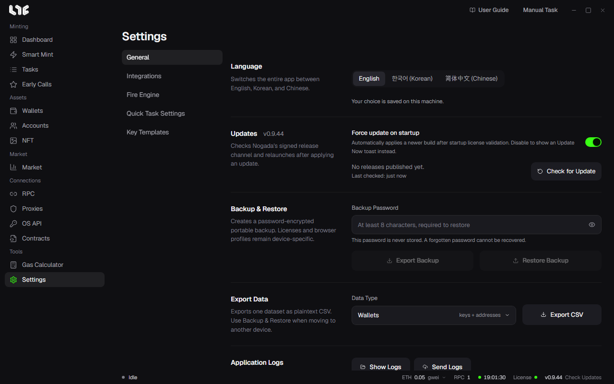

# Settings

**Settings** has five tabs on the left.

| Tab | Holds |
|---|---|
| General | Language, updates, Backup & Restore, data export, application logs, log out, wipe all data |
| Integrations | Captcha solver keys, Market Hub, PnL Alchemy URLs, Etherscan API key, Discord webhook, capture browser extension |
| Fire Engine | Task defaults, OpenSea Early Start, NFT Buying, Broadcast, Flashbots, chains |
| Quick Task Settings | Quick task wallets and RPCs per chain |
| Key Templates | Answer templates for social tasks |

Below, the settings are grouped by what you want to change rather than by tab. Each heading names the tab it is on.

## How tasks fire (Fire Engine)

### Defaults for new tasks

The **Tasks** card holds values new tasks start with. A value set on a task itself wins.

- **Default Delay**: the delay (ms) a new task gets.
- **Auto Tip Multiplier**: on tasks whose priority fee is auto, the RPC's suggested fee is multiplied by this. 1x suits normal transactions and 3 to 5x contested mints; the result never goes below 0.1 gwei.
- **Spam Guardrail**: how long (seconds) Spam may run at most. Empty means no such cap.
- **Market fee for NFT & Funds**: when on, NFT sends and fund moves pay exactly the fees the RPC suggests.

### Sending to several RPCs

The **Broadcast** card has **Multi-RPC broadcast** and **Multi-RPC broadcast for Spam**. What they change is in [RPCs and chains](../prepare/rpc-and-chains.md).

### Flashbots

App-wide values for Ethereum tasks with Flashbots on.

- **Bundle Window**: how many consecutive blocks are prepared ahead (at least 10). Flashbots Spam keeps that many covered, pushing the far end out at each new block.
- **Priority Fee**, **Max Fee**: used when the task's own fees are auto.
- **Reputation key**: a key that only identifies you to builders, so they can keep track of how your bundles get included. It holds no money and never shows on chain. **Reset** makes a new key and throws the built-up reputation away.
- **Builders**: which builders get the bundles.

### OpenSea Early Start

When on, tasks start asking OpenSea for mint data 1 second before the start time and return to their own delay once the start time arrives. No transaction leaves early. Big task groups spend more API quota this way.

### Chains

The chain list at the bottom hides chains you do not use, swaps the public fallback RPC, sets a minimum tip per chain and adds custom chains. → [RPCs and chains](../prepare/rpc-and-chains.md)

## Quick tasks (Quick Task Settings)

What the lightning button on Tasks uses.

- **Quick Task Wallets**: the wallets quick tasks use. Pick none and the lightning button stays off.
- **Quick Task RPCs (per chain)**: open a chain's row and pin RPCs. For a chain with nothing pinned, quick tasks take every RPC saved for that chain; with none saved, the public default.

## Other services (Integrations)

- **Market Hub**: whether the app is connected to the Nogada server that supplies market and NFT prices. It needs no OpenSea key. Listing, making offers and accepting them do not pass through this server; they use your own OpenSea API key.
- **Discord Webhook**: posts a short note to a Discord channel each time a task succeeds or fails. Paste a URL made in the channel's settings → Integrations → Webhooks; the test button sends one sample success and one sample failure.
- **PnL Alchemy URLs**: one Alchemy URL per chain. Empty falls back to the Alchemy address saved in RPC. **Test** checks what you typed (or the saved URL when empty) without saving.
- **Etherscan API Key**: used for things like reading contract ABIs. It works on a shared key when empty; your own key gets higher limits on Etherscan-family chains.
- **Captcha Solver API Keys**: CapMonster, CapSolver, 2captcha, AnySolver, for social tasks that meet a captcha.
- **Nogada Capture Browser Extension**: a separate add-on for Chrome or Edge. On supported explorers it picks up a transaction and opens a task window in the app with it filled in. Get it with **Download Extension**, unzip it, turn on Developer mode at `chrome://extensions`, and add the folder with **Load unpacked**. If the browser button gets no reaction from the app, click **Re-register protocol handler**.

## Buying in the Viewer (Fire Engine)

- **NFT Buying**: the **Buy Wallet** and **Buy Max Fee** for the Viewer's bulk buy. Without a buy wallet, the Viewer cannot buy. → [The NFT menu](../after/nft-menu.md)

## Language and updates (General)

- **Language**: English, 한국어, 简体中文, saved on this PC.
- **Updates**: the version you have and **Check for Update**. **Force update on startup** decides what happens when a new version is out: on, it is installed at launch; off, an **Update Now** notice lets you pick the moment. Only releases signed by Nogada are accepted.

The rest of the General tab (**Backup & Restore**, **Export Data**, **Application Logs**, **Log Out**, **Wipe All Data**) is in [Backup and data](backup-and-data.md).

## Key Templates

Answer sets that go into a social task's text fields as `{name}`. → [Accounts and social tasks](../social/accounts-and-social.md)
