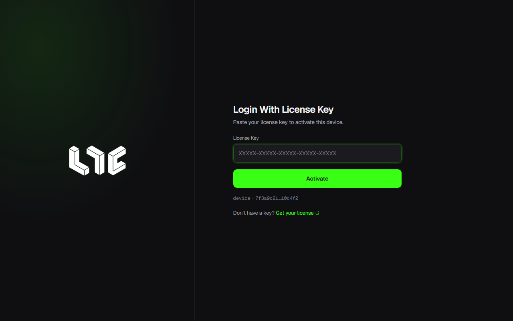

# License

Nogada needs a license key to open. You buy the key with crypto on the store page and enter it on the app's first screen. A key looks like `NOGADA-XXXX-XXXX-XXXX-XXXX`.

## Durations and prices

These are beta prices.

| Duration | Price |
|---|---|
| 1 week | $15 |
| 1 month | $29 |

There is no auto-renewal. Buying again with the same Telegram account adds the time to what is left on your key.

## How to buy

Everything happens on the [store page](https://nogada.app/buy). You log in with your Telegram account, no password.

1. Click **Log in with Telegram** and log in in the Telegram window.
2. Pick a duration, network and coin, then click **Place order**.
3. Send the **Amount to send** to the **Send to** address. The order screen shows the time left; an order stays open for 30 minutes.
4. Once the network confirms the deposit, the key appears on screen and is also sent to you on Telegram. You can close the page.

The store takes ETH, USDC and USDT on Ethereum and Base. If you pay in ETH, the amount is fixed at the rate when you placed the order and does not change during that order.

### The amount has to match to the last digit

Every order has different last digits. The store matches deposits to orders by those digits, so the key is issued automatically only when you send exactly that amount.

- When withdrawing from an exchange, check whether the withdrawal fee is taken out of the amount. A smaller amount is not picked up automatically.
- Send only the coin you picked, on the network you picked. Funds sent on another network cannot be found.
- If you sent a different amount or it was not picked up, enter the transaction hash in the field at the bottom of the order screen and click **Check**. The operator checks it and then issues the key.
- ETH sent through a contract, such as some exchanges' batched withdrawals or smart wallets, is not picked up automatically. Contact the operator (see [Asking for help](../help/when-stuck.md#asking-for-help)).

## Activating in the app

1. When the app opens you see **Login With License Key**.
2. Paste the key into **License Key** and click **Activate**.
3. When the main screen opens and the dot next to **License** in the bottom status bar is green, you are done.

The activation is saved on this PC, so you do not enter the key again next time. If you do not have a key yet, **Get your license** on this screen opens the store page.

The PC's clock has to be right: when it is more than an hour off, the app does not accept the license server's answer and says "This PC's clock is more than an hour off". Turn on automatic time in Windows and try again.

## One key, one PC

The key is bound to the PC you first activate it on. The **device** line at the bottom of the screen identifies this PC: it is the device ID, made from the Windows machine ID.

- **The same device ID somewhere else.** A copied or cloned Windows, or another Windows user on the same PC, has the same device ID. If the key is turned on there, the place that used it until then stops at its next license check (every 15 minutes) and shows "This key was turned on on another PC, so its use on this PC has ended". Its running tasks stop too.
- **A new PC.** A PC with a different device ID is refused until you reset the device, as below.
- **Data copied from another PC.** If the app's data came from another PC or Windows account, the app asks "Enter the key again to use it on this PC". Entering it ends the use on the PC that had it.

To move to another PC:

1. On the current PC, make a backup in **Settings → General → Backup & Restore**. See [Backup and data](../app/backup-and-data.md).
2. Click **Reset device** on [My license](https://nogada.app/dashboard). You can do this once every 24 hours. For a key not bought on the store page, ask the operator to reset it (see [Asking for help](../help/when-stuck.md#asking-for-help)).
3. On the new PC, enter the key and restore the backup.

**Settings → General → Log Out** only removes the activation saved on this PC. It stops running tasks and returns to the license screen, but the PC binding recorded on the server stays. So logging out alone does not let the key work on another PC.

## The My license page

[My license](https://nogada.app/dashboard) shows:

- your key, its expiry and status (Active, Expiring soon, Expired, Suspended)
- the bound device and **Reset device**
- your payments and any order not paid yet
- **Add time** and **Download the app**

## Refunds

It is a digital product, so there are no refunds. Amounts sent above the order amount are not returned either. Minting success depends on gas, competition and the project, and is not guaranteed.
