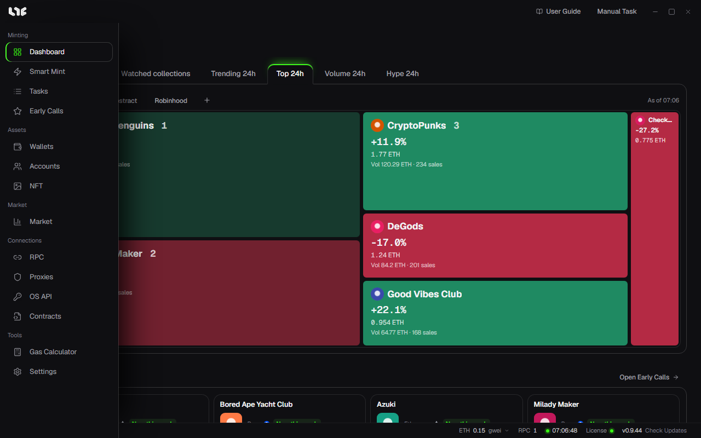

# The screen

The app has a menu on the left, a bar at the top, the work area in the middle and a status bar at the bottom.

## Left menu

The menu shows only icons until you move the mouse over it; then it opens and shows the names. It has five sections, roughly in the order you use them.

| Section | Item | What it does |
|---|---|---|
| Minting | Dashboard | The market right now and Early Calls at a glance. The first screen when the app opens. |
| | Smart Mint | Makes mint tasks from a link or address. |
| | Tasks | Create, start and stop tasks. While tasks are running, a count shows next to the item. |
| | Early Calls | Pre-mint projects picked by the operator. |
| Assets | Wallets | Your minting wallets, in groups. |
| | Accounts | The Gmail, X and Discord identities social tasks run as. |
| | NFT | Holdings, P&L and the Viewer. |
| Market | Market | Collection rankings, charts, alerts, Mint Calendar. |
| Connections | RPC | Node addresses the app sends transactions through. |
| | Proxies | Spread site requests over many IPs. |
| | OS API | OpenSea API keys. |
| | Contracts | EIP-7702 contracts for bundles. |
| Tools | Gas Calculator | Gas costs and Unix time conversion. |
| | Settings | App-wide settings such as language, updates, backup and the fire engine. |

## Top bar

- **User Guide**: opens this guide in your browser.
- **Manual Task**: goes to Tasks and opens the **Create Task** window. Works from any screen.
- The three buttons at the far right are minimize, fullscreen and close. Close quits the app completely.

## Bottom status bar

Read it from the left.

| Item | Meaning |
|---|---|
| First item | The last thing that happened in the app. With nothing going on it says **Idle**; while tasks run it shows how many, and while a listing or NFT send is in progress it shows that progress. It keeps you from missing a result while you are on another screen. |
| Gas | Current gas (gwei) on the chosen chain. Click it to pick another chain. |
| RPC | The number of saved RPCs. Hover to see each one's health. |
| Clock | The time, matched against internet time. A green dot means it agrees with the PC clock; when the PC clock is off by more than 1.5 seconds, the difference shows next to it. Click to sync again. Tasks fire by the PC clock, so if the difference is large, sync Windows time. |
| License | A green dot means the license is valid. |
| Version | The current version and **Check Updates**. |

## Dashboard

**Market now** at the top of the Dashboard shows collections as tiles. The number next to the name is the rank; green is up and red is down. Each tile shows the floor, the 24-hour change, volume and the number of sales, and clicking it opens that collection in Market.

| Tab | Chosen by |
|---|---|
| Watched collections | Collections you starred in Market |
| Trending 24h | Most sales in 24 hours |
| Top 24h | Most 24-hour volume |
| Volume 24h | 24-hour volume against the 7-day daily average |
| Hype 24h | Biggest 24-hour floor rise (3 or more sales) |

Switch chains with the chain tabs in the panel under the tabs, and add another chain with **+**.

**Early Calls** below shows cards of projects the operator picked. **Open Early Calls** takes you to the [Early Calls](../tasks/early-calls.md) screen.

## Language

The app starts in English the first time. Pick English, 한국어 or 简体中文 in **Settings → General → Language**. It changes at once and is saved on this PC.
