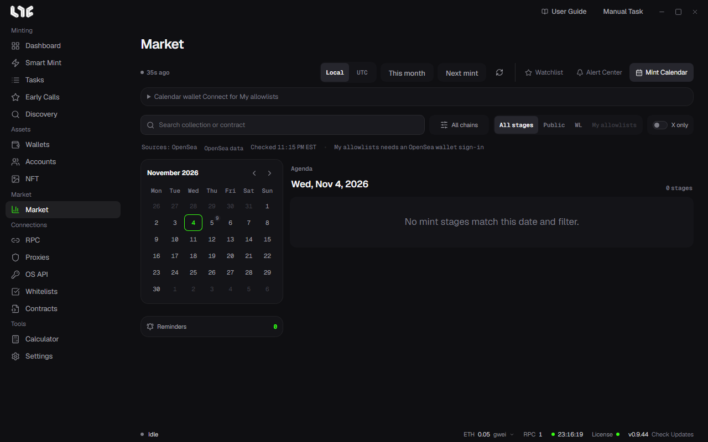

# Mint Calendar

View upcoming mint schedules on a calendar and get a notice before they start. Open it from **Mint Calendar** in the **Market** toolbar.

OpenSea mint schedules come through your own OpenSea API key. You must put a key in **OS API** for the schedule to appear. [OpenSea API key](../setup/opensea-api.md)

## Toolbar and filters

- Switch between **Local** and **UTC**.
- **This month** goes to today, and **Next mint** goes to the closest stage.
- **Search collection or contract**, and a chain select.
- Stage filter: **All stages, Public, WL, My allowlists**.
- **X only**.

## My allowlists

Keeps only the stages your wallets are eligible for.

1. Expand the **Calendar wallet** card and pick a wallet.
2. Click **Connect for My allowlists**.

This is an OpenSea sign-in used only for eligibility checks. There is no transaction and no gas fee. When you connect, you sign OpenSea's sign-in message and agree to its Terms of Service and Privacy Policy. If you close the app, the connection is released, and the sign-in expires after one day.

## Calendar and agenda

- The calendar on the left shows the number of stages for each date. When you click a date, the **Agenda** on the right changes.
- The **Agenda** shows the start time and the time left, the collection, the chain, the stage, the price, and the maximum quantity per wallet.
- The bell at the end of a row is **Set reminder**.

## Reminders

Pick when to be notified before the start (At start, 5 min, 15 min, 30 min, 1 hour, 3 hours, 1 day) and the channel (Windows, Telegram). Delete one from the **Reminders** card on the left.

## Drop details

Click a row to open its details.

- The contract, total supply, type, and update status
- The start, end, price, and per-wallet limit for each stage
- **On-chain check**: Compares the schedule directly against the contract. If it fails, click **Retry**
- The source and the **Website, X, Open source** links

For a drop you like, open the mint page with **Open source**, then put that link into [Smart Mint](../tasks/smart-mint.md).
