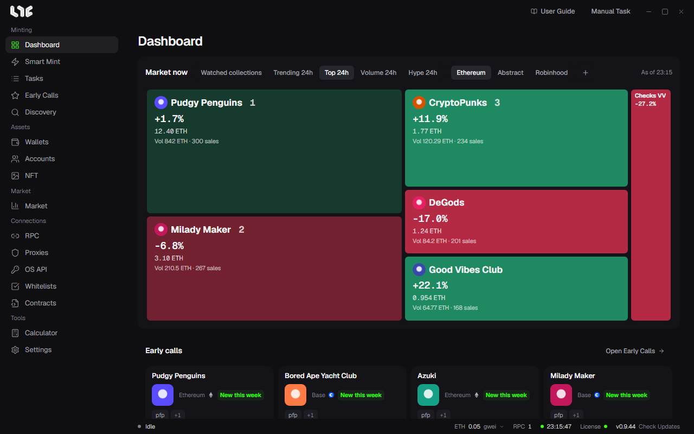

# Dashboard

This is the app's first screen. You see the current market and Early Calls.

## Market now

The tile size shows trading volume. Green is up and red is down. Click a tile to go to the collection detail in Market.

| Tab | What it shows |
| --- | --- |
| Watched collections | Collections you starred in Market |
| Trending 24h | Top by number of sales in 24 hours |
| Top 24h | Top by trading volume in 24 hours |
| Volume 24h | Top by increase in 24-hour volume over the 7-day average |
| Hype 24h | Top by 24-hour floor price increase (3 or more sales) |

Pick a chain on the right. Use **+** to open another chain.

## Early Calls

Pre-mint projects the operator picked as Dashboard picks appear here. Open [Early Calls](early-calls.md) with **Open Early Calls**.

## Top and bottom

- **User Guide** at the top: Opens this guide.
- **Manual Task** at the top: Opens the Create Task window directly.
- The status bar at the bottom: Shows the running state, gas, the number of RPCs, the PC time, the license state, and the version. Hover over gas or RPC for details.
