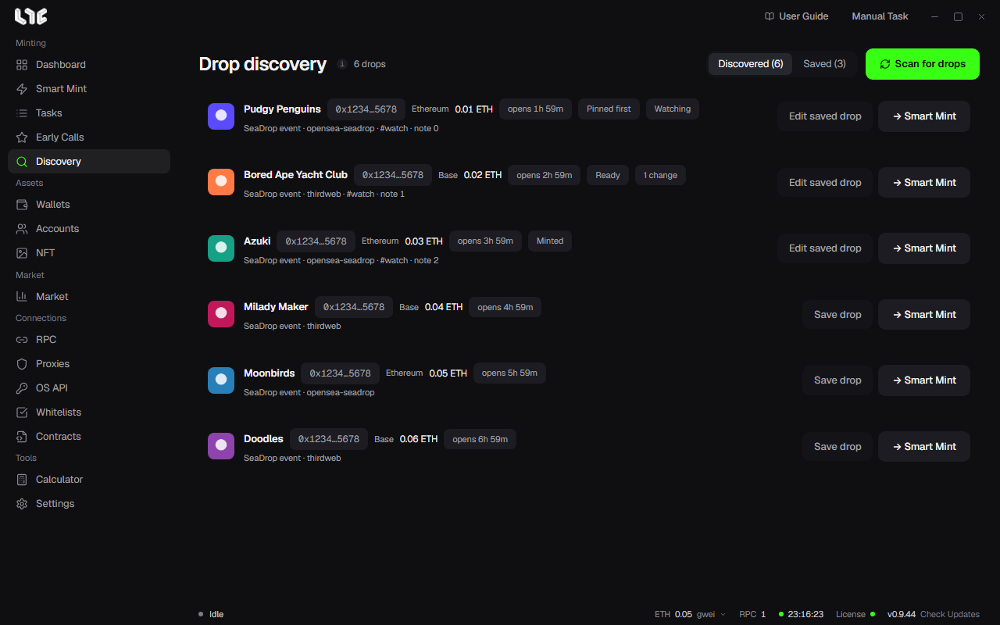

# Drop discovery

Finds new drops by scanning the SeaDrop configuration events and recent SeaDrop deployments on supported chains. It removes duplicates by contract. It does not scan until you click **Scan for drops**, so it does not use your RPCs the rest of the time.

## How to use it

1. Click **Scan for drops**.
2. See the drops in the list. The chain, price, time left until the open, and the source are shown.
3. Click **→ Smart Mint** and that drop is filled into [Smart Mint](../tasks/smart-mint.md).

You can copy the contract from a row.

## Saving

If you add a drop with **Save drop**, it stays even after it passes out of the discovery list. See it under **Saved**.

In **Edit saved drop**, you set the following.

- **Pinned first**
- The status: **Watching, Ready, Minted**, and so on
- Tags (separated by commas) and a personal note

If the price, start, end, phases, platform, or name of a saved drop changes, the number of changes is shown. When you confirm, the mark is cleared. Remove one with **Remove saved drop**.

A drop found by scanning is a candidate that has not been verified yet. Check that it matches the official link before you use it.
