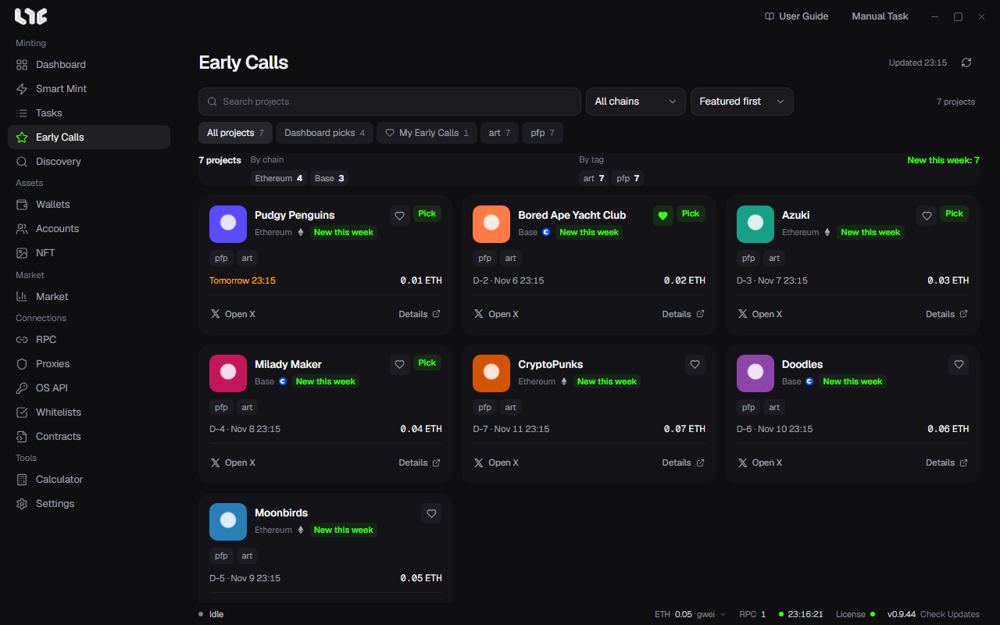

# Early Calls

A list of pre-mint projects the operator picked. Open it from **Early Calls** in the left menu.

## Browsing

- Filter with **Search projects**, chain, and tag.
- Sort: Featured first, Newest first, Mint soonest.
- Tabs: **All projects, Dashboard picks, My Early Calls**.
- The statistics at the top count the projects in the current filter by chain and by tag.

## Cards

A card shows the project name, a one-line intro, the chain, tags, the mint schedule, and the days left (like D-3). Click **Details** to see the project introduction, the mint price, links, and the operator's update history.

Click the star to add it to **My Early Calls**. It is saved on this PC.

## Tags

The operator adds tags such as New project, Rising, Whitelist open, Mint soon, Team revealed, Collab, Free mint, and Hype.

Viewing an Early Call does not start a task. When the mint opens, create the task with [Smart Mint](../tasks/smart-mint.md).
