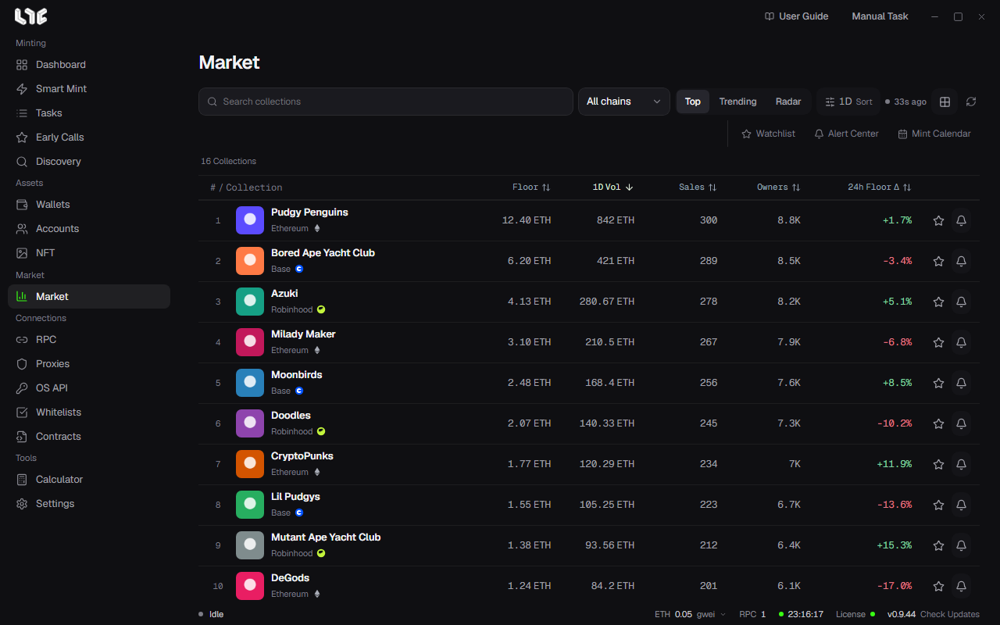

# Market

This screen shows collection prices in real time, collects the collections you follow, and lets you set alerts.

Prices arrive in real time from the Nogada Market Hub. You can see them without an OpenSea API key. The connection status is shown in **Settings → Integrations → Market Hub**.

Use **Watchlist**, **Alert Center**, and **Mint Calendar** on the right of the toolbar to move between screens.

## Browsing

- **Search collections**: Find by name.
- **Chain**: See only a specific chain.
- **Top, Trending, Radar**: Three ways to see rankings. Trending shows the collections that are rising in the period you pick, and Radar combines the two.
- **Period and sort**: Pick the discovery basis and the lookup period. Only one sort criterion applies at a time.
- Switch between **Card view** and **Table view**.

The table shows # / Collection, Floor, Volume, Sales, Owners, and 24h Floor Δ. Click a column header to sort.

The star on a row is **Watch**, and the bell is **Create alert**. Click the name to go to the collection detail.

## Collection detail

A price summary appears at the top. It shows Floor, Top Offer, 24h Volume and sales count, Avg Sale, Supply, Owners, Listings, Holder Ratio, and Offer / Floor.

### Chart

- **Chart timeframe**: 1H, 1D, 7D, 30D. You can pick the candle interval separately.
- **Chart indicators**: Floor, Order book, Listings, Offers, Volume, SMA 20, EMA 50, Bollinger, RSI 14, My average.
- **Rarity filter**: Filters the sale dots by Legendary + epic, Rare and up, and so on. Click a sale dot to open that token's card. If a saved rank exists, it is shown first without using the OpenSea limit.
- **Chart style**: Sale dots, Candles, Close line.
- Drawing tools: crosshair, trend line, price line, and price and time measurement.
- Zoom with the wheel, pan by dragging, reset with a double-click or Home, and use the arrow keys and +/−.
- **Copy chart image** copies the image.

The first time you open a collection, you wait a moment while the price history is gathered. The time left is shown.

### Right panel

- **Activity**: Filter sales, listings, offers, transfers, and mints with chips. Use **Browse history** to see earlier records.
- **Order Book**: Cumulative offers and listings by price level.
- **Holders**: The number of holders, the share held by the top 10, and the top wallets.
- **Traits**: Floor, supply, and 24-hour trades by trait. Some chains do not support it.

## Watchlist

Collects only the collections you starred. It is the same list as **Watched collections** on the Dashboard.

## Alert Center

It has **Collection**, **Wallet**, and **History** tabs.

### Collection alerts

They notify you of changes even if you do not keep a detail screen open. In **New alert**, you set the following.

- **Collection slug** and the chain
- **Metric**: Floor price, Floor change %, Volume change %, Sales change %, Listings change %, Top offer / Floor %, Top 10 holder concentration %, RSI
- **Condition** and **Threshold**. For Floor price, you also use **Price currency**
- **Cooldown** and **Once, Repeat**
- Channel: **Windows**, **Telegram**

### Wallet alerts

In **New wallet alert**, you follow the OpenSea activity of an EVM address. Pick from Mint, Received, Buy, and Sell.

### Connecting Telegram

To receive alerts on Telegram, create a connection code in the Market Telegram connection card in the Alert Center, and send the command in your bot chat signed in with the same license. The code is valid for 5 minutes. It connects only Market alerts.

## Viewing NFTs you bought with a wallet

See the NFTs you hold in [Holdings](../tools/nfts.md), and your profit and loss in [P&L](../tools/pnl.md).
