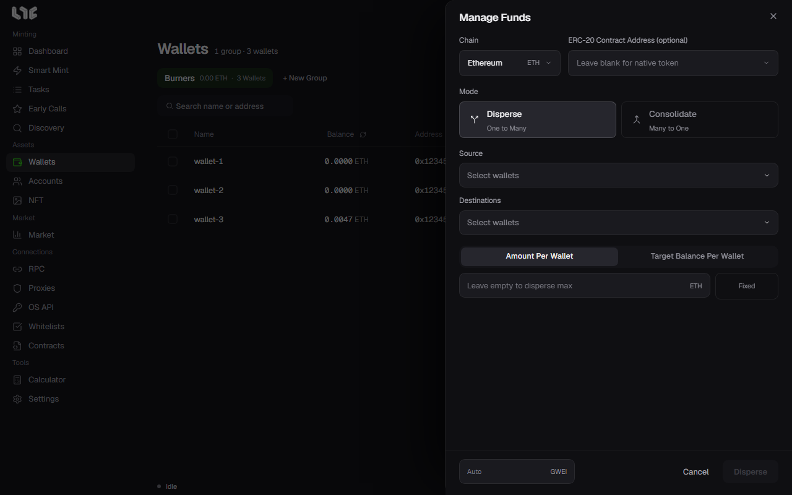

# Dispersing and consolidating funds

**Wallets → Manage Funds** moves coins between wallets in bulk. Use it to hand out gas before a mint, and to gather what is left into one wallet afterwards.

## The fields

| Field | What goes in |
|---|---|
| Chain | The chain to move funds on. |
| ERC-20 Contract Address (optional) | The token contract, only when moving a token. Empty means the chain's own coin (ETH and so on). |
| Mode | **Disperse** (one to many) or **Consolidate** (many to one). |
| Source | The wallet the money leaves from. |
| Destinations | The wallets that receive it. To send to an address that is not in the list, you can enter it yourself. |
| Amount | Set it one of the two ways below. |
| gwei, bottom left | The gas for this move. Empty is auto. One number such as `30` sets both the max fee and the priority fee; `30/2` sets the max fee first and the priority fee second. |

## Two ways to set the amount

- **Amount Per Wallet**: every destination gets the same amount. Leave it empty to split everything the source can send.
- **Target Balance Per Wallet**: tops each destination up to this balance, sending only what is missing. Wallets already at or above it are skipped. In Consolidate it works the other way: each sending wallet keeps this amount and sends the rest.

Click **Fixed** next to the amount to enter a range such as `0.02 - 0.03`. Each wallet then gets a random amount in that range.

## What Disperse actually does

Disperse first sends one transaction through a disperse contract that pays every destination. If that transaction fails, the app asks **Send individually?**; if you accept, the same source wallet sends one transaction per destination.

## One wallet to one address

To send from one wallet to one address, the send button on the wallet's row is quicker. → [Wallets](wallet-groups.md)

## Before you send

- Check the source and destinations once more. A transaction on chain cannot be undone.
- The source wallet needs gas on top of the amount it sends.
- For how much each wallet needs, see **Balance Needed** in the [Calculator](../app/calculator.md).
