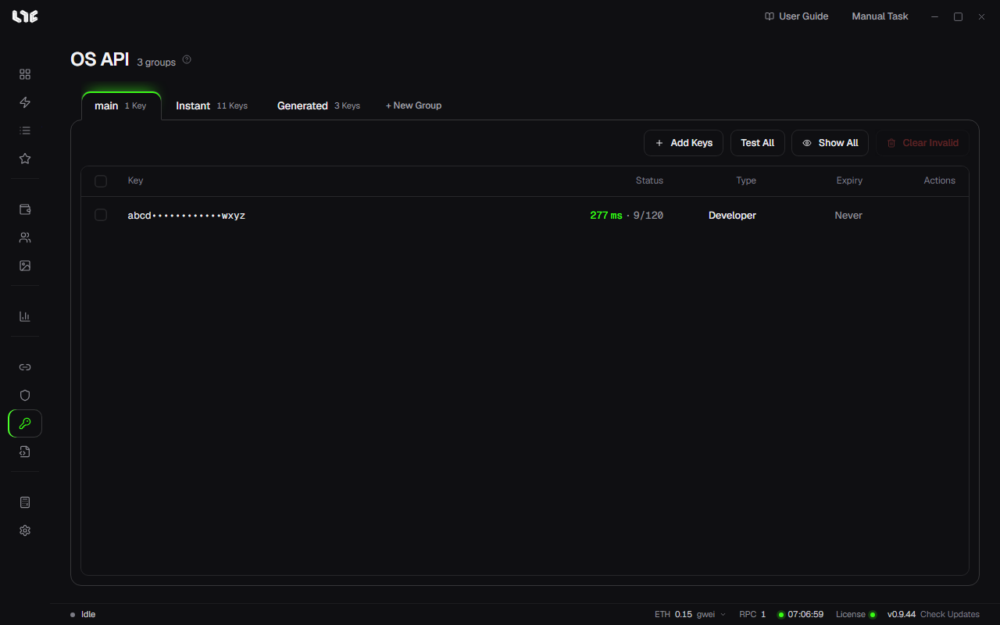

# OpenSea API keys

**OS API** holds your OpenSea API keys. You can mint without one; to sell on OpenSea from the app, you need one.

## Getting a key

There are two kinds.

- **Developer key**: free from OpenSea. On opensea.io open **Settings → Developer**, verify your email, click **Get access**, fill in the short form, then **Create key**. One OpenSea account can make up to three. It allows far more requests than an Instant key.
- **Instant key**: made by the Instant key task in [Accounts and social tasks](../social/accounts-and-social.md). It lasts 7 days and allows only a few requests. Making one always goes through a proxy (see [Proxies](proxy-groups.md)).

## Adding keys

1. Make a group with **+ New Group**. Tasks can pick which group's keys they use.
2. Click **Add Keys** and put each key on a line of its own.
3. Click the add button. The app asks OpenSea about every key and saves only the ones it accepts.

Keys are stored on this PC, encrypted.

## Reading the table

| Column | Meaning |
|---|---|
| Key | Only a few characters at each end show. **Show All** shows the whole key. |
| Status | The response time at the last check, and the remaining requests / limit OpenSea reported. |
| Type | The kind of key, such as **Developer** or **Instant**. |
| Expiry | When the key expires, if it does. |

- **Test All**: checks every key in the group again.
- **Clear Invalid**: removes keys in the group that expired or that OpenSea refused.

The **Instant** group holds short-lived keys made by the Instant key task. Tasks that make keys are picked from the modules in [Accounts and social tasks](../social/accounts-and-social.md).

## What a key unlocks

| Feature | Without a key |
|---|---|
| **List Selected**, **Cancel Listings** and **Accept Offer** in Holdings | Does not work. The buttons are off, and hovering over them tells you to add a key on the OS API page. |
| The **Listing** and **Top offer** columns of the Holdings table | Show **needs OpenSea API key** instead of a value. |
| The post-mint actions **List NFT** and **Accept Offer** | Does not work. The field says **needs OpenSea API key**. |
| **OpenSea API** and **Dual Mode** in the OpenSea Mode of Smart Mint and of a task | Cannot be picked. The field name says **needs OpenSea API key**. |
| Wallet alerts in Market | The Alert Center shows no **Wallet** tab and wallet alerts do not run. Saved wallet alerts are not deleted; they come back when you add a key again. |
| Connecting My allowlists in the Mint Calendar | Does not work. Trying to connect tells you to add a key on the OS API page first. |
| **Normal Mode** and **Anonymous Mode** for signed drops | Works. |
| Market prices and charts | Works. They come from the Nogada server. |

## Many wallets, several keys

The **Status** column shows how many requests OpenSea still allows each key. When one task group asks for many wallets at once, a single key can run out partway, so keep several keys if you mint with many wallets. Smart Mint's note gives the same advice.

Each key has its own limit. Keys do not share it even when they are used from the same IP, so using a key does not need a proxy.

## What we saw in our tests

Rough numbers from our own tests in November 2026, to give you a feel for it. OpenSea changes its limits over time, and your drop and timing can give different results.

| What we tried | What happened |
|---|---|
| One Developer key asking for mint data for 10 wallets at once | All 10 got an answer |
| The same key, 30 wallets at once | 26 got an answer, 4 were refused for asking too fast |
| How fast a Developer key refills | It took about 120 requests in a burst, then about 2 more every second |
| One Instant key | About 5 answers, then roughly 5 more per hour |

In API mode each wallet asks once. By the numbers above, 100 wallets would need about 4 Developer keys. That is worked out from these numbers, not tried at a real open, and these key tests ran against a drop whose stage had not opened yet. Opening the NFT screen for 100 wallets right before a mint can also use up a key.
