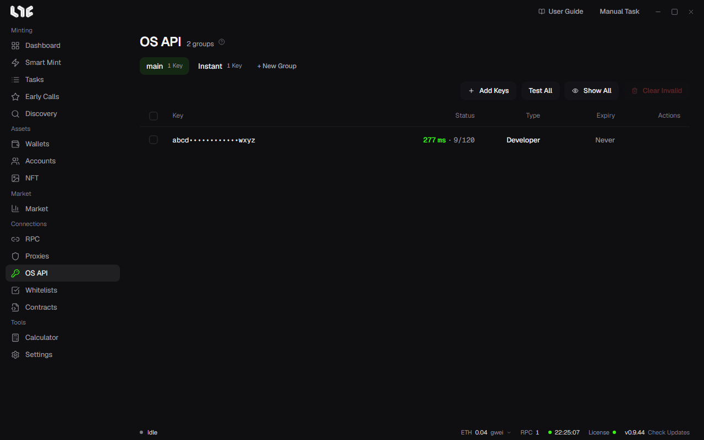

# OpenSea API keys

**OS API** holds your OpenSea API keys. You can mint without one; to sell on OpenSea from the app, you need one.

## Adding keys

1. Make a group with **+ New Group**. Tasks can pick which group's keys they use.
2. Click **Add Keys** and put each key on a line of its own.
3. Click the add button. The app asks OpenSea about every key and saves only the ones it accepts.

Keys are stored on this PC, encrypted.

## Reading the table

| Column | Meaning |
|---|---|
| Key | Only a few characters at each end show. **Show All** shows the whole key. |
| Status | The response time at the last check, and the remaining requests / limit OpenSea reported. |
| Type | The kind of key, such as **Developer** or **Instant**. |
| Expiry | When the key expires, if it does. |

- **Test All**: checks every key in the group again.
- **Clear Invalid**: removes keys in the group that expired or that OpenSea refused.

The **Instant** group holds short-lived keys made by the Instant key task. Tasks that make keys are picked from the modules in [Accounts and social tasks](../social/accounts-and-social.md).

## What a key unlocks

| Feature | Without a key |
|---|---|
| Listing NFTs, cancelling listings, accepting offers | Does not work. The button tells you to add a key on the OS API page. |
| The post-mint actions **List NFT** and **Accept Offer** | Does not work. The field says it needs an OpenSea API key. |
| Fetching Smart Mint's mint data with the OpenSea API | Cannot be picked. |
| **OpenSea API** and **Dual Mode** in a task's OpenSea routing | Cannot be picked. |
| The default path (proxies) for signed drops | Works. With a key, it is used instead when the IPs are blocked or no data comes back. |
| Market prices and charts | Works. They come from the Nogada server. |

## Many wallets, several keys

The **Status** column shows how many requests OpenSea still allows each key. When one task group asks for many wallets at once, a single key can run out partway, so keep several keys if you mint with many wallets. Smart Mint's note gives the same advice.
