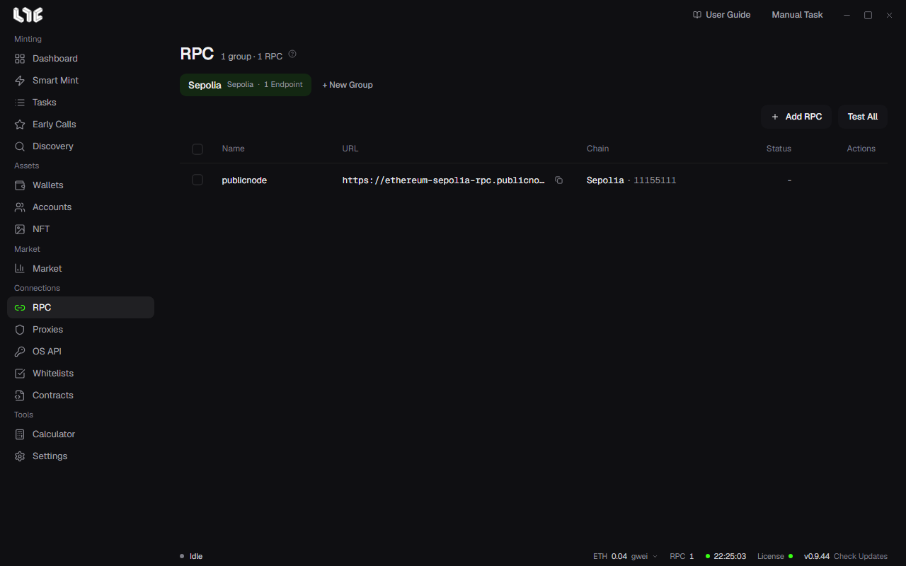

# RPCs and chains

An RPC is the node address the app uses to read a chain and send transactions. Every transaction a task sends leaves through one, so a slow or blocked RPC means a late or failed send.



## If you add no RPC

The app still works. If you have saved no RPC for a chain, it sends through that chain's built-in public RPC and says **No RPC, public RPC fallback** at the bottom of the task window. Public RPCs are shared by many people and get blocked or slow when requests pile up. For a contested mint, add a paid RPC. The app's help recommends Alchemy, Ankr, DRPC and QuickNode.

## Adding RPCs

1. In **RPC**, make a group with **+ New Group**.
2. Click **Add RPC** and paste one per line, either `name,URL` or just the URL.

```
eth-alchemy,https://eth-mainnet.g.alchemy.com/v2/yourkey
https://base-mainnet.example.com/abc
```

3. When you add them, the app asks each address which chain it is and fills in the **Chain** column with the name and chain ID.
4. Click **Test All** to check every RPC in the group. Each row also has a button to check just that one. Results show in the **Status** column.

Hover over **RPC** in the bottom status bar to see the health of all saved RPCs at once.

## How tasks use RPCs

When you pick several wallets in the task window, one task is made per wallet. RPCs are shared out like this.

- If you picked RPCs in **RPC Endpoints**, those are used; if you left it empty, every RPC saved for that chain is used.
- Normally each task gets one RPC in turn: wallet 1 gets RPC 1, wallet 2 gets RPC 2, and so on.
- With **Multi-RPC broadcast** on (**Settings → Fire Engine → Broadcast**), every task gets all of them. The same signed transaction goes to all those RPCs at once, so nonces do not clash and it spreads faster. **Multi-RPC broadcast for Spam** does the same for spam tasks.
- When a task has several RPCs and an RPC error happens during the pre-send check or preparation, it moves to the next RPC. If all of its RPCs report they are out of balance or credits, the task stops with that reason.

Alchemy addresses saved in RPC are also used to read NFT P&L and holdings. To set them per chain, enter them in **Settings → Integrations → PnL Alchemy URLs**.

## Chain settings

Per-chain settings are in the chain list at the bottom of **Settings → Fire Engine**.

- **On/off**: hide chains you do not use.
- **Public fallback RPC**: change the public RPC used when no RPC is saved for that chain. Empty uses the app's default. If the chain has any RPC saved, the fallback is not used at all.
- **min tip**: the lowest priority fee (gwei) auto gas may use on that chain. Empty sets no extra floor.

### Adding a custom chain

Add an EVM chain that is not on the list with **Add Custom Chain**. Enter the name, the RPC URL, the symbol (the gas coin's name) and an explorer (optional); type the chain ID or click **Detect** to read it from the RPC. Check the chain ID before saving: it is the one value you cannot edit later, and a wrong one means deleting the chain and adding it again. The app treats the gas coin as having 18 decimals, so on chains that use a different number, balances and amounts may display wrong.

## Supported chains

| Chain | Gas coin | Chain ID |
|---|---|---|
| Abstract | ETH | 2741 |
| Apechain | APE | 33139 |
| Arbitrum | ETH | 42161 |
| Arc | USDC | 5042 |
| Avalanche | AVAX | 43114 |
| Base | ETH | 8453 |
| Bittensor | TAO | 964 |
| BSC | BNB | 56 |
| Ethereum | ETH | 1 |
| HyperEVM | HYPE | 999 |
| Ink | ETH | 57073 |
| Linea | ETH | 59144 |
| MegaETH | ETH | 4326 |
| Monad | MON | 143 |
| opBNB | BNB | 204 |
| Optimism | ETH | 10 |
| Polygon | POL | 137 |
| Robinhood | ETH | 4663 |
| Ronin | RON | 2020 |
| Shape | ETH | 360 |
| Stable | USDT0 | 988 |
| Zora | ETH | 7777777 |
| Sepolia (testnet) | ETH | 11155111 |
