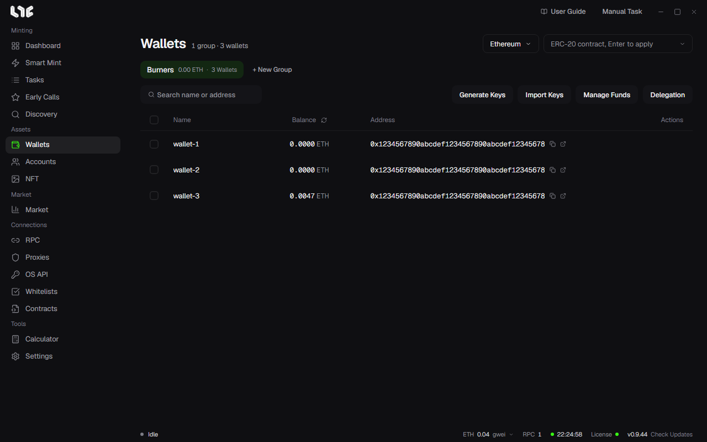

# Wallets

Tasks pick wallets by group, so you make a group first and put wallets in it.



## Make a group

1. In **Wallets**, click **+ New Group**.
2. Enter a name and click **Create**. Splitting groups by purpose or chain makes them easy to pick when you create tasks.

The group chip shows the group's total balance and number of wallets. Hover over the chip for the rename and delete buttons. Deleting a group deletes the wallets in it.

## Add wallets

Use the two buttons at the top right.

**Import Keys** adds wallets you already have. Paste one per line, either `name,private key` or just the private key. The name is optional. The window shows how many lines it can read; click the import button to add them.

```
main-1,0xprivatekey...
main-2,0xprivatekey...
0xprivatekey...
```

**Generate Keys** makes new wallets. Enter **Count** and confirm; new private keys and addresses appear in the group. Keep a copy of the new private keys somewhere safe.

Private keys are stored on this PC, encrypted with your Windows account, and never sent to a server.

## Reading the table

| Column | Meaning |
|---|---|
| Name | The wallet's name. Without a name, the end of the address shows. |
| Balance | The balance on the chain picked at the top right. The icon next to the column title refreshes it. |
| Address | With a copy button and an open-in-explorer button. |
| Actions | Hover over a row for edit, send and delete. |

Change the chain at the top right to read that chain's balances. Enter an ERC-20 token contract in the field next to it and press Enter to see that token's balance instead.

The search field takes part of a name or address.

## One wallet

- **Edit** (pencil): rename the wallet and view or copy its address and private key. The private key shows only after you click the eye button.
- **Send** (paper plane): send coins from this wallet to one address. Enter the chain, **Recipient** and the amount. **Send max** sends everything minus gas. Enter gwei in the field at the bottom left to use that gas, or leave it empty for auto.
- **Delete** (trash): removes the wallet. It cannot be undone, so make sure you have the private key elsewhere first.

## Many wallets at once

Tick wallets and a bar appears at the bottom.

- **Bulk Rename**
- **Copy Addresses**: copies the selected addresses, one per line.
- **Copy Private Keys**: in the confirmation, choose **Copy Keys** (keys only) or **Copy Name,Keys** (one `name,key` line each). Other programs can read the clipboard, so clear it after pasting.
- **Delete**

## The delegation column

**Delegation** swaps the balance column for a delegation column. It shows which contract each wallet is delegated to through EIP-7702, with a filter and a rescan button. You use it with bundle minting. → [Bundles and contracts](../tasks/bundles.md)

## Next

To fund the wallets for gas, go to [Dispersing and consolidating funds](funding.md).
