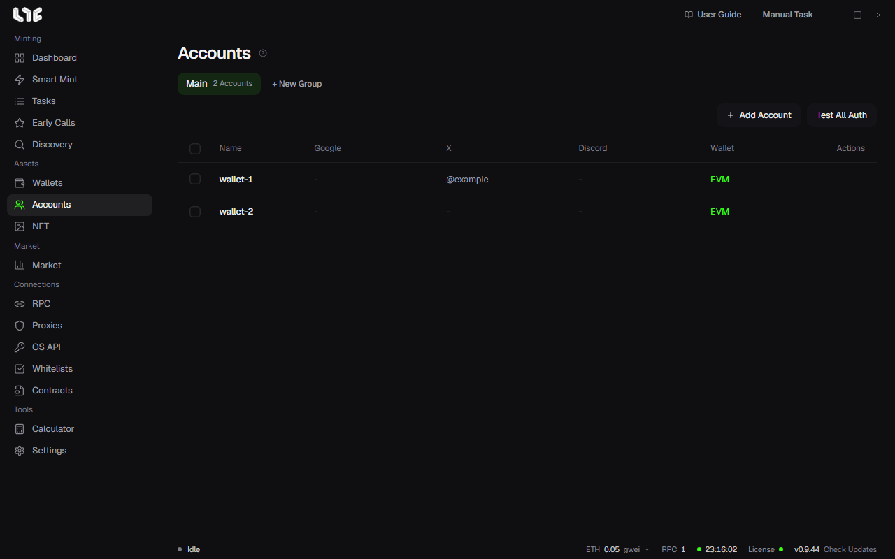

# Social accounts

This is where you keep the accounts you use for social tasks. Usually you attach one email, one X account, one Discord account, and one proxy to each wallet. If you only do onchain minting, you do not need this screen.

## What an account stores

| Field | Use |
| --- | --- |
| Display Name | A free-form label |
| Private Key / EVM Wallet | Submitting the address and site signatures |
| Gmail | The address to submit, and the Google Form login |
| App Password | For mail checks. Optional |
| X Cookies (auth_token) | X actions and X login |
| X Handle | Fills the `{xhandle}` slot. It is filled in when you verify the cookie |
| Discord Token | Discord actions |
| Discord Username | Fills the `{discord}` slot. It is filled in when you verify the token |
| Proxy | Pick a proxy from the Proxies menu. Optional |

## Adding accounts

1. Click **+ New Group** and pick a wallet group with **Import from Wallets**. An account is created for each wallet.
2. Click edit on a row to attach the social info.
3. To fill in many accounts at once, select the accounts and click **Bulk Connect**.

You can also add accounts one at a time with **Add Account**.

## Connecting Google

You need this for Google Forms where the author requires an email login.

1. In the account edit window, click **Connect Google**.
2. A small browser opens. Log in as you normally would.
3. Close the window once you are logged in. When the check finishes, the Gmail field is filled in.

## Getting the X auth_token

If you bought the account, it usually comes with it. To get it yourself, do this.

1. Log in to X in your browser.
2. Press F12 to open developer tools.
3. On the **Application** tab, pick **Cookies → https://x.com**.
4. Copy the value of the `auth_token` row and paste it into the account's X Cookies field.

## Getting a Discord token

1. Log in to Discord on the web in your browser.
2. Press F12 to open developer tools and pick the **Network** tab.
3. Enter `/api` in the filter and click any channel.
4. Click one request and copy the `authorization` value under **Headers → Request Headers**.
5. Paste it into the account's Discord Token field.

A token has three parts separated by dots. Copy all of it. The token changes if you change your password or log out of all devices.

## Testing auth

Use the test on a row or **Test All Auth** to check that the saved credentials are still valid. Run it once before you run a big task.

## Where it is stored

Accounts are saved encrypted in `%LOCALAPPDATA%\nogada\data\accounts.dat`. Each account gets its own browser profile under `%LOCALAPPDATA%\nogada\browser-profiles\`. Browser profiles contain cookies and are not included in backups.
