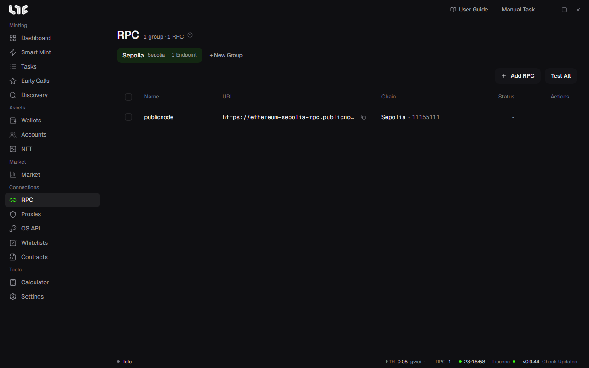

# RPC

Every onchain task goes through an RPC. A good RPC list affects stability more than anything else.

## Adding RPCs

1. Create a group with **+ New Group**. Grouping by chain is convenient.
2. Click **Add RPC** and paste one per line. Enter `name,URL` or just the URL.
3. The app checks the chain, measures latency, and adds the RPC to the list.

You can measure again at any time with the ping on the left of a row and with **Test All**.

A paid RPC URL contains an API key. The app saves the URL encrypted in `%LOCALAPPDATA%\nogada\data\rpc.dat`. Do not paste it into Discord or chat.

## Which RPC does a task send through?

If a task does not pick an RPC, it uses all the saved RPCs for that chain. If there are none, it uses the built-in public RPCs.

**Settings → Fire Engine → Multi-RPC broadcast** decides the behavior.

- **On**: Sends the same signed transaction to all the RPCs the task picked, at the same time. The content is identical, so there is no nonce conflict.
- **Off**: Gives each task one RPC, in rotation.

## How many do I need?

| Use | Recommended |
| --- | --- |
| Light use with 3-5 wallets | 1-2, free or paid |
| 20 or more wallets | 3-5 paid, more is better |
| Spam | Paid RPCs from several providers |

For providers, see [RPC providers](../resources/nodes.md).

## Changing the public RPC

In the chain list under **Settings → Fire Engine**, you can change the public RPC address for each chain. Use this when a built-in public RPC has gotten worse and you do not want to add your own RPC. A saved RPC picked in a task always comes first.
