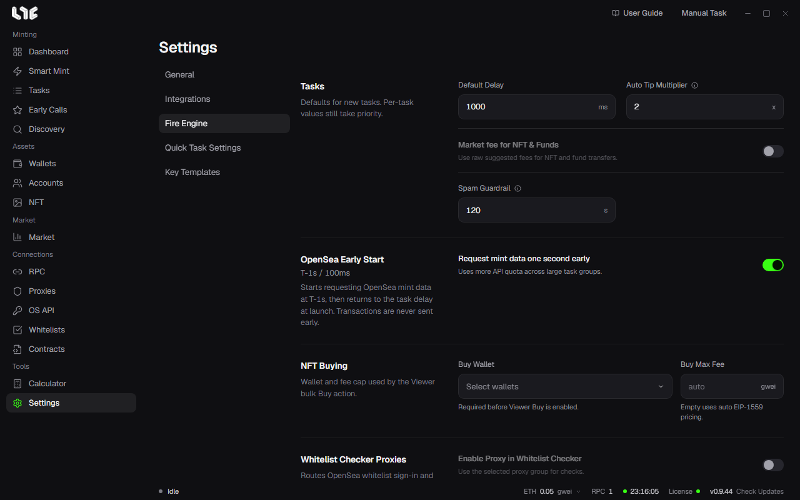

# Settings

Settings has five tabs: **General**, **Integrations**, **Fire Engine**, **Quick Task Settings**, and **Key Templates**.

## General

- **Language**: Pick English, Korean, or Simplified Chinese.
- **Updates**: Shows the installed version and checks for a new one. If you turn on **Force update on startup**, the app applies a new build right after the license check. If you turn it off, the app only shows a notice. [App updates](../reference/updates.md)
- **Backup & Restore**: Makes a password-encrypted backup and restores from it. [Backup, restore, and moving](../reference/backup-restore.md)
- **Export Data**: Exports one kind of data as an unencrypted CSV. [Local data and exports](../reference/data-storage.md)
- **Application Logs**: Opens the log folder, or sends the support team a bundle with sensitive values masked.
- **Log Out**: Stops running tasks and returns to the license screen. [License](../getting-started/license.md)
- **Wipe All Data**: Permanently deletes the wallets, accounts, RPCs, proxies, API keys, license activation, tasks, and browser profiles on this PC. Use it when you clear out a VPS. Deleting the `.exe` does not delete these.

## Integrations

- **Captcha Solver API Keys**: Supports CapMonster, CapSolver, 2captcha, and AnySolver. You only need them for social modules that have a captcha.
- **Market Hub**: The connection status to the Nogada server. Market and NFT prices arrive from here in real time, and no OpenSea key is needed. Signing always happens on this PC.
- **PnL Alchemy URLs**: One Alchemy URL per chain. If you leave it empty, the app uses the Alchemy address from the RPC menu. Stable uses an Etherscan key. **Test** checks only the URL, without saving it.
- **Etherscan API Key**: Optional. The shared key works even if you leave this empty. If you enter your own key, the ABI lookup limit goes up.
- **Discord Webhook**: Sends a short notice to Discord when a task succeeds or fails. Copy the URL from your Discord channel settings under **Integrations → Webhooks** and paste it here.
- **Nogada Capture Browser Extension**: See [Capture extension](../tools/extension.md).

## Fire Engine

**Tasks**

- **Default Delay**: The retry interval (ms) for new tasks. The value set on a task comes first.
- **Auto Tip Multiplier**: Multiplied onto the RPC's suggested value when the priority fee is automatic. Use 1x for ordinary transactions and 3-5x for competitive mints. 0.1 gwei is the lower limit.
- **Market fee for NFT & Funds**: Uses the suggested fee as is for NFT and fund transfers.
- **Spam Guardrail**: The longest time Spam can run. Even if you forget to turn Spam off, it does not run forever. If you leave it empty, there is no limit.

**OpenSea Early Start**: Starts requesting mint data from T-1s. [OpenSea API key](opensea-api.md)

**NFT Buying**: The wallet and fee cap used by Viewer bulk buying. [Viewer](../tools/viewer.md)

**Whitelist Checker Proxies**: Sends OpenSea whitelist sign-in and eligibility checks through a proxy group. Up to 50 wallets at the same time.

**Broadcast**

- **Multi-RPC broadcast**: Sends the same signed transaction to all the RPCs the task picked. [RPC](rpc.md)
- **Multi-RPC broadcast for Spam**: Sends Spam transactions the same way.

**Flashbots**: The global settings for the private route you pick on Ethereum mainnet tasks.

- **Bundle Window**: The number of blocks a bundle stays valid.
- **Priority Fee, Max Fee**: Replace the automatic values for tasks that have Flashbots turned on.
- **Reputation key**: The key that builders use to measure reputation. It holds no funds. If you reset it, the reputation it built up is lost.

**Chains**: Hide chains you do not use, and set the public RPC address and the minimum tip for each chain. Add an EVM chain with **Add Custom Chain**. [Add a custom chain](../reference/custom-chains.md)

## Quick Task Settings

These are the defaults used by the **Quick Task** button. If you set wallets and an RPC for each chain, you do not have to pick them when you create a task. If you do not pick wallets, the Quick Task button is turned off. For a chain with no RPC set, the app uses all the saved RPCs for that chain, and then the public defaults.

## Key Templates

Create the answer pools used by social tasks. [Answer templates and social modules](../social/templates-modules.md)
