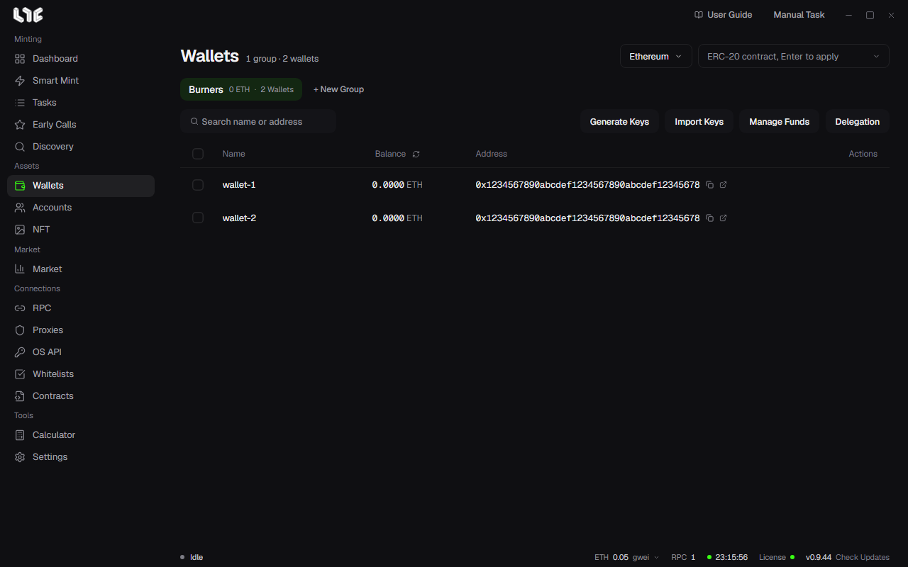

# Wallets

All the wallets you use for onchain tasks live here. Wallets are organized into groups.

## Groups

Create a group with **+ New Group** and split your wallets by purpose, chain, or use. You can rename groups or change their order.

If you delete a group, the wallets inside it are deleted too. A confirmation window appears first.

## Adding wallets

- **Generate Keys**: Set a count and create new wallets. The keys are generated on this PC.
- **Import Keys**: Enter one per line. `name,private key` or just the private key both work.

On a row, you can rename a wallet or delete it.

## Viewing balances

Pick a chain at the top right to read native balances. Enter an address in the **ERC-20 contract** field and press Enter to see that token's balance. A cell where the read failed shows `-`, not `0`. This is so you can tell an RPC that did not answer from an empty wallet.

## Sending from one wallet

Click the send button on a row to open the **Send Funds** window. Enter the recipient address and the amount. **Send max** sends the full balance minus gas.

## Manage funds: disperse and consolidate

Select wallets and click **Manage Funds**.

- **Disperse** (One to Many): Sends from one source wallet to many wallets. If the chain has a disperse contract, it finishes in one transaction. If not, it sends to each wallet separately.
- **Consolidate** (Many to One): Gathers funds from many wallets into one wallet or an external address.

You set the amount in two ways.

- **Amount Per Wallet**: A fixed amount or a random range. With a random range, each receiving wallet gets a different amount.
- **Target Balance Per Wallet**: Fills each receiving wallet up to that balance, or takes funds out of sending wallets and leaves that much behind.

If you enter an **ERC-20 Contract Address**, the app moves that token. If you leave it empty, it moves the native token. Gas is always paid in the native token.

## Unwrap WETH and delegation

- **Unwrap WETH**: Turns the selected wallets' WETH back into ETH. Wallets with no ETH to pay for gas are skipped.
- **Delegate**: Checks and removes a wallet's EIP-7702 delegation. Some mint contracts reject delegated wallets. See [Contracts](../tools/contracts.md).

## How are keys stored?

Wallets are saved in `%LOCALAPPDATA%\nogada\data\wallets.dat`. This file is encrypted with Windows DPAPI and tied to this PC and this user.

> **Warning**: The app cannot bring back a deleted wallet. Before you delete an important wallet, make a [backup](../reference/backup-restore.md) or export the key and keep it safe. A backup is only useful if you made it before deleting and you remember its password.
