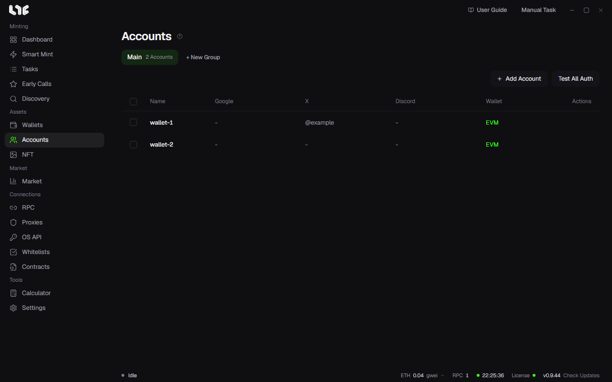

# Accounts and social tasks

Allowlist chores such as Google Forms, X follows and Discord joins can be run across many accounts, the same way mints run across many wallets. The tasks live on the **Tasks → Social** tab; the identities they use live in **Accounts**.

## What social tasks can do

On **Tasks → Social**, make a group and click **New Social Task**. The task types are:

| Type | What it can do |
|---|---|
| Google Form | Enter the form address and click **Parse** to load the questions. Per question, every account gives the same answer, each account picks at random, or your answer includes values such as `{wallet}`. A Google email field is filled with the account's Gmail. Forms that need a sign-in are submitted only by accounts with Google connected. |
| X Action | Follow, Unfollow, Like, Retweet, Reply to tweet, Quote tweet, Tweet |
| Discord | Join Server (with a message after joining), press buttons and add reactions on a message, Leave Servers |
| Alphabot | Account linking, watching Alphabot and Rumble raffles |

Every type also asks for a task name, account groups, a proxy group (optional) and the delay between accounts (seconds, a range). In a text field, `{wallet}`, `{gmail}`, `{xhandle}` and so on are replaced with each account's own value.

If some tasks fail, **Retry Failed** in the Social tab's bottom bar runs only those again.

Tasks with a captcha need a key from CapMonster, CapSolver, 2captcha or AnySolver in **Settings → Integrations → Captcha Solver API Keys**. Discord tasks use the AnySolver key for captchas.

## Accounts

An account is one wallet plus the Gmail, X, Discord and proxy that go with it. Everything in it, tokens and cookies included, is stored on this PC, encrypted. Deleting an account deletes that whole bundle, and a wallet you did not also add in Wallets cannot get its private key back.

### Adding one account

Make an account group with **+ New Group** if you have none, then click **Add Account**.

| Field | What goes in |
|---|---|
| Display Name, Private Key | Required. The private key is the account's wallet. |
| Proxy | The proxy this account uses. |
| Gmail, App Password | The Gmail address and a Google app password (16 characters). **Connect Google** opens a Chrome profile just for this account; sign in to Google there and it is used for forms that need a sign-in. Save the account first to use it. |
| X Handle, X Cookies | The X username (without @) and the auth_token cookie value. If there is a cookie, the cookie is used first. |
| Discord Username, Discord Token | If there is a token, the token is used first. |

### Adding many at once

- **From a wallet group**: when you make an account group with **+ New Group**, pick a wallet group in **Import from Wallets** and every wallet in it becomes an account. Their Gmail, X, Discord and proxy start empty; fill them in later with Edit.
- **From text**: the bulk import takes one account per line, in the order `name,key,gmail,apppass,xhandles,discordusername`, separated by commas or tabs. Trailing fields may be empty.

### Checking sign-ins

**Test All Auth** goes through the rows one at a time, so as not to hit the providers' rate limits, and checks that each Gmail app password, X cookie and Discord token still works. The button on a row checks just that row.

## Modules

The **Tasks → Modules** tab lists task modules received from the license server. They are split into **Onchain** and **Social**; you can search and hide modules you do not use. Newly pushed modules come in with the refresh button, without restarting the app.

## Answer templates

To give accounts different answers, make an answer set in **Settings → Key Templates**: a name, then one answer per line. Write the name in braces, such as `{colors}`, in a social task's text field, and each account gets one line from the set.

Example: a set `colors` with three lines, red, blue and green, used by five accounts.

- **Order**: accounts 1 to 5 get red, blue, green, red, blue. When the lines run out, it starts again from the top.
- **Random**: the lines are shuffled first, then handed out the same way. The shuffle depends on the account group and the set's name, so the same group gets the same answers every time you make the task.
