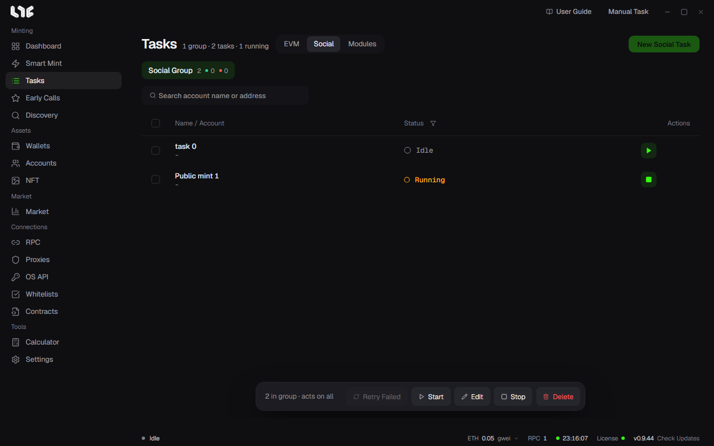

# Social tasks

Social tasks handle jobs that do not touch a chain, using many accounts. Google Forms, X and Discord actions, sign-up procedures, whitelist applications, and fixed quest submissions belong here.

## What you need

- **Accounts**: They hold the wallet address, Gmail, X handle and cookie, Discord info, and proxy. [Social accounts](../setup/accounts.md)
- **Captcha solving**: Needed only for modules that have hCaptcha, Turnstile, or reCAPTCHA v2/v3. Put the keys in **Settings → Integrations**.
- **Browser session**: Needed only for Google Forms that require login, or for browser-engine modules.

## Google Forms

**Tasks → Social → New Social Task** creates Google Form, X Action, Discord, and Alphabot tasks.

1. Open or create a social group.
2. Click **New Social Task** and pick **Google Form**.
3. Enter the Google Forms URL and click **Parse**. The app reads it anonymously first, and if that is blocked, it reads it with the linked Google account of the account group.
4. Pick an account group. One task is created for each account.
5. Decide the answer to each question. You can use account values, fixed values, a random choice, or auto fill.
6. Save.

Question types that are not supported (linear scale, grid, date, time, file upload) are skipped on submission. If they are not required questions, the form can still accept the rest.

## X actions

Pick an action such as Follow, Unfollow, Like, Retweet, Reply to tweet, Quote tweet, or Tweet. Each account uses its saved X cookie. Check first that the cookies are still valid with **Test All Auth**.

## Discord actions

Each account can do Join Server, Leave Servers, and Press Buttons / Add Reactions. Captchas use the AnySolver key in Settings. Leaving servers is processed 2.5 seconds apart.

## Alphabot

Signs in with the account wallet, then links the stored Discord and X sessions.

## Social modules

These are site-specific flows uploaded by the operator. Start from **Tasks → Modules**. The window opens locked to that module, and you only fill in the fields the module sets.

1. Open **Tasks → Modules**.
2. Pick a social module.
3. Pick an account group.
4. Fill in the module's fields.
5. If there is a captcha, pick a solving service. If you do not, the task cannot get past it.
6. Save.

A module runs on the `http` engine, which uses ordinary requests, or on the `browser` engine, for sites that need a real browser. The module author decides which one.

## Accounts do not mix

One task uses only one account. It uses that account's wallet, handle, Gmail, proxy, and browser profile. A task that is missing a value it needs does not fall back to another account. It leaves the reason in the row log and is skipped or fails.

## Captcha handling

The module decides the captcha fields. At run time, the app solves them with the service and key in Settings and puts that token into the request. If there is no solving service, the window blocks you or the row fails with a settings error.

Details are in [Answer templates and social modules](templates-modules.md).
