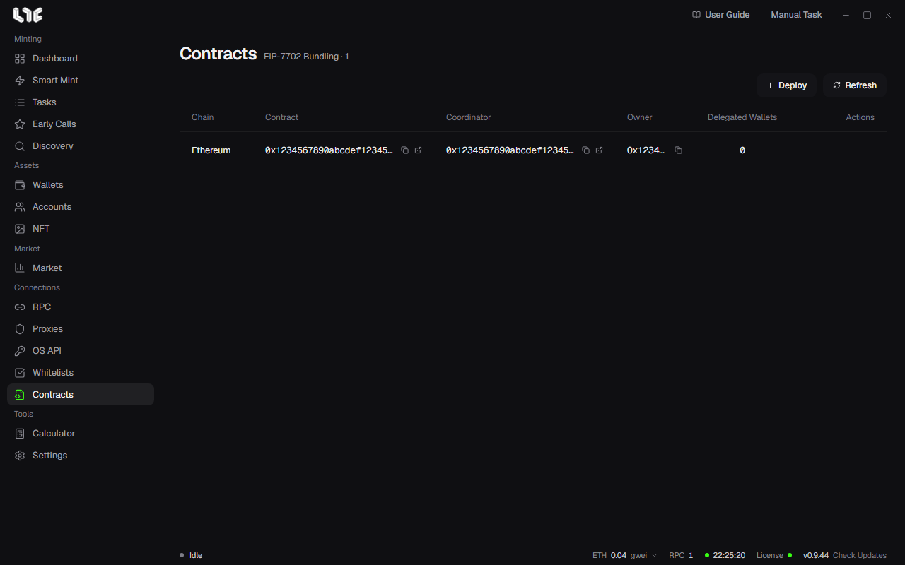

# Bundles and contracts

A bundle mints from many wallets in a single transaction. Instead of each wallet sending its own transaction, the wallets are delegated to an executor contract through EIP-7702, and one transaction through a coordinator contract mints for all of them.

To use bundles, do three things in order.

1. Deploy a bundler contract on the chain.
2. Delegate the wallets to its executor.
3. Make a bundle task.

## 1. Deploy a bundler contract

In **Contracts**, click **Deploy**.

| Field | What goes in |
|---|---|
| Chain | The chain you will bundle on. |
| Owner wallet | The wallet that deploys and owns the contract. It pays the deploy gas. |
| RPC group | The RPCs to send the deploy transaction through. If the chain has no RPC, you are told to add one on the RPC screen first. |
| Max fee, priority fee | Empty is auto. |

When the deploy finishes, the coordinator and executor appear as one row. The table shows the chain, contract, coordinator, owner and number of delegated wallets.

The row's actions:

- open in explorer, copy owner address
- **Delegate wallets**, **Revoke wallets**
- **Delete contract**: removes only the app's record. The contracts and delegations on chain stay.

## 2. Delegate wallets

A row's **Delegate wallets** opens **Configure Delegation**.

- Pick the wallets to delegate.
- **Gas Payer**: the one wallet that pays gas for the delegation transactions.
- **Delegate To**: set to that row's executor contract address.

A delegated wallet carries the executor contract's code from then on. Give that power only to an executor you deployed yourself; **Revoke wallets** takes it back.

To see which wallet is delegated where, use the **Delegation** button on the **Wallets** screen.

## 3. Make a bundle task

On **Tasks**, click **New Bundle**, or pick several tasks on one chain and click **Bundle** in the bottom bar.

In the first step, **Create Bundle**, enter the chain, contract, function, value and parameters as in a normal task, and pick the **Bundler Contract** and wallets. **Wallet Compatibility** shows whether the picked wallets are delegated to that executor. **Continue** goes on to the bundle settings.

| Field | Meaning |
|---|---|
| Mint Payment | Who pays the mint price: **Contract Owner Pays** or **Each Wallet Pays**. |
| Call Gas Limit | The gas limit for one wallet's mint call. |
| Outer Gas Limit | The gas limit for the whole bundled transaction. |
| Bribe Per Success | The tip to the block builder for each successful mint. |
| Max fee, priority fee | Empty is auto. |
| Timestamp | When to send. If the picked tasks have different timestamps, you are asked which one the bundle should use. |
| Spam, Delay | When on, the bundle transaction is sent again and again at the set interval. |
| RPC Endpoints | The RPCs to send the bundle transaction through. |

Every task in a bundle must be on the same chain. If there is no deployed and delegated contract on that chain, you are told to set one up first.

If some wallets are not ready to mint when it fires, the first transaction goes out first and those wallets go in a second transaction once they are ready.
