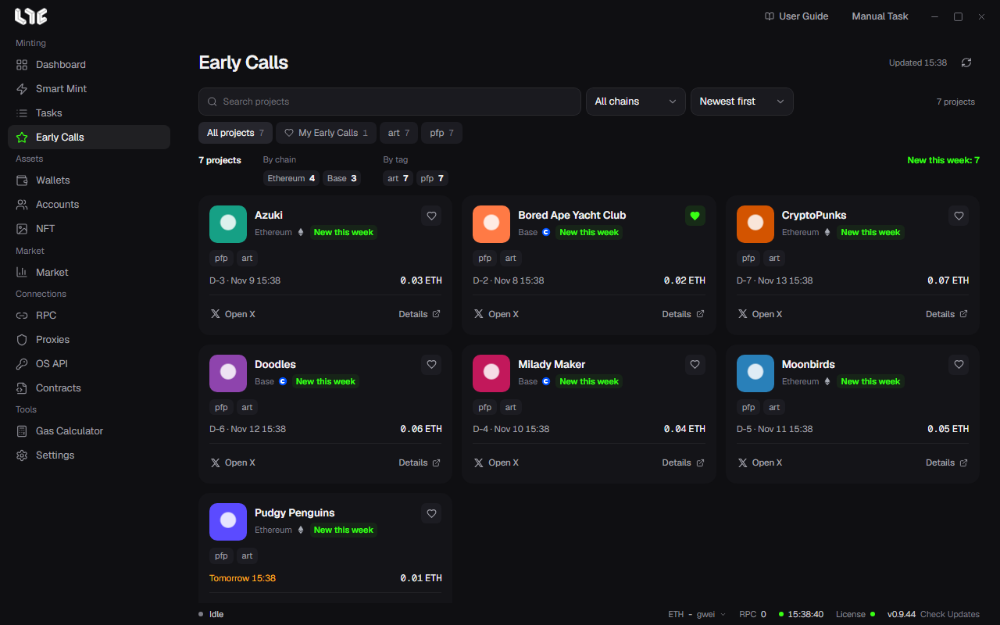

# Early Calls

Early Calls is the list of projects the Nogada operator registered. The top right shows when it was last fetched, and the button next to it fetches it again.

## Filtering and sorting

- Search field: find a project by name.
- **All chains**: filter by chain.
- Sort: **Newest first**, **Mint soonest**, **Name A–Z**.
- Chips: **All projects**, **My Early Calls** (projects you hearted), and one per tag.

The line under the chips shows how many projects match now, per chain, per tag, and how many were posted this week.

## Reading a card

| Mark | Meaning |
|---|---|
| New this week | Registered this week. |
| Date and D-N | The mint date and time. Today or tomorrow shows as, for example, **Tomorrow 22:09**. |
| Price | The known mint price. |
| Heart | Adds to or removes from My Early Calls. |
| Open X, Details | Opens the project's X or its details. |
