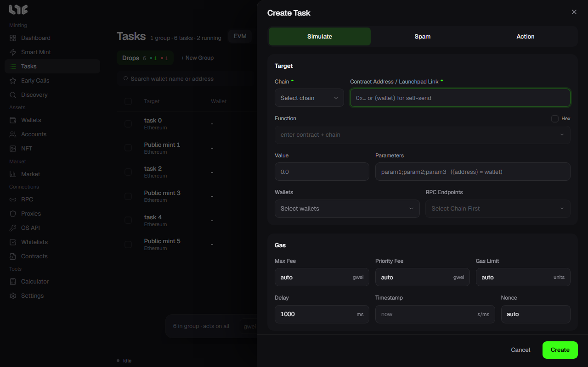

# Create a task

Click **Tasks → EVM → New Task** to open the **Create Task** window. Here is what each field does.

## Contract Address / Launchpad Link

| What you enter | What happens |
| --- | --- |
| Contract address | Finds the ABI and shows the function list |
| OpenSea drop link | Finds the drop, phases, and price and fills them in. [OpenSea drops](opensea.md) |
| Transient, Blever, Scatter, Verse, MintBay, Ronin Market links | Finds the mint info and fills it in |

If the app cannot find the ABI, paste the ABI yourself or switch to Hex.

## Function and Hex

- **Function**: Only functions that change state are shown. Pick a function and fill in the parameters. Good when each wallet needs different values.
- **Hex**: Sends the call data as is. Good for transactions whose content is always the same.

## Parameters

Write the function's inputs in order, separated by semicolons. Example: `2;0xabc…;[1,2,3]`. The count must match the function.

### Placeholders

| Text | Meaning |
| --- | --- |
| `{address}` | The full address of the task wallet (`0x…`). You usually use this for address parameters |
| `{wallet}` / `{self}` | The signing wallet as 40 lowercase characters without `0x`. Use it in parameters and Hex. If you put it in the contract field, it becomes a send to yourself |
| `{id}` / `{idN}` / `{idA-B}` | Finds a usable token ID. `{id777}` is 0-777 and `{id100-777}` is that range |
| `{n}` / `{nN}` / `{nA-B}` | Finds, by simulation, a number for which the call succeeds. `{n777}` is 1-777 |

If you use `{id…}` or `{n…}`, the task is locked to simulation and you cannot use Spam.

## Value

This is the **total** amount of native token sent with each transaction. It is not the price per item. For a free call, or a call that cannot receive funds, leave it at 0 or blank. For an ordinary paid mint, enter the mint price × quantity. For supported launchpads, the app fills it in.

## Wallets and RPC

Pick a wallet group and wallets. One wallet is one task. If you turn on **Funded Only**, only wallets with a balance are shown.

You do not have to pick an RPC. By default the task uses all the RPCs for that chain. See [RPC](../setup/rpc.md).

## Gas

If you leave it empty, it is automatic. Details are in [Gas](gas.md).

- **Gas Limit**: Usually leave it empty. If you enter it yourself, it saves one call, but if it is too low the transaction fails.
- **Max Fee**: The most gwei you can pay.
- **Priority Fee**: The tip you pay to get included. It cannot be larger than the max fee.

## Time

- **Delay**: The retry interval (ms).
- **Timestamp**: A Unix time. The task waits until then and then starts. In Spam you can write `start-end`.
- **Nonce**: Usually leave it empty. Use it only when you are aiming at a specific nonce of a wallet.

You can convert a timestamp in the [Calculator](../tools/calculator.md).

## Mode

Turn **Simulate** and **Spam** on or off at the top of the window. If both are off, the task sends immediately. See [Task modes](modes.md).

## Flashbots

Used only on Ethereum mainnet. When on, the same signed transaction is also submitted as a bundle. If you set it to private only, it skips the public mempool. In Spam it becomes a bundle-only route, so a missed bundle uses no gas and does not consume the nonce. The values from **Settings → Fire Engine** are used.

## Action: what to do after minting

If you turn on **Action** at the top of the window, you set what to do after the mint is confirmed. You cannot use it with Spam.

| Action | What it sets |
| --- | --- |
| Transfer NFT | The Destination and the Transfer Fee. **Drain remaining ETH after NFT transfer** can also send the leftover ETH |
| List NFT | The OpenSea List Price and Expiry. It needs an OpenSea API key |
| Accept Offer | The Minimum Offer in WETH. It needs an OpenSea API key |

When you use a wallet you bought from a whitelist market, it is safer to move the NFT and the ETH to your own wallet right at mint.

## Order of creation

1. Enter the contract or link.
2. Pick a function or switch to Hex.
3. Fill in the parameters and the value.
4. Pick wallets and RPCs.
5. Set the gas and timing. Usually leave the gas on automatic.
6. Pick the mode.
7. Click **Create**, then start the task. The task is created in the Idle state.
