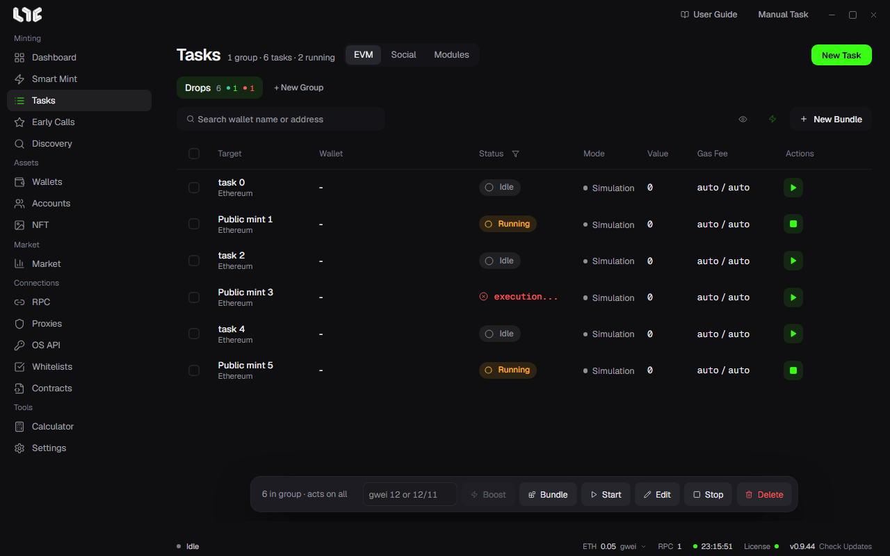

# Tasks and modules

The **Tasks** screen is the center of the app. Groups hold tasks together, and each row is the unit that is actually started, stopped, retried, and logged.

## Tabs

| Tab | What a row means |
| --- | --- |
| EVM | One wallet runs one transaction setup |
| Social | One account runs one social setup |
| Modules | You pick a task template uploaded by the operator |

## Groups and rows

- Group tasks by collection, market, or flow with **+ New Group**.
- One row is created per wallet.
- The status shows as Idle, Running, Stopped, Success, Failed, and so on.
- Use **More task actions** on a row to duplicate it, show its logs, or delete it. The log shows the `logs/nogada.log` lines that relate to that task.
- You cannot edit a running task. Stop it first.

**Start**, **Stop**, **Edit**, **Delete**, **Bundle**, and **Boost** in the bottom bar apply to the rows you picked, or to the whole group if no row is picked. Edit applies only to stopped tasks.

## Three ways to create tasks

- [Smart Mint](smart-mint.md): Paste a link. This path is enough for most cases.
- [Create a task](onchain.md): Fill in the fields yourself with **New Task**. Use it when you send a function call or Hex as is.
- **Quick Task**: Creates a task right away with the wallets and RPCs set in Settings.

On any path, creating a task does not fire it. You have to click Start.

## Modules

A module is a task template the operator uploads to the server. It is a task you would otherwise build yourself, filled in ahead of time.

| Module | What it creates |
| --- | --- |
| Onchain | A task with the contract, chain, function or Hex, gas, and value filled in |
| Social | A social task that uses a fixed HTTP or browser flow |

Pick one in **Tasks → Modules**. Usually you only change your own settings, such as wallets, RPCs, and fees. Do not change the contract, the function or Hex, or the value unless the operator says so.

If a new module has been uploaded but you do not see it, click **Refresh modules**. You do not need to restart the app.
