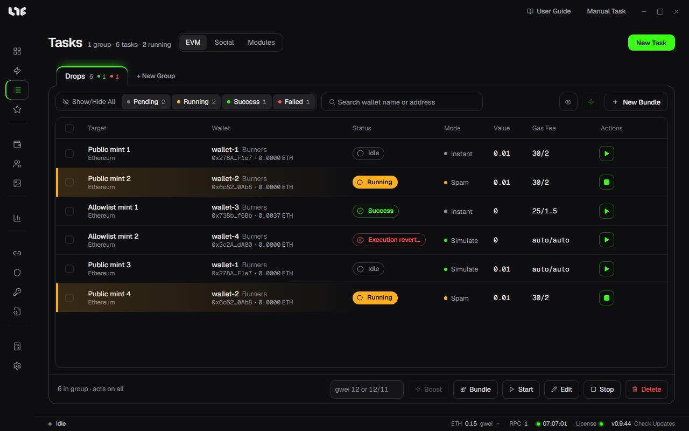

# Running tasks and Boost

Tasks you make collect in **Tasks**, by group. Here you start and stop them, see results, and raise the gas of transactions already sent.

## The top of the screen

- **EVM / Social / Modules** tabs: mint tasks are on the EVM tab. Social and Modules are covered in [Accounts and social tasks](../social/accounts-and-social.md).
- The numbers next to the title: groups, tasks, and tasks running now.
- **Group tabs**: the groups sit side by side as tabs above the list. Click one to open that group. The number on a tab is its task count, the green dot its successes and the red dot its failures. Shift-click to pick several groups, and drag to reorder.
- With several groups picked, **+ New Group** turns into **Delete N**, which deletes the picked groups with the tasks in them in one go.
- When the groups do not fit on one row, a **More groups** button appears at the end of the row; click it to reach the groups pushed out.
- **New Task**: opens [Creating a task by hand](task-form.md).

The status tabs above the list (**Pending**, **Running**, **Success**, **Failed**) show how many tasks are in each state; each click shows or hides that state. Several can be on together, and **Show/Hide All** turns all four on or off at once.

The three buttons right of the search field:

| Button | What it does |
|---|---|
| Eye | Hides or shows the wallet and gas columns. |
| Lightning | Opens a **Quick Task**. See below. |
| New Bundle | Makes a bundle task that mints from many wallets in one transaction. → [Bundles and contracts](bundles.md) |

## Reading the table

| Column | Meaning |
|---|---|
| Target | Task name and chain. |
| Wallet | The wallet this task uses. |
| Status | Idle, Running, success or failure with its reason. A running row has an orange bar on its left. |
| Mode | The launch method, such as Simulation or Spam. |
| Value | The coin sent per transaction. |
| Gas Fee | Max fee / priority fee. auto means automatic. |
| Actions | ▶ start, ■ stop. Hover over a row for edit, delete and **⋯**. |

The **⋯** menu has **Duplicate** (opens a new task window with the same settings), **Show Logs** and **Delete**. A running task cannot be edited, so stop it first.

## Start and stop

- A row's ▶ starts just that task.
- **Start** in the bottom bar starts many tasks at once.
- A task with a timestamp waits until that time after you start it, then sends.
- **Stop** stops it. A transaction already sent to the network cannot be called back.

Tasks run inside the app. Close the app and waiting tasks stop with it.

## The bottom bar

The bottom bar acts on all visible tasks or only on the ones you picked.

- With nothing picked it says **N in group · acts on all**, and every visible task in the group is the target.
- Tick tasks and it changes to **N selected**; only those are the target.

| Button | What it does |
|---|---|
| gwei field + Boost | Changes the gas. See "Boost" below. |
| Bundle | Puts the picked tasks into one bundle. |
| Start / Stop | Starts or stops the target tasks. |
| Edit | Edits the target tasks together. Fields left empty keep each task's current value. |
| Delete | Deletes the target tasks. |

## Boost

Use it when a transaction you already sent is stuck because its gas is too low. In the bottom bar's gwei field, one number such as `12` sets both the max fee and the priority fee to 12; `12/11` sets the max fee to 12 and the priority fee to 11. Then click **Boost**.

Each task is handled like this.

| Task state | What Boost does |
|---|---|
| A sent transaction is still pending | Sends a transaction with the same nonce and the new gas to replace it. The task's gas setting also changes to the new value. |
| Not sent yet, or nothing pending | Only changes the task's gas setting. The next send uses it. |
| Already finished | Skipped. |

If the original transaction confirms first, the replacement does nothing and you are not charged twice. The app never raises gas on its own; gas goes up only when you click Boost.

## Show Logs

A row's **⋯ → Show Logs** opens that task's record. The top sums up the wallet, gas fee, value and mode, and the filter field narrows lines with words like `FAIL`, `revert` or a wallet name. **Copy All** copies the record to paste when you ask for help.

The same record is also in `logs/nogada.log` next to the exe.

## Quick Task

The lightning button opens the task window with wallets and RPCs you set up in advance. The window title is **Quick Task**; your saved values replace the wallet and RPC fields, and there are no delay, timestamp or nonce fields either: they become the default delay, send now and auto nonce.

- Pick the wallets in **Settings → Quick Task Settings → Quick Task Wallets**. With none picked, the lightning button is off.
- Set RPCs per chain in **Quick Task RPCs (per chain)** on the same screen. A chain without any set uses all RPCs saved for that chain, or the public default if there are none.

Quick tasks you make are started from the table like any other task.

## When it fails

- Look at the reason in the status column and at the logs first.
- If the balance is short, add coin and start it again.
- If it failed because the phase was not open yet, turn on Simulate or set the timestamp to the opening time.
- Common messages are collected in [When you are stuck](../help/when-stuck.md).
