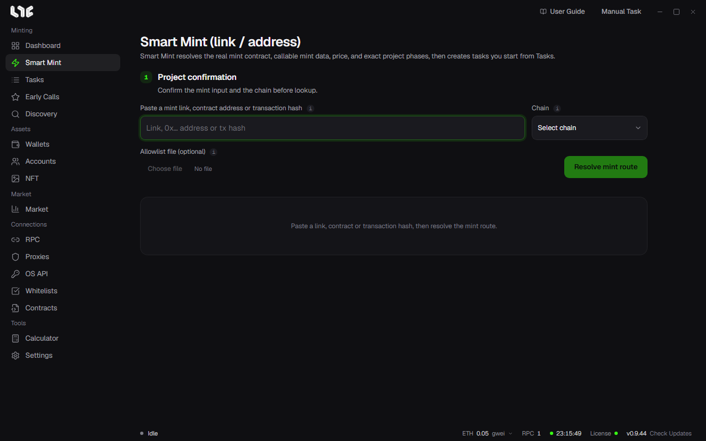

# Smart Mint

This screen finds the mint contract, mint data, price, and phases from a single link and creates tasks. It is unique to Nogada. Looking up or picking a phase does not fire anything. You start from the Tasks screen.

## What you can enter

- A contract address
- An explorer link
- A marketplace or launchpad link
- A link to the project's mint site
- A mint transaction hash, or an explorer transaction link

You pick the chain yourself. The same address can exist on several chains, so the app never changes it on its own.

## Steps

1. Pick a chain, paste your input, and click **Resolve mint route**.
2. Pick a phase in **Phase selection**. The phases appear with the names the project used. The app does not pick for you.
3. In **Execution settings**, set the wallets, quantity, gas, launch method, proxy, and post-mint actions.
4. In **Final review**, check the details and create the task.
5. Click Start on the **Tasks** screen.

## What the screen shows

- **Mint function**: Shows the function it found and the evidence. If there are several candidates, pick one from the list.
- **Price**: Shows where it was read from. A green value is a reference value. For a drop that mints directly from the contract, enter the price and look up again.
- **Not revealed** and **Not confirmed yet**: Values the project publishes at the open are never guessed. They are shown as not revealed. They are filled in when you look up again after the open.
- **Route lookup sources**: Shows which sources were read and what failed.

## Allowlist file

If a phase uses a Merkle approach, you can put a CSV or OpenZeppelin JSON in **Allowlist file (optional)**. The limit is 4 MiB. The app checks the proofs against the current onchain root.

## Launch method

| Method | What it does |
| --- | --- |
| Instant ×1 | Sends the prepared transaction once per wallet |
| Spam (repeated) | Repeats at the interval you set. It ends when the mint is confirmed, a limit is reached, or you stop it |
| Safe (simulate first) | Simulates before sending, and skips only the wallets that are expected to fail |

If you start early on a phase that is not open yet, Spam is recommended. The method does not change until you pick one yourself. A fuller comparison is in [Task modes](modes.md).

## When the lookup fails

Even a valid link may not be readable because of site protection or regional limits. Try these in order.

1. Enter the OpenSea collection link or the explorer link of the same project.
2. Enter the real minter or NFT contract address and the exact chain.
3. Enter the link to the project's mint page. The app can find the function name from the site's ABI.
4. Create the task yourself with an ABI or Hex in [Create a task](onchain.md).

The `(R-…)` code at the end of an error points to the cause. Send it along when you contact support.

## Drops where the site gives each wallet a signature

For a drop that requires a signature the app cannot build, the app tells you so. Mint on the project's site, or, if the site is supported, paste the mint site link into Smart Mint.
