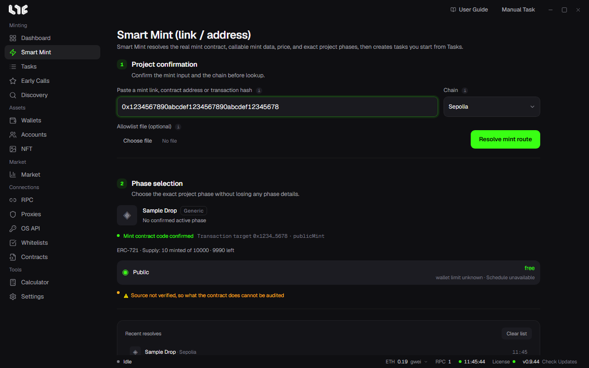
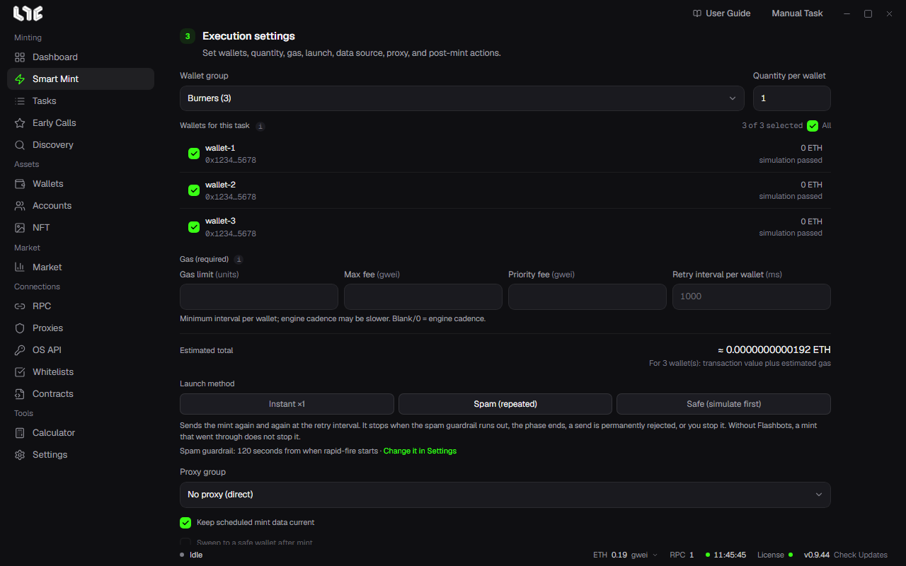
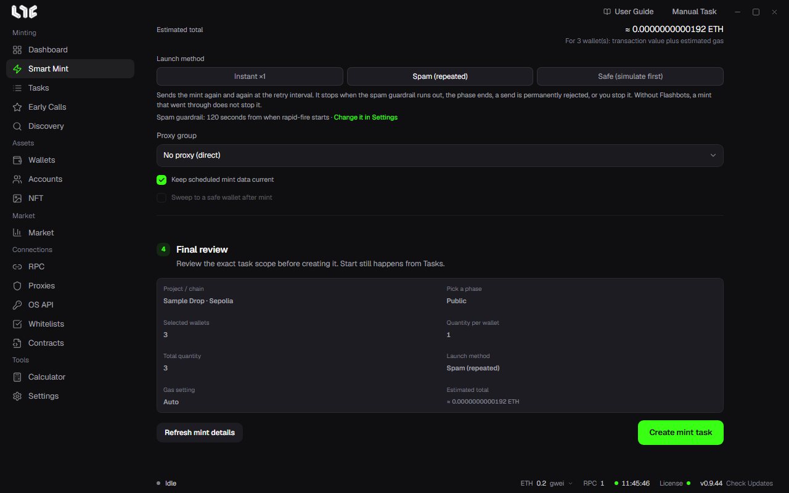

# Smart Mint

Smart Mint makes a mint task from a single link. The app finds the mint contract, the data to call, the price and the phases; you only choose wallets and a launch method. You start the task afterwards from **Tasks**.

The screen goes top to bottom in four steps.

## 1. Project confirmation

Put one of these into **Paste a mint link, contract address or transaction hash**:

- the project's mint page, a launchpad link or a marketplace link
- the contract address or the contract's explorer link
- the hash or explorer link of a transaction where someone minted that drop

Pick the **Chain** yourself. The same address can exist on several chains, so the app never switches it on its own.

If you have the allowlist file, add it under **Allowlist file (optional)**. It takes CSV or OpenZeppelin JSON up to 4 MiB and is checked against the Merkle root on chain now.

Click **Resolve mint route** and you see it go through reading the link, checking the contract and preparing the mint data. If several contracts match the link, it asks which one to look up. If you pasted a transaction hash, a field appears to pick the wallets to check against that transaction.

## 2. Phase selection

You see the project's name and platform, the mint function, the supply and the list of phases. Each phase shows its price (**free** when free), the per-wallet limit and the time. Click the phase you want to mint.

You may see:

- **A warning that the source is unverified**: the contract code is not publicly verified, so the app cannot read what it does. You can still mint, but check that the project is one you trust.
- **The mint price could not be read**: enter the mint price per token and click **Look up with this price**. The same field appears when the price it read is only a reference. A price you enter is used as is until the task fires.
- **Native fee**: when a fee paid next to the token price cannot be confirmed, you are asked for the fee per token. Enter 0 if there is none.
- **The sale is not open yet**: before it opens, the chain will not confirm the mint call. The app looks it up again on its own and fills it in after opening.
- ERC-1155 drops have a **Token ID** field. Empty uses the link's ID. 0 is a real ID.

## 3. Execution settings

| Field | What you set |
|---|---|
| Wallet group | The wallet group to mint with. |
| Quantity per wallet | How many each wallet mints. If the drop has a per-wallet limit, it shows too. |
| Wallets for this task | Tick the wallets in the group to use. Each wallet's balance and check result (for example, simulation passed) shows next to it. |
| Gas (blank = auto) | Gas limit, max fee, priority fee. Empty lets the app decide; a value is used as entered. |
| Estimated total | Transaction value plus estimated gas for all ticked wallets. The real gas is set when it fires. |
| Launch method | See the table below. |
| Proxy group | The proxies for the launch and mint data requests. Empty connects directly. |

### Launch method

| Method | What it does |
|---|---|
| Instant ×1 | When the task starts, each wallet sends its prepared transaction once. |
| Spam (repeated) | Keeps sending at the set interval. It stops when it reaches a limit (such as the end of the time range or the Spam Guardrail), gets an error that retrying will not fix, or you stop it. Without Flashbots, one landed mint does not stop it. |
| Safe (simulate first) | Simulates before sending and skips only wallets the simulation predicts will fail. It does not guarantee success. |

Spam adds the **Retry interval per wallet** field: the shortest gap before one wallet sends again. Empty or 0 is the default pace.

Under the launch method you see when Spam stops and the current **Spam Guardrail** (seconds from when Spam starts, or off). **Change it in Settings** next to it opens the **Settings → Fire Engine → Tasks → Spam Guardrail** field.

When the phase opens later, **Recommended** appears next to Spam. It means Spam fits if you start early and want to send the moment it opens. The launch method does not change until you pick it yourself.

### Drops that need a signature

Drops where each wallet must get signed mint data, such as an OpenSea allowlist, add a **Mint data source** field.

- **Default (proxy)**: fetches the mint data over proxy IPs. A registered OpenSea API key is used instead only when the IPs are blocked or no data comes back.
- **OpenSea API**: fetches each wallet's data with your OpenSea API key. No proxies needed, but each key has its own request limit. You cannot pick it without a key.

Highlight's signed drops show a field to paste each wallet's signed mint data from highlight.xyz. Leave it empty to fetch again when the task starts.

### Two checkboxes

- **Keep scheduled mint data current**: when on, scheduled tasks bring the price, phase and mint data up to date before they start. The preparation finishes before the launch time, so firing is not delayed.
- **Sweep to a safe wallet after mint**: after a successful mint, the NFTs and leftover coin move straight to the safe wallet you enter. Not available with Spam.

If the drop is paid in an ERC-20 token, an **Approve early** button appears. Without it, the app approves exactly what is needed when it is needed.

## 4. Final review

It shows the project and chain, phase, number of wallets, quantity per wallet, total quantity, launch method, gas setting and estimated total in one place. If it is right, click **Create mint task**. To read the details again, click **Refresh mint details**.

Once the tasks are made, an **Open Tasks** button appears. The task's start time is when the phase opens. Start it from Tasks and it sends at that time; if the phase is already open, it sends right away. → [Running tasks and Boost](running.md)

## When the lookup fails

| Message | What to do |
|---|---|
| R-RPC | It could not reach the chain or the project server. Check your [RPCs](../prepare/rpc-and-chains.md) and try again. |
| R-LINK | It could not read the link. Check the URL or paste the mint contract address. |
| R-RESOLVE | It could not find the mint route. Try again, or use **Use ABI / Hex** to [create a task by hand](task-form.md). |
| No RPC endpoint for this chain | Add an RPC for that chain on the RPC screen. |
| This address is not a contract | You pasted a wallet address. Check the mint contract address. |

**Recent resolves** at the bottom keeps the projects you looked up. Click one to look it up again; **Clear list** empties it.
