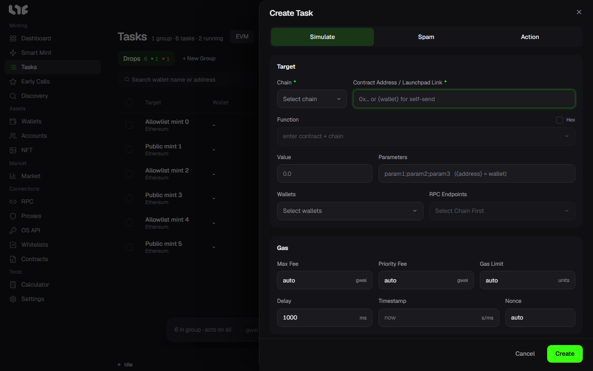
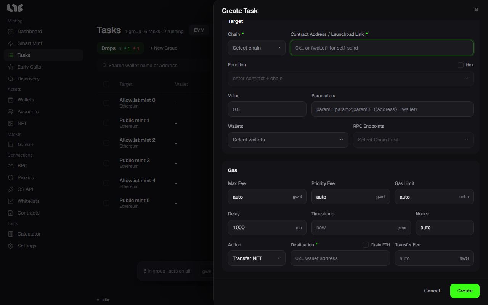

# Creating a task by hand

Use this window when Smart Mint could not find the route, or when you want to set the contract and function yourself. Open it with **New Task** on the **Tasks** screen or **Manual Task** in the top bar. You need a task group first (**+ New Group**).

## When and how it fires

The three buttons at the top of the window decide how the task sends.

| Button | When on |
|---|---|
| Simulate | Tries the same call before sending. If the try fails (revert), it waits for **Delay** and tries again, and sends the moment it passes. Good for waiting until a mint opens and then firing. |
| Spam | Keeps sending transactions at the set interval until something stops it: you stop it, the time range ends, **Max Tx** is reached, **Settings → Fire Engine → Spam Guardrail** runs out, or an error comes back that retrying will not fix. |
| Action | Adds something to do after the mint. See "After the mint" below. |

Simulate and Spam cannot both be on. With both off, the task sends once, at the set time. With Spam on, Action is not available, and the max fee, priority fee and gas limit need numbers instead of auto; a red star marks those fields.

The timing fields:

| Field | Meaning |
|---|---|
| Timestamp | When to send. Empty sends as soon as you start. Enter Unix time in seconds or milliseconds; how far away it is then shows next to the field name. With Spam you can enter a range such as `start-end` to send only during that time. |
| Delay | The pause (ms) before trying again, or before the next transaction in Spam. New tasks get **Settings → Fire Engine → Default Delay**. |
| Nonce | Normally left empty (automatic). Type a number only to force one particular nonce. With Spam on, this field turns into **Max Tx**; empty means no cap. |

To turn a date and time into Unix time, use **Unix Time Converter** in the [Calculator](../app/calculator.md). The fire time counts on this PC's clock.

## What to call

| Field | What goes in |
|---|---|
| Chain | The chain to mint on. |
| Contract Address / Launchpad Link | The mint contract address, or the drop link on a launchpad. `{wallet}` makes each wallet send to its own address. |
| Function | If the contract code is verified, the callable functions are listed. Picking one sets up the parameter field. |
| Hex | When on, you enter the raw call data (starting with 0x) instead of a function. Use it for contracts whose code is not verified. |
| Value | How much coin goes out with each transaction. Free mints use 0. |
| Parameters | Function parameters separated by `;`. `{address}` is replaced by each wallet's address. |

### If you put in a launchpad link

Put a launchpad drop link in the contract field and the window changes to fit that launchpad. A **Mint Phase** field appears, and picking a phase fills the timestamp with that phase's start time.

For an OpenSea drop you get these fields:

- **OpenSea Routing**: how each wallet's signed mint data is fetched.
  - **Normal Mode**: each wallet signs in to OpenSea and fetches it.
  - **Anonymous Mode**: fetches without signing in, through the task's proxies. An API key is used only for wallets that got nothing.
  - **OpenSea API**: fetches with the keys on OS API. You need a key to pick it.
  - **Dual Mode**: asks through Normal Mode and the OpenSea API at the same time and uses whichever answers first. You need a key to pick it; **Route API to Proxy** makes the API requests go through proxies too.
- **NFT Amount**: how many each wallet mints. If there is a per-wallet limit, it shows next to the field.
- **Price per NFT**: the highest price per NFT you will pay. If the price OpenSea gives at fire time is higher, the task stops instead of sending.

## Which wallets, through which RPCs

| Field | What goes in |
|---|---|
| Wallets | The wallets to use. **Funded Only** lists only wallets that have a balance. Every wallet you pick becomes its own task in the same group. |
| RPC Endpoints | The RPCs this task uses. How they are shared out is in [RPCs and chains](../prepare/rpc-and-chains.md). |

## Gas

| Field | Meaning |
|---|---|
| Max Fee | The cap on the gas price (gwei). Empty is auto. |
| Priority Fee | The tip to the block producer (gwei). Empty is auto, multiplied by **Auto Tip Multiplier** in **Settings → Fire Engine**. |
| Gas Limit | The most gas one transaction may use. Empty lets the app estimate it. |
| Flashbots | Only on Ethereum. When on, the transaction is submitted only as a Flashbots bundle, not to the public pool. |

With Flashbots and Spam both on, the Delay field becomes **Rolling window** and the Max Tx field becomes **Success / End / Stop**. Spam then goes on until it succeeds, reaches the end of the timestamp range, you stop it, or it hits the Spam Guardrail. The bundle window size is set in **Settings → Fire Engine → Flashbots**.

## After the mint

Turn on **Action** and fields appear at the bottom of the window. They run in that wallet after a successful mint.

| Action | Fields | What it does |
|---|---|---|
| Transfer NFT | Destination, Drain ETH, Transfer Fee | Sends the minted NFTs to the destination address. With **Drain ETH** on, it also sends all the coin left after the NFT transfer. |
| List NFT | List Price, Expiry | Lists the minted NFTs on OpenSea at that price. Expiry runs from 1 hour to 30 days. Needs an OpenSea API key. |
| Accept Offer | Minimum Offer, Gas Fee | Accepts the best offer on the minted NFTs. Leave Minimum Offer empty to accept any offer. Needs an OpenSea API key. |

## Create

**Create** puts the tasks in the group. Nothing is sent yet. You start them in [Running tasks and Boost](running.md).

If no RPC is saved for the chain, **No RPC, public RPC fallback** shows at the bottom and the button becomes **Confirm**. Click it if a public RPC is fine; otherwise add an RPC first.
