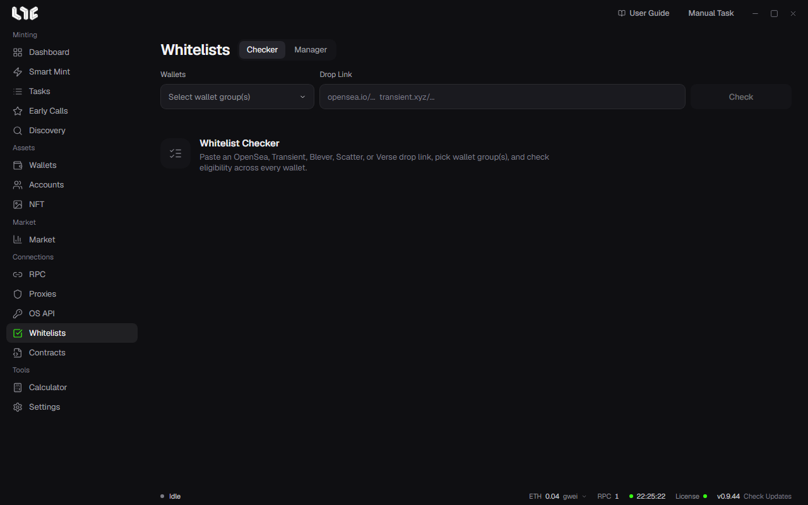

# Whitelists

When a project posts its allowlist, paste the drop link into **Checker** to see which of your wallets got in. The second tab, **Manager**, is your own list of projects you are in.

## Checking a drop

1. Pick a wallet group under **Wallets**.
2. Paste an OpenSea, Transient, Blever, Scatter or Verse drop link into **Drop Link**.
3. Click **Check**.
4. Each phase gets a row that marks every wallet as eligible or not. Take the next step with the buttons on that row; hover over a button to see its name.

| Button name | What it does |
|---|---|
| Create mint tasks for the eligible wallets in this phase | Makes tasks with only the eligible wallets. |
| Copy addresses for this phase's eligible wallets | Copies the eligible wallets' addresses. |
| Copy private keys for this phase's wallets | Copies those wallets' private keys. |
| Disperse funds to this phase's wallets | Sends gas to those wallets. |
| Save eligible wallets to Manager | Saves the eligible wallets as one entry in Manager. |

## Checking many wallets

For an OpenSea allowlist, the check signs each wallet in to OpenSea and asks about eligibility. Without proxies this runs from this PC, a few wallets at a time. Turn on **Settings → Fire Engine → Whitelist Checker Proxies** and pick a proxy group, and up to 50 wallets are checked at once through the proxies. A request that keeps failing on proxies is retried directly from this PC.

## Manager

Manager keeps the projects you are in, with their wallets. **Save eligible wallets to Manager** in the Checker adds an entry, and **+ Add** lets you write one yourself.

| Field | What goes in |
|---|---|
| Status | **Whitelist** (you got in) or **Ongoing** (applied and waiting). |
| Project name | Required. |
| X link | The project's X address. Required. |
| Website / OpenSea | Optional. |
| Mint / deadline date | The mint or application deadline date and time. |
| Amount per wallet | How many each wallet may mint. |
| Chain, wallets | Optional. |

Filter by status with the **All**, **Whitelist** and **Ongoing** buttons above the list, and find a project by name in the search field. Expand an entry to see its wallets; the pencil edits it and the trash removes it.
