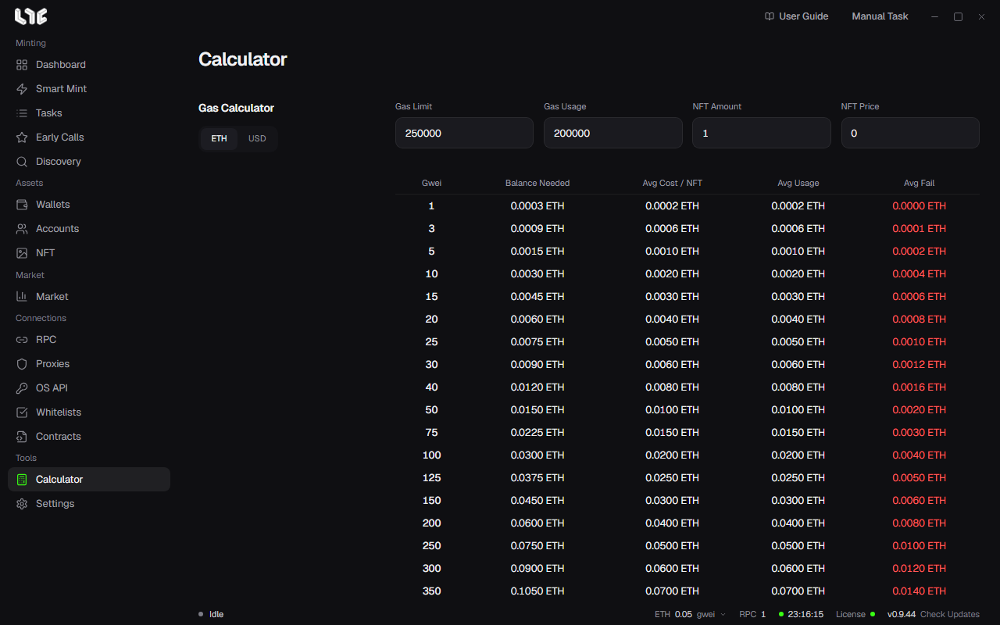

# Calculator

**Calculator** has a Unix time converter and a gas calculator. Both run on this PC only.

## Unix Time Converter

When you write in one field, the other changes.

- **Unix Timestamp**: In seconds. If you enter milliseconds, the app converts them to seconds.
- **Local Date & Time**: Uses this PC's time zone.

**Set to now** fills in the current time. Put the copied value in a task's **Timestamp** field.

## Gas Calculator

Shows the cost in a table for a set list of gwei values. It is not a live base-fee estimator.

| Input | Meaning |
| --- | --- |
| Gas Limit | The gas limit to reserve for one transaction |
| Gas Usage | Gas used by a successful mint |
| NFT Amount | Number of NFTs to mint |
| NFT Price | Native token price of one NFT |

| Result | Calculation |
| --- | --- |
| Balance Needed | NFT cost + 1.2 × limit gas cost |
| Avg Cost / NFT | Avg Usage ÷ NFT Amount |
| Avg Usage | NFT Amount × NFT Price + success gas cost |
| Avg Fail | Estimated gas cost of a failed transaction at that gwei |

Use it before minting to work out how much to put in each wallet. The **USD** button switches the display to dollars.
