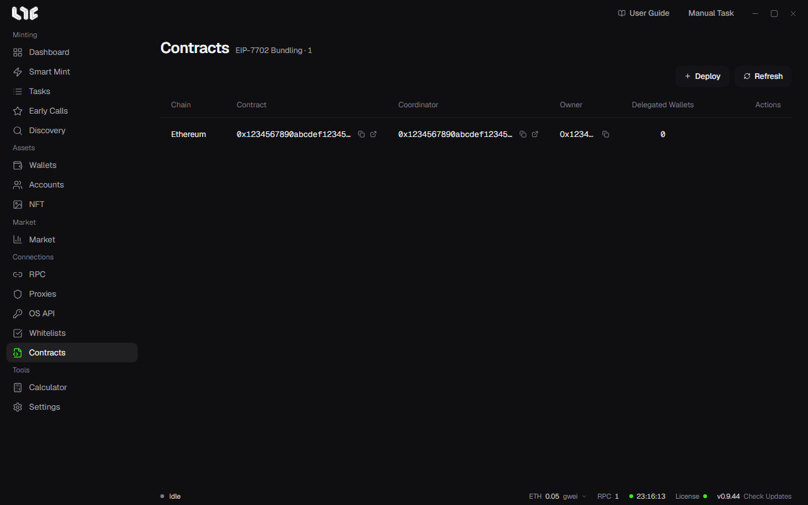

# Contracts

**Contracts** is a workspace for EIP-7702 bundles. It stores coordinator and executor deployments and helps with wallet delegation. It is not an ordinary contract address book.

With a bundle, transactions from many wallets are sent as one package. Create one with **New Bundle** on the Tasks screen.

## Deploying a bundler

Click **Deploy** and pick the following.

- The chain
- An **RPC group** with at least one responding RPC
- A funded **Owner wallet**
- The Max Fee and the Priority Fee. If you leave them empty, they are automatic

The app deploys the coordinator and the executor, reports each step, and then saves the addresses. **Refresh** matches the saved record with the chain state.

## Delegating and revoking

On a ready executor, use **Delegate wallets** to pick EVM wallets and set the EIP-7702 delegation. The **Delegated Wallets** count is the result of the last check. **Revoke wallets** removes the delegation onchain.

A delegation sets the code that runs on behalf of the wallet. Before you sign, check the chain, the executor address, the wallets, and the gas. Delegate only to a deployed executor contract that you trust.

> **Warning**: Deleting a row only removes the record on this PC. The deployed contracts and the wallet delegations stay as they are. Revoke the wallet delegations first, confirm it onchain, and then delete.

## If deployment fails

In the **RPC** menu, add or ping an RPC for that chain, check the owner wallet's balance, and try again. Custom chains also appear in the list, but whether it really works depends on that chain's EIP-7702 support.
