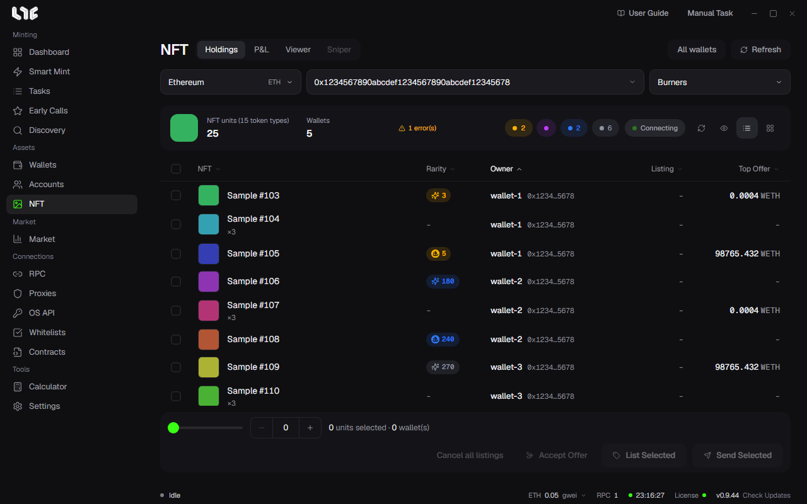

# Holdings

The **NFT** menu has the **Holdings**, **P&L**, and **Viewer** tabs. The Holdings tab shows the NFTs your wallets hold, and you can send, list, and accept offers right there.

## Loading

1. Pick a chain.
2. Pick a wallet group. You can pick several groups together.
3. Pick a collection. If you enter a collection address, only that collection is read.
4. Click refresh.

To read all wallets at once, click **All wallets**. It reads by going through the chains, so it reads only when you click.

The top of the results shows the NFT units and the token types. The two numbers differ because of ERC-1155. An ERC-721 row is one token, and an ERC-1155 row has a quantity. When you send, you can set how many to move for each row.

## Rarity

The color of the rank number shows the tier.

| Tier | Range |
| --- | --- |
| Legendary | Top 1% |
| Epic | Top 10% |
| Rare | Top 25% |
| Common | The rest |

The tier is rank ÷ supply. The same rank can be a different tier if the supply is different. You can filter with the tier chips at the top. If there is an OpenSea rank, the app uses that value, and if there is not, it uses the rank Nogada calculated.

## View and select

- **Card View**: An image grid.
- **List View**: A table with the list price, the top offer, rarity, and the owning wallet.

Click to select, and Shift+click to select a range. You can select across wallets. The bottom bar shows the selected quantity and the number of wallets.

- **Refresh Metadata**: Deletes the saved names and images and downloads them again. Use it after a reveal.
- **Hide Info**: Masks addresses and wallet names. Use it for screenshots.

## Send, consolidate, and disperse

Click **Send Selected**.

- **Disperse across destinations** off: Sends the selected NFTs to one place. Use it to gather NFTs minted with many wallets.
- **Disperse across destinations** on: Splits them over several places.

You can send to your own wallets or to a **Custom address**. Transfers leaving the same wallet are combined into one transaction if the collection and the chain support it. Results appear for each item, so even if only some fail you can tell what did not go through.

## Listings and offers

An OpenSea API key is required. Without one, the buttons are turned off. Signing always happens on this PC.

- **List Selected**: Puts the selected NFTs up for sale in the **Create listings** window. You can set them all to the same value, or set prices with a **Ladder** that raises the price step by step. If you turn on **Adjust for fees**, the price is raised so that the amount you receive equals the value you entered.
- **Accept Offers**: Accepts the best valid offer onchain for each selected NFT. It costs gas.
- **Cancel all listings**: Cancels all the listings and offers that the wallets of the selected NFTs have made on this chain. One transaction goes out per wallet, and it costs gas.

## Why can't I see it?

ERC-1155 has no standard way to list the tokens a wallet holds. The app finds them with a supported indexer and then confirms the quantity onchain. If a chain has no indexer, the app does not treat the wallet as empty and tells you so. A chain that failed to read appears in the status line at the top, and the NFTs last read stay visible.
