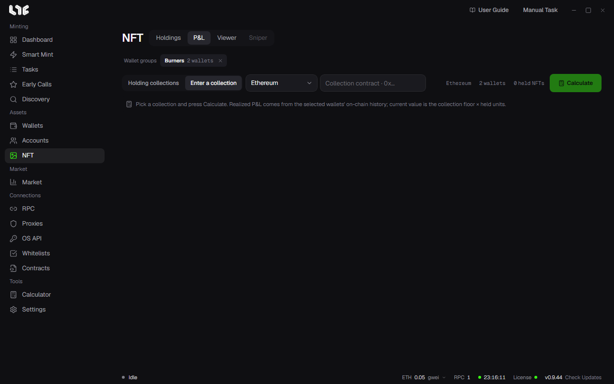

# P&L

**NFT → P&L** calculates the collection's profit and loss for the wallets you pick. It now also includes the records of wallets that no longer hold the NFTs.

## Calculating

1. Pick a collection. Pick one from **Holding collections** or enter the contract with **Enter a collection**.
2. Pick a chain and wallet groups.
3. Click **Calculate**.

Realized profit and loss is calculated from the onchain records of the selected wallets. The current value is the collection floor × the quantity held.

An active collection can take time. Canceling a calculation has no effect on the NFTs you hold.

## Alchemy is required

P&L reads the transaction history through Alchemy. Enter it in **Settings → Integrations → PnL Alchemy URLs**, or enter that chain's Alchemy address in the **RPC** menu. Stable uses an Etherscan key. The free Alchemy plan has a range limit, so a long history can fail.

## Supported chains

P&L has its own chain list. A chain in the app may not support P&L. The chains shown in the chain field on the screen are the supported chains.

## Reading the result

- **If some records are missing**, that value is an estimate or is left out of the total. Expand the explanation to see what was skipped.
- **Mint cost** is the amount the wallet sent in mint transactions, **sale** is the amount the marketplace paid out, and **holdings** is the floor × quantity.
- Some results cannot be copied or downloaded.

## P&L card

Makes a card for sharing. Pick from the Poster, Split, Ticket, and Terminal styles, and you can add your own background image. PNG, JPG, or WebP up to 10MB, in 3 slots, saved on this PC. Copy the card or save it as a PNG.
