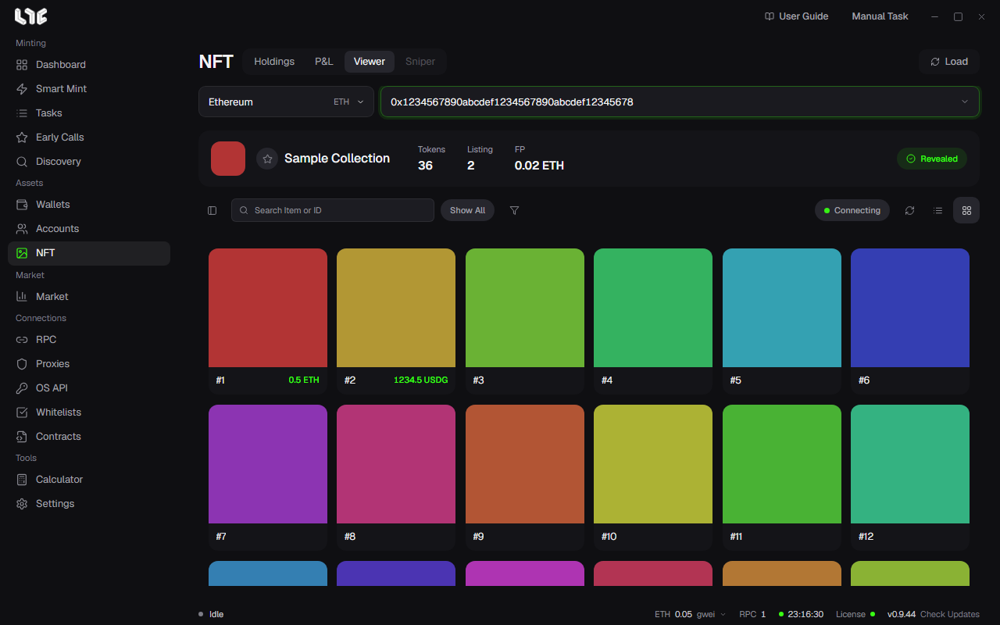

# Viewer

**NFT → Viewer** is a screen for viewing a whole collection. It is not limited to what your wallets hold. Use it to find rare items at the floor or to watch a drop before the reveal.

## Loading

Paste the collection contract, pick a chain, and click **Load**. It shows the tokens, OpenSea listings and offers, rarity, and live activity together.

- **Filters** on the left: filter by listing status, rarity tier, and traits.
- Search at the top: find items by item name or token ID.
- Switch between card and table view, and sort by list price, rarity, or top offer.
- Click the star to add a collection to **Favorite collections**.

If **Partial** appears, the collection is too large or the read was interrupted, so only part of it is shown. Load it again. Live updates keep filling it in.

## Reveal watch

On a collection before its reveal, click **Monitor Reveal** and the app watches onchain events and metadata, and when the reveal happens it reads the collection again.

## Bulk buy

Pick the listed items and click Buy. You need the following first.

- At least one OpenSea API key. [OpenSea API key](../setup/opensea-api.md)
- The buy wallet in **Settings → Fire Engine → NFT Buying**
- That wallet's **Buy Max Fee** (optional)

The app checks the listing again right before buying. It sends one transaction per NFT, and reports submitted, skipped, and failed separately.

> **Warning**: Bulk buy buys only native-currency listings. ERC-20 listings are shown but skipped. A listing you see can change or disappear at any time, so check the price and the wallet before you click.
