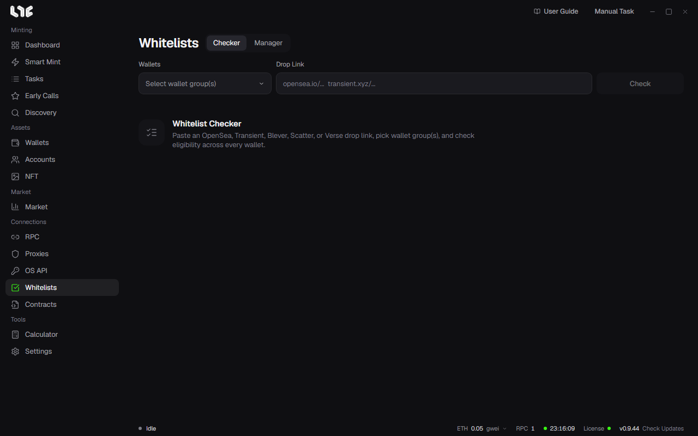

# Whitelists

The **Checker** checks whether wallet groups are eligible for a drop, and the **Manager** keeps the useful results.

## Checking a drop

1. Open **Whitelists → Checker**.
2. Paste a drop link. OpenSea, Transient, Blever, Scatter, and Verse links are supported, along with checkers the operator has uploaded.
3. Pick one or more wallet groups.
4. Click check. Results arrive for each wallet. You can stop with Stop.

A result column appears for each phase. A check mark means the wallet is eligible, and the number beside it is the per-wallet limit the source reported.

The results are the values at the moment you checked. If the list is still changing, check again before you use them.

If you have many wallets, turn on a proxy group in **Settings → Fire Engine → Whitelist Checker Proxies**. It checks up to 50 wallets at the same time.

## What to do with eligible wallets

If you pick a phase that is not public, you can use the following.

- **Create Tasks**: Opens the task window with the eligible wallets and the phase filled in.
- **Fund Wallets**: Opens fund management with those wallets.
- **Export**: Saves the private keys of the eligible wallets.
- **Save Whitelist**: Puts the result in the Manager.

A public phase does not count as a whitelist. An operator checker may report only eligibility and give no mint data. In that case you cannot use Create Tasks.

> **Warning**: An exported private key file is not encrypted. Anyone who has the file can use those wallets. Keep it safe, and delete it when you no longer need it.

## Manager

Saved entries are split into **Whitelist** and **Ongoing**. You can search and add entries by hand, and each phase uses the same Create Tasks, Fund Wallets, and Export. If you save the same source again, it does not create a new entry. It merges in the latest eligible wallets.

Deleting an entry in the Manager only removes the record on this PC. Eligibility at the source does not change.
