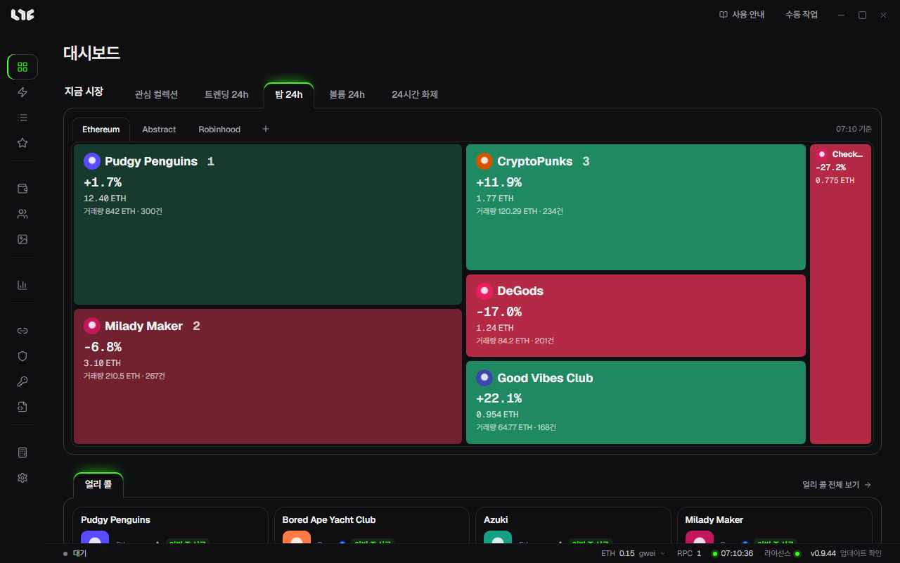

# Nogada 가이드

Nogada는 Windows PC에서 돌리는 NFT 민팅 앱입니다. 여러 지갑으로 같은 드롭을 동시에 민팅하고, 민팅한 NFT를 올리거나 보내고, 시장과 손익까지 한 앱에서 봅니다. 이더리움과 EVM 체인을 지원합니다.

## 이 앱으로 하는 일

| 하고 싶은 일 | 쓰는 메뉴 |
|---|---|
| 민팅 링크만 넣고 작업 만들기 | [스마트 민트](tasks/smart-mint.md) |
| 컨트랙트와 함수를 직접 골라 작업 만들기 | [작업](tasks/task-form.md) |
| 정각에 쏘기, 실패하면 다시 쏘기, 가스 올리기 | [작업 실행과 부스트](tasks/running.md) |
| 지갑 여러 개를 한 거래로 묶어 민팅 | [번들과 컨트랙트](tasks/bundles.md) |
| 민팅한 NFT 올리기, 내리기, 보내기, 오퍼 수락 | [NFT 메뉴](after/nft-menu.md) |
| 컬렉션 시세, 차트, 알림 | [마켓](after/market.md) |
| 다가오는 민팅 일정 | [민트 캘린더](after/mint-calendar.md), [얼리 콜](tasks/early-calls.md) |

## 처음이라면

아래 순서대로 읽으면 앱을 켜고 첫 작업을 만들 때까지 막히지 않습니다.

1. [내려받기와 첫 실행](getting-started/install.md)
2. [라이선스](getting-started/license.md)
3. [첫 민팅까지 따라 하기](getting-started/first-setup.md)
4. [스마트 민트](tasks/smart-mint.md)

## 가이드의 차례

가이드는 앱을 쓰는 순서대로 나뉘어 있습니다.

- **시작하기**: 설치, 라이선스, 화면 읽는 법, 첫 작업까지의 짧은 길.
- **민팅 준비**: 지갑, 자금, RPC, 프록시, OpenSea API 키처럼 민팅 전에 갖춰 둘 것.
- **민팅**: 작업을 만들고 돌리는 모든 방법.
- **NFT와 마켓**: 민팅한 뒤에 쓰는 화면.
- **소셜**, **도구와 설정**, **도움말**: 필요할 때 찾아보는 쪽.

## 먼저 알아 둘 것

- 개인키는 이 PC에만 저장되고 Windows 계정으로 암호화됩니다. 거래 서명도 항상 이 PC에서 합니다.
- 작업은 앱 안에서 돕니다. 앱을 닫으면 예약한 작업도 돌지 않습니다.
- 민팅 성공은 가스, 경쟁, 프로젝트 사정에 달려 있어 앱이 보장하지 않습니다.
- 화면 글은 영어, 한국어, 중국어로 바꿀 수 있습니다. 처음 켜면 영어로 나오니 **Settings → General → Language**(설정 → 일반 → 언어)에서 고릅니다.
