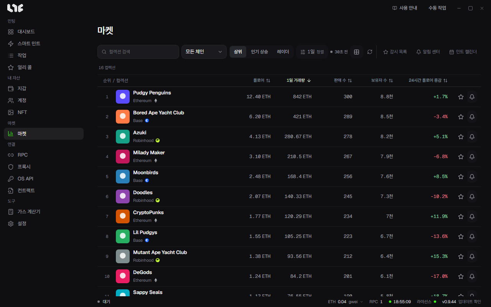
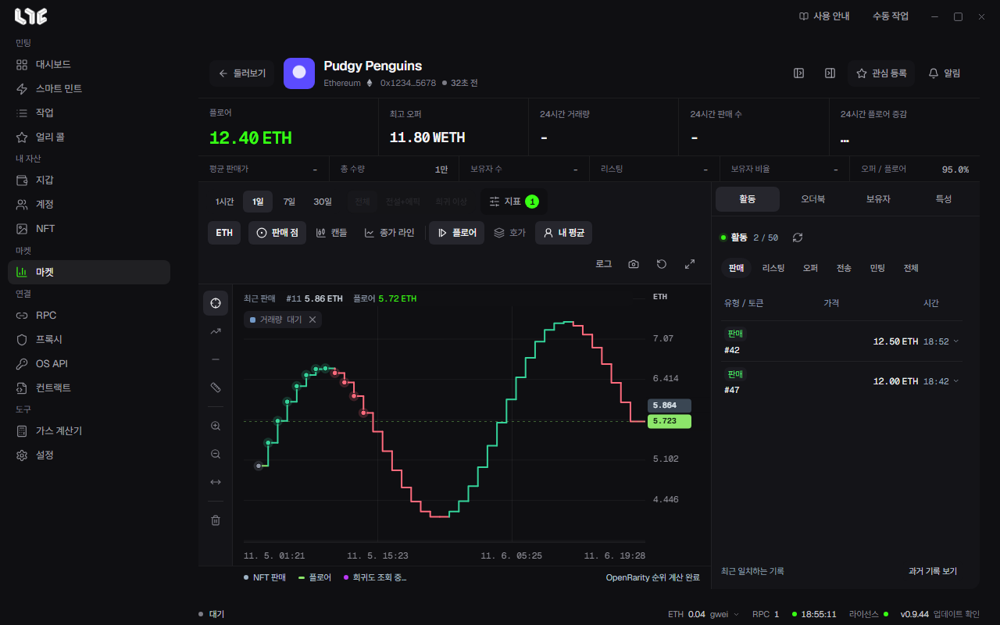

# 마켓

**마켓**은 컬렉션 순위, 컬렉션별 차트와 거래 기록, 가격 알림을 보는 곳입니다. 시세는 Nogada 서버의 마켓 허브에서 받으므로 OpenSea API 키가 없어도 됩니다. 거래 서명은 언제나 이 PC에서 합니다.

마켓 화면 오른쪽 위의 **관심 목록**, **알림 센터**, **민트 캘린더** 버튼으로 각 화면을 엽니다.

## 순위 보기

위쪽 탭으로 목록의 종류를 고릅니다.

| 버튼 | 목록 |
|---|---|
| 상위 | OpenSea 상위 컬렉션을 고른 기준으로 정렬합니다. |
| 인기 상승 | OpenSea에서 요즘 뜨는 컬렉션입니다. 조회 기간을 고를 수 있습니다. |
| 레이더 | 상위와 인기 상승을 합쳐 보여 줍니다. |

- 검색 칸에서 컬렉션을 찾고, **모든 체인**으로 체인을 거릅니다.
- 탭 오른쪽의 기간·정렬 버튼(처음에는 **1일**)에서 기간과 정렬 기준을 고릅니다. 정렬 기준은 한 번에 하나만 적용됩니다. 표의 칸 제목을 눌러도 그 칸으로 정렬됩니다.
- 옆의 점과 시각은 목록을 마지막으로 받은 때입니다. 격자 버튼은 카드 보기, 화살표 버튼은 새로고침입니다.

표의 칸은 플로어, 1일 거래량, 판매 수, 보유자 수, 24시간 플로어 증감입니다. 행 끝의 별은 **관심 등록**, 종은 **알림 만들기**입니다. 행을 누르면 그 컬렉션의 화면이 열립니다.

## 관심 목록

별을 누른 컬렉션은 **관심 목록**에 모입니다. 컬렉션은 10개까지 담을 수 있고, 더 담으려면 하나를 먼저 뺍니다. 검색, 체인 거르기, 새로고침이 있고, 대시보드의 **관심 컬렉션** 탭도 이 목록을 씁니다.

## 컬렉션 화면

위쪽에 이름, 체인, 컨트랙트와 함께 숫자 칸이 나옵니다.

- 큰 칸: 플로어, 최고 오퍼, 24시간 거래량, 24시간 판매 수, 24시간 플로어 증감
- 작은 칸: 평균 판매가, 총 수량, 보유자 수, 리스팅, 보유자 비율, 오퍼 / 플로어

### 차트

- 기간: **1시간**, **1일**, **7일**, **30일**
- 희귀도 거르기: 전체, **전설+에픽**, **희귀 이상**. 희귀도를 읽는 동안에는 잠겨 있습니다.
- **지표**: SMA 20, EMA 50, 볼린저 밴드, RSI 14, 거래량. 판매 캔들이 모자라면 몇 개가 필요한지 알려 줍니다.
- 모양: **판매 점**, **캔들**, **종가 라인**
- 겹쳐 보기: **플로어**, **호가**(리스팅과 오퍼), **내 평균**(NFT 메뉴에서 손익을 계산해 둔 경우)
- 오른쪽 위: **자동**(가격 범위 자동 맞춤), **로그** 가격축, 확대, 축소, 차트 이미지 복사, 보기 초기화, 크게 보기
- 왼쪽 도구: 십자선, 추세선, 반직선, 가격선, 세로선, 사각형, 피보나치 되돌림, 가격·시간 측정. 그 아래쪽에 **자석**(가장 가까운 판매 점이나 캔들 값에 붙음), 되돌리기, 선택한 선 지우기, 그린 선 지우기가 있습니다.
- 범례: 읽기 줄과 지표 칩은 차트 위에 떠 있지 않고 차트 위쪽의 자기 줄에 있습니다. 읽기 줄에는 봉의 변화율도 나옵니다. 그래서 맨 위의 점도 가려지지 않고 눌립니다.
- 차트 아래 줄: 범위 밖 판매가 있으면 **튀는 값 N건**이 나오고 **모두 보기**가 붙습니다.

조작은 이렇습니다.

- **옮기기**: 차트를 아무 방향으로나 끌면 끈 방향으로 움직입니다. 위아래로도 옮겨집니다(그 방향으로 4px 이상 끌면 그 방향이 움직입니다). 위·아래 방향키로도 가격을 옮깁니다.
- **가격 범위**: 옮기거나 늘리기 전까지는 자동으로 맞춰집니다. 가격축을 끌면 가격 범위를 늘리거나 줄입니다. **자동** 단추, 가격축 두 번 누르기, 기간 바꾸기, **로그** 전환, 보기 초기화를 하면 다시 자동이 됩니다. 자동 범위는 플로어보다 훨씬 동떨어진 판매를 빼고 잡습니다.
- **범위 밖 판매**: 범위 밖으로 나간 판매 점과 캔들은 가장자리에 가격이 적힌 화살표로 보입니다. 판매 점의 화살표를 누르면 그 판매가 열립니다. **모두 보기**를 누르면 그 값까지 범위에 넣고, **튀는 값 접기**로 되돌립니다.
- **시간 확대**: 마우스 휠로 확대합니다. 시간축을 끌면 오른쪽 끝을 기준으로 확대·축소하고, 시간축을 두 번 누르면 시간 범위를 다시 맞춥니다. 오른쪽 위의 확대·축소 단추는 보는 시간 범위의 가운데를 기준으로 합니다. **Shift** + 휠이나 터치패드의 옆 스크롤은 좌우로 옮깁니다.
- **최신 거래로**: 최신 거래가 화면 밖에 있으면 최신 거래로 가는 단추가 나옵니다. 보던 폭은 그대로 유지됩니다.
- **처음 보기로**: 두 번 누르거나 Home 키를 누르면 돌아갑니다.
- **판매 점**: 차트의 판매 점을 누르면 그 토큰의 카드가 열립니다.

그린 것은 이렇게 다룹니다.

- 그린 것을 눌러 고르고 **Delete** 키로 지웁니다.
- **Ctrl+Z**로 되돌립니다. **그린 선 지우기**로 지운 뒤에도 됩니다.
- 그린 것은 이 PC에 컬렉션과 통화별로 남습니다.

### 오른쪽 패널

| 탭 | 내용 |
|---|---|
| 활동 | 판매, 리스팅, 오퍼, 전송, 민팅 기록입니다. 실시간으로 이어지고, **과거 기록 보기**로 더 불러옵니다. |
| 오더북 | 가격대별 주문 수입니다. |
| 보유자 | 상위 보유자와 상위 10명의 보유 비중입니다. |
| 특성 | 특성별 플로어, 공급량, 24시간 거래, 수량 비중입니다. |

## 알림 센터

**알림 센터**에서 컬렉션이나 지갑의 변화를 알려 주는 알림을 만듭니다. 상세 화면을 열어 두지 않아도 앱이 켜져 있는 동안 알려 줍니다. 알림은 앱이 판단해서 보내므로 앱을 끄면 오지 않습니다. 알림은 Telegram으로 받습니다. 알림 센터의 **마켓 Telegram 연결**을 펼쳐 **연결 코드 생성**을 누르고, 나온 명령을 앱과 같은 라이선스로 로그인한 봇 대화에 보내면 연결됩니다. 코드는 5분 뒤 만료됩니다. 연결하면 라이선스 종료 알림과 작업의 사이트 단계 알림도 같은 대화로 옵니다. 같은 연결 칸이 **설정 → 일반**의 업데이트 바로 아래에도 있습니다. 연결된 뒤에는 **마켓 알림 연결 해제**로 끊고, 다시 연결하려면 새 코드를 만들어 보냅니다.

알림 센터의 탭은 **컬렉션**, **지갑**, **기록**입니다. 컬렉션과 지갑 탭 옆 숫자는 만들어 둔 알림 수입니다.

### 컬렉션 알림

**새 알림**을 누르고 이렇게 채웁니다. 컬렉션 알림은 컬렉션 10개까지 걸 수 있습니다.

| 칸 | 넣는 것 |
|---|---|
| 컬렉션 식별자 | OpenSea의 컬렉션 슬러그(예: `pudgypenguins`)입니다. 순위 표의 종 버튼으로 열면 채워져 있습니다. |
| 체인 | 그 컬렉션의 체인입니다. |
| 지표 | 플로어 가격, 플로어 변화율 %, 거래량 변화율 %, 판매 수 변화율 %, 리스팅 수 변화율 %, 최고 오퍼 / 플로어 %, 상위 10명 보유 비중 %, RSI |
| 조건 | **이하** 또는 **이상** |
| 기준값 | 알릴 값입니다. % 지표는 퍼센트로 넣습니다. |
| 가격 통화 | 플로어 가격일 때만 씁니다. 그 컬렉션의 플로어 옆에 보이는 통화를 넣습니다. |
| 알림 간격 | **한 번** 알리고 끝낼지, 조건이 이어지면 **반복**할지 고릅니다. |

### 지갑 알림

**지갑** 탭의 **새 지갑 알림**으로 특정 EVM 주소의 OpenSea 계정 이벤트를 지켜봅니다.

- 지갑 알림은 OS API에 내 OpenSea API 키가 있을 때만 쓸 수 있습니다. 키가 없으면 **지갑** 탭이 나오지 않고 지갑 알림도 돌지 않습니다. 만들어 둔 지갑 알림은 지워지지 않고, 키를 다시 넣으면 돌아옵니다.
- 지갑 5개까지 걸 수 있습니다. 더 걸려면 다른 지갑의 알림을 먼저 지웁니다.
- 칸은 **지갑 주소**, **이름**, **알림 간격**, 이벤트, 체인입니다. 이벤트는 민팅, 받음, 구매, 판매 가운데 고릅니다.
- **알림 간격**은 1분, 5분, 15분, 1시간, 6시간 가운데 고르고, 기본은 1분입니다. 조용하던 지갑에 이벤트가 생기면 첫 건은 바로 알립니다. 그 뒤 간격 안에 생긴 이벤트는 모아 두었다가 간격이 끝날 때 알림 한 통으로 보냅니다.
- 모은 알림에는 이벤트 종류별 수와 이벤트를 한 줄에 하나씩 최대 10줄까지 적고, 나머지는 "외 N건"으로 셉니다. 모든 건은 **기록** 탭에 하나씩 남습니다.

### 기록

**기록** 탭에는 보낸 알림과 전달 결과가 남습니다. **기록 지우기**로 비웁니다.
