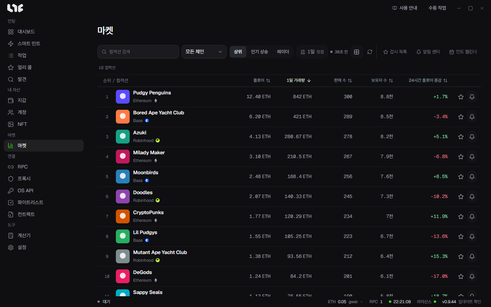
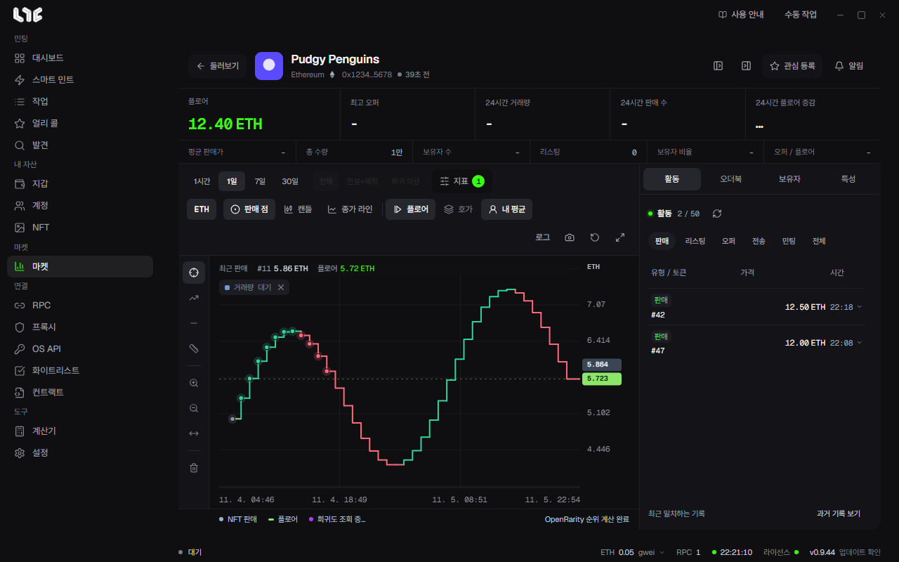

# 마켓

**마켓**은 컬렉션 순위, 컬렉션별 차트와 거래 기록, 가격 알림을 보는 곳입니다. 시세는 Nogada 서버의 마켓 허브에서 받으므로 OpenSea API 키가 없어도 됩니다. 거래 서명은 언제나 이 PC에서 합니다.

## 순위 보기

위쪽 버튼으로 목록의 종류를 고릅니다.

| 버튼 | 목록 |
|---|---|
| 상위 | OpenSea 상위 컬렉션을 고른 기준으로 정렬합니다. |
| 인기 상승 | OpenSea에서 요즘 뜨는 컬렉션입니다. 조회 기간을 고를 수 있습니다. |
| 레이더 | 상위와 인기 상승을 합쳐 보여 줍니다. |

- 검색 칸에서 컬렉션을 찾고, **모든 체인**으로 체인을 거릅니다.
- **1일 정렬** 버튼은 기간과 정렬 기준을 고르는 곳입니다. 정렬 기준은 한 번에 하나만 적용됩니다. 표의 칸 제목을 눌러도 그 칸으로 정렬됩니다.
- 옆의 점과 시각은 목록을 마지막으로 받은 때입니다. 격자 버튼은 카드 보기, 화살표 버튼은 새로고침입니다.

표의 칸은 플로어, 1일 거래량, 판매 수, 보유자 수, 24시간 플로어 증감입니다. 행 끝의 별은 **관심 등록**, 종은 **알림 만들기**입니다. 행을 누르면 그 컬렉션의 화면이 열립니다.

## 감시 목록

별을 누른 컬렉션은 **감시 목록**에 모입니다. 검색, 체인 거르기, 새로고침이 있고, 대시보드의 **관심 컬렉션** 탭도 이 목록을 씁니다.

## 컬렉션 화면

위쪽에 이름, 체인, 컨트랙트와 함께 숫자 칸이 나옵니다.

- 큰 칸: 플로어, 최고 오퍼, 24시간 거래량, 24시간 판매 수, 24시간 플로어 증감
- 작은 칸: 평균 판매가, 총 수량, 보유자 수, 리스팅, 보유자 비율, 오퍼 / 플로어

### 차트

- 기간: **1시간**, **1일**, **7일**, **30일**
- 희귀도 거르기: 전체, **전설+에픽**, **희귀 이상**. 희귀도를 읽는 동안에는 잠겨 있습니다.
- **지표**: SMA 20, EMA 50, 볼린저 밴드, RSI 14, 거래량. 판매 캔들이 모자라면 몇 개가 필요한지 알려 줍니다.
- 모양: **판매 점**, **캔들**, **종가 라인**
- 겹쳐 보기: **플로어**, **호가**(리스팅과 오퍼), **내 평균**(NFT 메뉴에서 손익을 계산해 둔 경우)
- 오른쪽 위: **로그** 가격축, 차트 이미지 복사, 보기 초기화, 크게 보기
- 왼쪽 도구: 십자선, 추세선, 가격선, 가격·시간 측정, 확대, 축소, 그린 선 지우기

마우스 휠로 확대하고 끌어서 옮깁니다. 두 번 누르거나 Home 키를 누르면 처음 보기로 돌아갑니다. 차트의 판매 점을 누르면 그 토큰의 카드가 열립니다.

### 오른쪽 패널

| 탭 | 내용 |
|---|---|
| 활동 | 판매, 리스팅, 오퍼, 전송, 민팅 기록입니다. 실시간으로 이어지고, **과거 기록 보기**로 더 불러옵니다. |
| 오더북 | 가격대별 주문 수입니다. |
| 보유자 | 상위 보유자와 상위 10명의 보유 비중입니다. |
| 특성 | 특성별 플로어, 공급량, 24시간 거래, 수량 비중입니다. |

## 알림 센터

**알림 센터**에서 컬렉션이나 지갑의 변화를 알려 주는 알림을 만듭니다. 상세 화면을 열어 두지 않아도 앱이 켜져 있는 동안 알려 줍니다. 알림은 Windows 알림으로 받습니다.

### 컬렉션 알림

**새 알림**을 누르고 이렇게 채웁니다.

| 칸 | 넣는 것 |
|---|---|
| 컬렉션 식별자 | OpenSea의 컬렉션 슬러그(예: `pudgypenguins`)입니다. 순위 표의 종 버튼으로 열면 채워져 있습니다. |
| 지표 | 플로어 가격, 플로어 변화율 %, 거래량 변화율 %, 판매 수 변화율 %, 리스팅 수 변화율 %, 최고 오퍼 / 플로어 %, 상위 10명 보유 비중 %, RSI |
| 조건 | **이하** 또는 **이상** |
| 기준값 | 알릴 값입니다. % 지표는 퍼센트로 넣습니다. |
| 가격 통화 | 플로어 가격일 때만 씁니다. 그 컬렉션의 플로어 옆에 보이는 통화를 넣습니다. |
| 알림 간격 | **한 번** 알리고 끝낼지, 조건이 이어지면 **반복**할지 고릅니다. |

### 지갑 알림

**지갑** 탭의 새 알림으로 특정 EVM 주소의 OpenSea 계정 이벤트를 지켜봅니다. 주소, 라벨, 체인, 이벤트(민팅, 받음, 구매, 판매)를 고릅니다.

### 기록

**기록** 탭에는 보낸 알림과 전달 결과가 남습니다. **기록 지우기**로 비웁니다.
