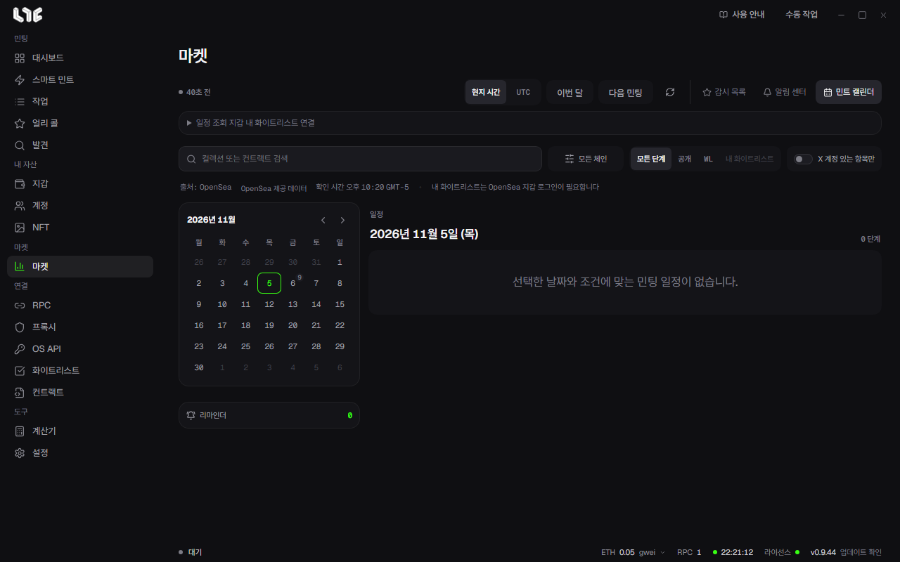

# 민트 캘린더

**마켓 → 민트 캘린더**는 다가오는 민팅 일정을 달력으로 보여 줍니다. 지금은 OpenSea가 내준 일정을 씁니다.

## 화면 읽기

- 왼쪽 달력: 날짜 옆 작은 숫자는 그날의 민팅 단계 수입니다. 날짜를 누르면 오른쪽 **일정**에 그날의 단계가 나옵니다. 화살표로 달을 넘깁니다.
- 위쪽 버튼: **현지 시간** / **UTC**로 시각 표시를 바꾸고, **이번 달**과 **다음 민팅**으로 바로 이동합니다. 오른쪽 화살표는 새로고침입니다.
- 출처 줄: 일정을 받은 곳과 확인한 시각입니다.

## 거르기

- 검색 칸: 컬렉션 이름이나 컨트랙트로 찾습니다.
- **모든 체인**: 체인별로 거릅니다.
- 단계: **모든 단계**, **공개**, **WL**, **내 화이트리스트**
- **X 계정 있는 항목만**: X 주소가 있는 프로젝트만 남깁니다.

## 드롭 자세히 보기

일정의 항목을 누르면 단계별 시작과 끝, 가격, 지갑당 한도, 공급량, 컨트랙트, 웹사이트와 X 링크가 나옵니다. 체인에서 직접 확인한 값인지도 함께 보여 줍니다.

**리마인더 설정**을 누르면 그 단계가 열리기 얼마 전에 알릴지 정합니다. 알림은 Windows 알림으로 옵니다. 설정한 리마인더 수는 달력 아래 **리마인더** 칸에 나옵니다.

## 내 화이트리스트 보기

**일정 조회 지갑 내 화이트리스트 연결**을 펼치고 지갑을 연결하면, 그 지갑이 화이트리스트에 든 단계만 **내 화이트리스트**로 거를 수 있습니다.

- 연결은 OpenSea 로그인 메시지에 서명하는 것입니다. 거래가 아니라서 가스비가 들지 않습니다.
- 연결하면 OpenSea 서비스 약관과 개인정보 처리방침에 동의하게 됩니다.
- 앱을 끄면 연결이 풀리고, 로그인은 하루 뒤 만료됩니다.

여러 지갑의 자격을 한꺼번에 보려면 [화이트리스트 체커](../tasks/whitelists.md)를 쓰세요.
