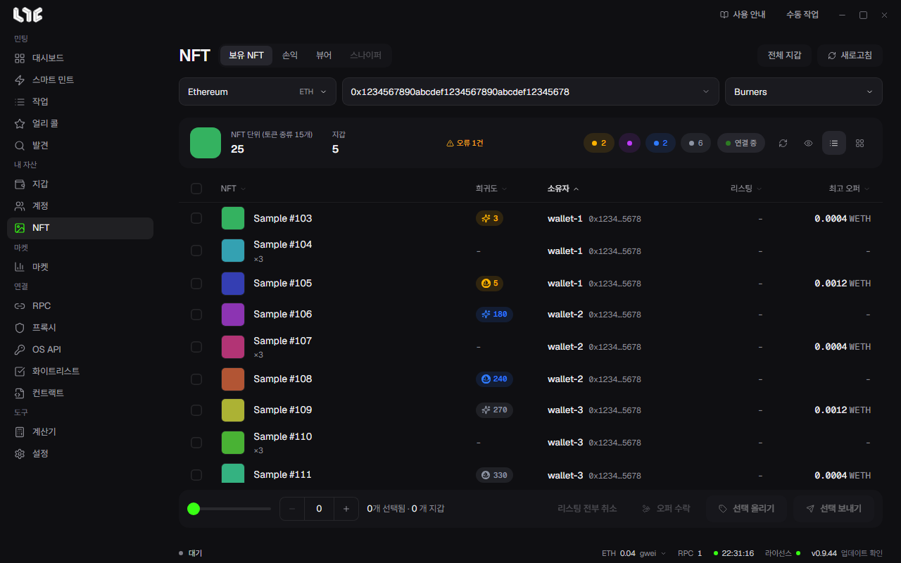
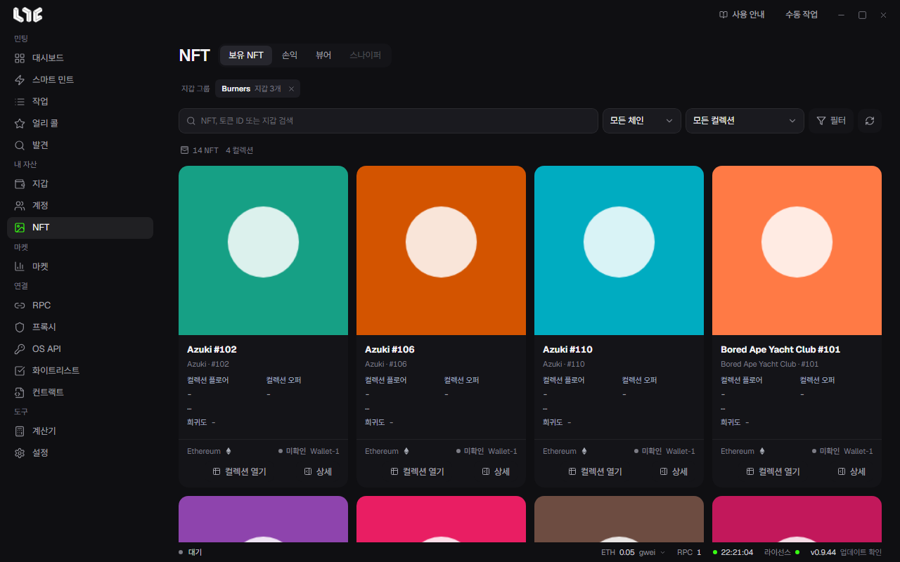
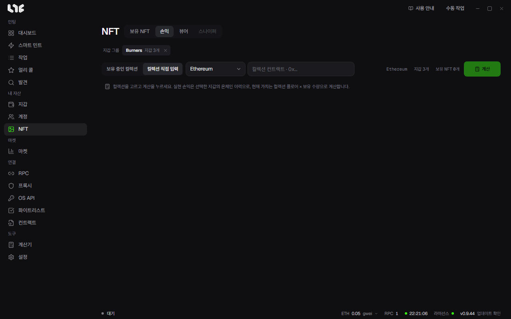
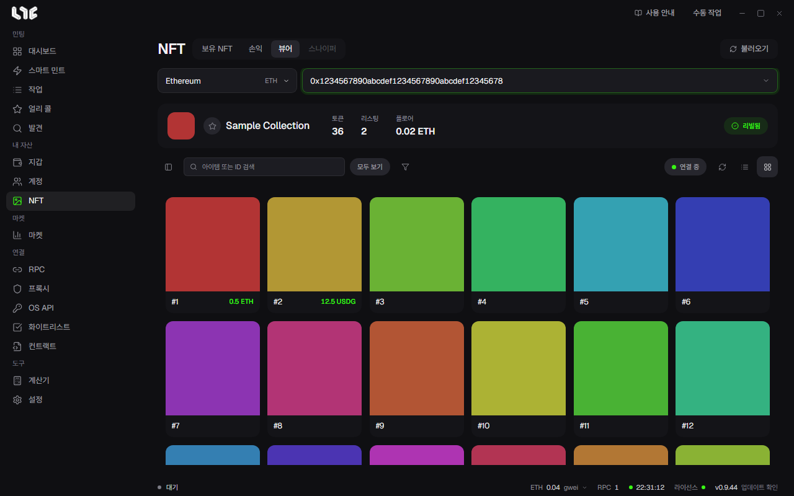

# NFT 메뉴

**NFT** 메뉴는 민팅한 뒤에 쓰는 곳입니다. 위쪽 탭은 **보유 NFT**, **손익**, **뷰어**, **스나이퍼**이고, 스나이퍼는 아직 열려 있지 않습니다(**곧**).

## 보유 NFT

민팅이 끝나면 여기서 NFT를 팔거나 옮깁니다. 컬렉션을 넣으면 내 지갑들이 가진 그 컬렉션의 NFT가 표에 모두 나오고, 거기서 바로 올리기, 내리기, 보내기, 오퍼 수락을 합니다.

1. 체인을 고릅니다.
2. **0x… NFT 컬렉션** 칸에 컬렉션 컨트랙트를 넣습니다.
3. **지갑 그룹 선택**에서 그룹을 고릅니다.

표 위에는 NFT 수와 토큰 종류, 지갑 수, 읽지 못한 지갑이 있으면 **오류 N건**, 희귀도 등급별 수가 나옵니다. **연결 중**은 리스팅과 오퍼 변화를 실시간으로 받고 있다는 뜻입니다.

| 칸 | 뜻 |
|---|---|
| NFT | 이름과 이미지입니다. ERC-1155는 가진 개수(×3 등)가 함께 나옵니다. |
| 희귀도 | 컬렉션 안의 순위입니다. 등급마다 색이 다릅니다. |
| 소유자 | 가진 지갑입니다. |
| 리스팅 | 지금 올라가 있는 가격입니다. |
| 최고 오퍼 | 지금 받을 수 있는 가장 높은 오퍼입니다. |

### 아래 막대

체크 칸으로 NFT를 고르거나, 왼쪽의 막대와 **−/+**로 고를 개수를 한 번에 정합니다. 그다음 버튼을 누릅니다.

| 버튼 | 하는 일 |
|---|---|
| 선택 올리기 | 고른 NFT를 OpenSea에 올립니다. 가격과 만료를 정하고, **수수료만큼 조정**을 켜면 크리에이터·플랫폼 수수료를 뺀 받는 금액이 입력한 값이 되도록 가격을 올립니다. 처음 올리는 컬렉션은 승인 거래가 먼저 나갑니다. |
| 선택 보내기 | 고른 NFT를 다른 주소로 보냅니다. 한 주소로 모으거나(**모으기**) 여러 주소로 나눌(**나눠 보내기**) 수 있고, NFT마다 거래가 하나씩 나갑니다. |
| 오퍼 수락 | 고른 NFT마다 가장 좋은 오퍼를 받아들입니다. 지갑과 컬렉션마다 처음 한 번은 승인 거래가 함께 나갑니다. 오퍼가 없거나 내 오퍼뿐인 NFT는 건너뜁니다. |
| 리스팅 전부 취소 | 고른 NFT의 OpenSea 리스팅을 체인에서 내립니다. |

올리기, 오퍼 수락, 리스팅 취소에는 [OpenSea API 키](../prepare/opensea-keys.md)가 필요합니다. 체인에 나가는 일이라 가스가 들고, 한 번 나가면 되돌릴 수 없습니다.

### 전체 지갑

오른쪽 위 **전체 지갑**을 누르면 모든 지갑의 NFT를 모든 체인에서 읽어 카드로 보여 줍니다. 누를 때만 읽습니다.

검색 칸에서 NFT 이름, 토큰 ID, 지갑을 찾고, 체인과 컬렉션, **필터**(정렬, 특성, 리스팅 상태)로 거릅니다. 카드에는 컬렉션 플로어, 컬렉션 오퍼, 희귀도, 체인, 리스팅 상태, 가진 지갑이 나오고, **컬렉션 열기**는 마켓의 그 컬렉션 화면으로 갑니다.

## 손익

컬렉션 하나에 대해 내 지갑들의 손익을 계산합니다.

1. 위쪽 지갑 그룹 칩에서 계산할 그룹을 고릅니다.
2. **보유 중인 컬렉션**에서 고르거나, **컬렉션 직접 입력**으로 체인과 컨트랙트를 넣습니다. 지금은 팔고 없는 컬렉션도 직접 넣어 계산할 수 있습니다.
3. **계산**을 누릅니다.

실현 손익은 고른 지갑들의 체인 기록으로 계산하고, 미실현 손익은 지금 가진 수량에 최근 컬렉션 플로어를 곱해 계산합니다. Alchemy를 지원하는 체인은 RPC 메뉴나 **설정 → 연동 → PnL Alchemy URL**의 Alchemy 주소로 기록을 읽습니다.

결과가 다 나오면 **공유 카드**로 손익 카드를 만들 수 있습니다. **카드 모양**을 고르고, 원하면 **이미지 올리기**로 배경(PNG, JPG, WebP, 10MB까지)을 넣은 뒤 **이미지 복사**나 **PNG 저장**을 누릅니다. 결과가 일부만 나온 상태에서는 복사하거나 저장할 수 없습니다.

손익을 계산해 두면 마켓의 컬렉션 차트에서 **내 평균** 선을 켤 수 있습니다.

## 뷰어

컬렉션 전체를 한 화면에 펼쳐 봅니다. 체인을 고르고 컬렉션 컨트랙트를 넣은 뒤 **불러오기**를 누릅니다. 별 버튼으로 즐겨찾는 컬렉션에 넣어 두면 다음에 목록에서 고를 수 있습니다.

- 위쪽에 토큰 수, 리스팅 수, 플로어, 리빌 상태(**리빌됨** 또는 리빌 전)가 나옵니다.
- 타일에는 토큰 번호와 올라와 있는 가격이 나옵니다. 검색 칸에 아이템 이름이나 ID를 넣고, 깔때기로 특성별로 거릅니다. 오른쪽 버튼으로 표 보기와 타일 보기를 바꿉니다.
- 희귀도 순위를 함께 보며 플로어 근처의 희귀한 토큰을 찾을 수 있습니다.

### 뷰어에서 사기

올라와 있는 토큰을 골라 **선택한 리스팅 구매**를 누릅니다. 앱은 사기 바로 전에 그 리스팅을 다시 찾아본 뒤, NFT 하나마다 따로 거래를 보내 삽니다. **설정 → 발사 엔진 → NFT 구매**에서 정한 **구매 지갑**이 있어야 하고, 같은 곳의 **구매 최대 수수료**가 가스 상한입니다. 그 체인의 기본 코인이 아닌 토큰으로 값을 매긴 리스팅은 아직 살 수 없습니다.

### 리빌 감시

아직 리빌되지 않은 컬렉션에서 지켜볼 시간(분)을 정하고 **리빌 감시**를 누릅니다. 앱은 그동안 체인 이벤트와 메타데이터를 살피다가, 리빌을 확인하면 멈추고 상태에 알립니다.
