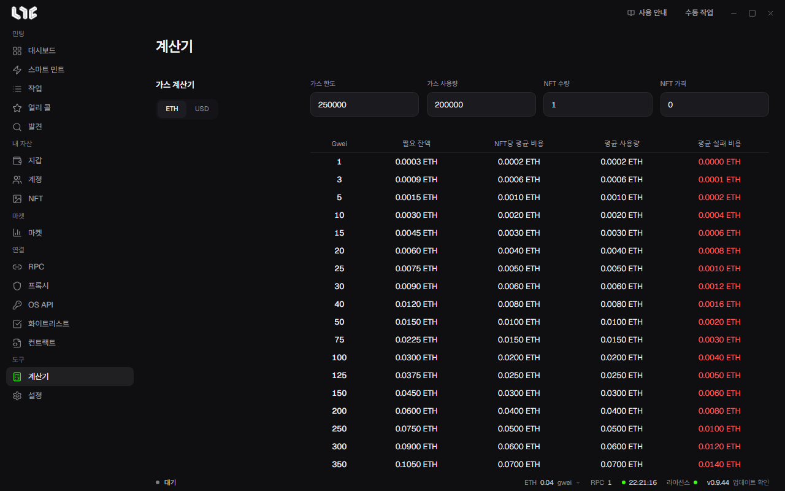

# 계산기

**계산기**에는 가스 계산기와 유닉스 시간 변환이 있습니다. 둘 다 체인에 아무것도 보내지 않습니다.

## 가스 계산기

네 칸을 채우면 가스 단가(gwei)별로 비용 표가 나옵니다. 단가는 1부터 1000 gwei까지 줄로 나뉩니다.

| 칸 | 넣는 것 |
|---|---|
| 가스 한도 | 작업에 넣을 가스 한도입니다. |
| 가스 사용량 | 민팅 거래가 실제로 쓰는 가스입니다. 익스플로러에서 같은 민팅 거래를 열어 보면 알 수 있습니다. |
| NFT 수량 | 지갑 하나가 민팅할 개수입니다. |
| NFT 가격 | 개당 민팅 가격입니다. |

표의 칸은 이렇게 계산합니다.

| 칸 | 계산 |
|---|---|
| 필요 잔액 | NFT 수량 × NFT 가격 + 1.2 × 단가 × 가스 한도. 지갑에 이만큼은 있어야 거래가 들어갑니다. |
| 평균 사용량 | NFT 수량 × NFT 가격 + 단가 × 가스 사용량. 성공했을 때 실제로 나가는 돈입니다. |
| NFT당 평균 비용 | 평균 사용량 ÷ NFT 수량 |
| 평균 실패 비용 | 단가 × 40,000 가스. 거래가 실패했을 때 잃는 가스비의 어림값입니다. |

ETH 가격을 받아 오면 왼쪽에 **ETH / USD** 버튼이 생겨 달러로도 볼 수 있습니다.

지갑마다 넣을 돈을 정할 때는 쓸 단가 줄의 **필요 잔액**을 보고 [자금 관리](../prepare/funding.md)의 **지갑당 목표 잔액**에 넣으면 됩니다.

## 유닉스 시간 변환

작업의 **타임스탬프** 칸은 유닉스 시간을 받습니다. 아래쪽 변환기에서 **현지 날짜와 시간**을 고르면 **유닉스 타임스탬프**가 나오고, 반대로 숫자를 넣으면 날짜가 나옵니다. **지금으로 설정**은 지금 시각을 넣고, 복사 버튼으로 숫자를 복사합니다.
