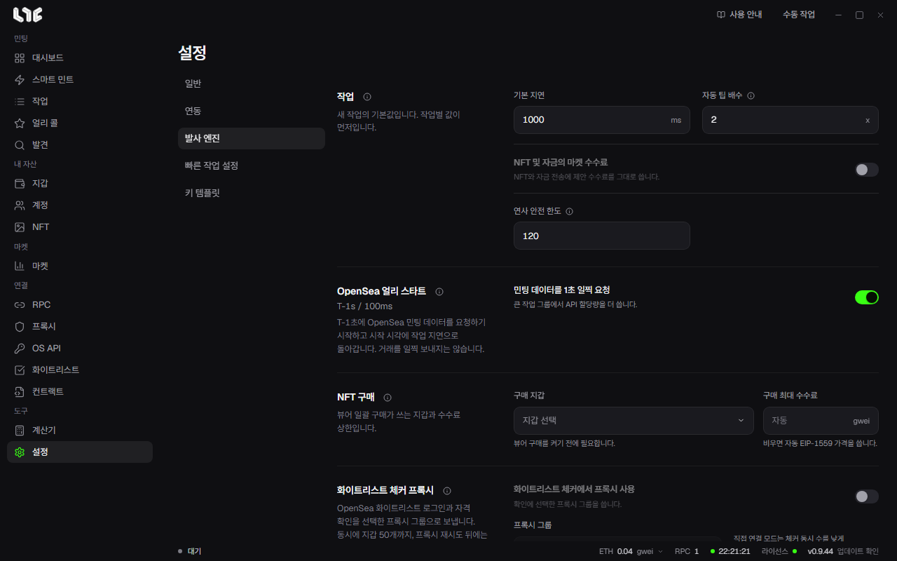
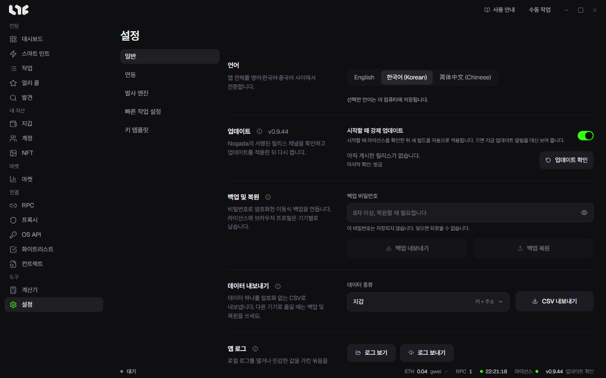

# 설정

**설정**은 왼쪽 탭 다섯 개로 나뉩니다.

| 탭 | 들어 있는 것 |
|---|---|
| 일반 | 언어, 업데이트, 백업 및 복원, 데이터 내보내기, 앱 로그, 로그아웃, 모든 데이터 지우기 |
| 연동 | 캡차 풀이 키, 마켓 허브, PnL Alchemy URL, Etherscan API 키, Discord 웹훅, 캡처 브라우저 확장 |
| 발사 엔진 | 작업 기본값, OpenSea 얼리 스타트, NFT 구매, 화이트리스트 체커 프록시, 전파, Flashbots, 체인 |
| 빠른 작업 설정 | 빠른 작업 지갑과 체인별 RPC |
| 키 템플릿 | 소셜 작업의 답변 템플릿 |

아래는 탭 순서가 아니라 바꾸고 싶은 것에 따라 묶었습니다. 제목 옆에 그 설정이 있는 탭을 적었습니다.

## 작업이 발사되는 방식(발사 엔진)

### 새 작업의 기본값

**작업** 칸에는 새 작업이 처음 갖는 값이 있습니다. 작업에서 따로 넣은 값이 이깁니다.

- **기본 지연**: 새 작업에 들어가는 지연(ms)입니다.
- **자동 팁 배수**: 우선 수수료가 자동인 작업에서 RPC가 제안한 값에 이 수를 곱합니다. 보통 거래는 1배, 경쟁이 있는 민팅은 3~5배가 맞고, 결과가 0.1 gwei 아래로 내려가지는 않습니다.
- **연사 안전 한도**: 연사가 길어야 몇 초까지 돌 수 있는지입니다. 비우면 이 한도가 없습니다.
- **NFT 및 자금의 마켓 수수료**: 켜면 NFT 보내기와 자금 이동이 RPC가 제안한 수수료를 그대로 냅니다.

### 여러 RPC로 보내기

**전파** 칸에 **여러 RPC로 전파**와 **연사를 여러 RPC로 전파**가 있습니다. 무엇이 달라지는지는 [RPC와 체인](../prepare/rpc-and-chains.md)에 있습니다.

### Flashbots

Flashbots를 켠 이더리움 작업에 앱 전체로 적용되는 값입니다.

- **번들 창**: 앞으로 몇 블록을 이어서 미리 준비할지입니다(최소 10). Flashbots 연사는 새 블록이 나올 때마다 끝을 한 칸씩 밀어 이만큼을 유지합니다.
- **우선 수수료**, **최대 수수료**: 작업의 수수료가 자동일 때 씁니다.
- **평판 키**: 빌더에게 나를 알리는 데만 쓰는 키로, 빌더는 이걸로 내 번들이 어떻게 들어갔는지 기록합니다. 돈을 담지 않고 체인에 드러나지도 않습니다. **초기화**하면 새 키가 생기고 쌓인 평판은 버려집니다.
- **빌더**: 번들을 받을 빌더들입니다.

### OpenSea 얼리 스타트

켜면 작업이 시작 시각 1초 전부터 OpenSea에 민팅 데이터를 묻기 시작하고, 시작 시각이 되면 원래 지연으로 돌아갑니다. 거래가 일찍 나가는 일은 없습니다. 작업 그룹이 크면 그만큼 API 할당량을 더 씁니다.

### 체인

아래쪽 체인 목록에서 쓰지 않는 체인을 숨기고, 공개 대체 RPC를 바꾸고, 체인별 최소 팁을 정하고, 사용자 체인을 넣습니다. → [RPC와 체인](../prepare/rpc-and-chains.md)

## 빠른 작업(빠른 작업 설정)

작업 화면의 번개 버튼이 쓰는 값입니다.

- **빠른 작업 지갑**: 빠른 작업이 쓸 지갑입니다. 하나도 고르지 않으면 번개 버튼이 꺼져 있습니다.
- **빠른 작업 RPC(체인별)**: 체인 줄을 펼쳐 RPC를 고정합니다. 아무것도 고정하지 않은 체인에서는 그 체인에 저장한 RPC를 모두 쓰고, 저장한 것도 없으면 공개 기본값을 씁니다.

## 다른 서비스와의 연결(연동)

- **마켓 허브**: 마켓과 NFT 시세를 대 주는 Nogada 서버에 앱이 붙어 있는지 보여 줍니다. OpenSea 키가 없어도 됩니다. 올리기, 오퍼 넣기, 오퍼 수락은 이 서버를 지나지 않고 내 OpenSea API 키로 합니다.
- **Discord 웹훅**: 작업이 성공하거나 실패할 때마다 Discord 채널에 짧은 알림을 올립니다. 채널 설정 → 연동 → 웹후크에서 만든 URL을 붙여넣고, 테스트 버튼으로 성공 하나와 실패 하나의 견본 알림을 받아 봅니다.
- **PnL Alchemy URL**: 체인마다 Alchemy URL 하나입니다. 비우면 RPC 메뉴에 저장한 Alchemy 주소를 씁니다. **테스트**는 입력한 것(비어 있으면 저장된 URL)을 저장하지 않고 확인합니다.
- **Etherscan API 키**: 컨트랙트 ABI 읽기 같은 데 씁니다. 비워도 공용 키로 돌아가고, 내 키를 넣으면 Etherscan 계열 체인에서 한도가 높아집니다.
- **캡차 풀이 API 키**: CapMonster, CapSolver, 2captcha, AnySolver. 캡차를 만나는 소셜 작업에 씁니다.
- **Nogada 캡처 브라우저 확장**: Chrome이나 Edge에 따로 붙이는 확장입니다. 지원하는 익스플로러에서 거래를 집어, 그 내용으로 채운 작업 창을 앱에서 엽니다. **확장 내려받기**로 받아 압축을 풀고, `chrome://extensions`에서 개발자 모드를 켠 뒤 **압축 해제된 확장 프로그램 로드**로 그 폴더를 넣습니다. 브라우저 버튼에 앱이 반응하지 않으면 **프로토콜 처리기 다시 등록**을 누릅니다.

## 뷰어 구매와 화이트리스트 확인(발사 엔진)

- **NFT 구매**: 뷰어의 일괄 구매에 쓰는 **구매 지갑**과 **구매 최대 수수료**입니다. 구매 지갑이 없으면 뷰어에서 살 수 없습니다. → [NFT 메뉴](../after/nft-menu.md)
- **화이트리스트 체커 프록시**: 화이트리스트 체커의 OpenSea 로그인과 자격 확인을 고른 프록시 그룹으로 돌립니다. → [화이트리스트](../tasks/whitelists.md)

## 언어와 업데이트(일반)

- **언어**: English, 한국어, 简体中文. 이 PC에 저장됩니다.
- **업데이트**: 지금 버전과 **업데이트 확인**. 새 버전이 나왔을 때 어떻게 할지는 **시작할 때 강제 업데이트**가 정합니다. 켜면 켤 때 깔고, 끄면 **지금 업데이트** 알림이 떠서 때를 내가 고릅니다. Nogada가 서명한 릴리스만 받습니다.

일반 탭의 나머지(**백업 및 복원**, **데이터 내보내기**, **앱 로그**, **로그아웃**, **모든 데이터 지우기**)는 [백업과 데이터](backup-and-data.md)에 있습니다.

## 키 템플릿

소셜 작업의 글 칸에 `{이름}`으로 넣는 답변 묶음입니다. → [계정과 소셜 작업](../social/accounts-and-social.md)
