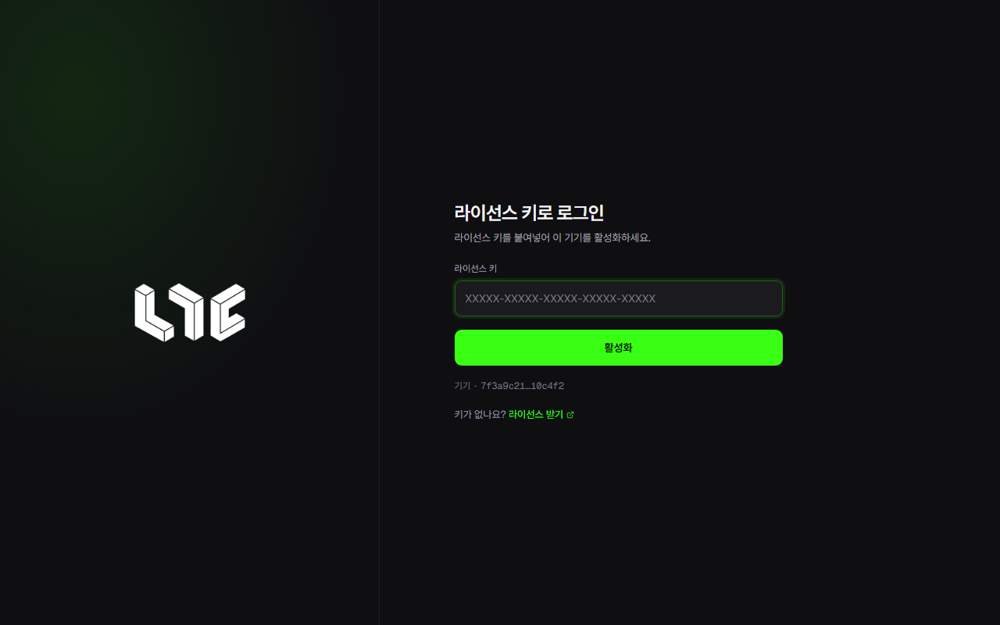

# 라이선스

Nogada는 라이선스 키가 있어야 켜집니다. 키는 판매 페이지에서 코인으로 사고, 앱의 첫 화면에 넣어 씁니다. 키는 `NOGADA-XXXX-XXXX-XXXX-XXXX`처럼 생겼습니다.

## 기간과 가격

지금은 베타 가격입니다.

| 기간 | 가격 |
|---|---|
| 일주일 | $15 |
| 한달 | $29 |

자동 결제는 없습니다. 같은 Telegram 계정으로 다시 사면 지금 키의 남은 기간에 그만큼 더해집니다.

## 사는 법

[판매 페이지](https://nogada-lic.duckdns.org/buy)에서 합니다. 비밀번호 없이 Telegram 계정으로 로그인합니다.

1. **Telegram으로 로그인**을 누르고 Telegram 창에서 로그인합니다.
2. 기간, 네트워크, 코인을 고르고 **주문 만들기**를 누릅니다.
3. 화면에 나온 **보낼 금액**을 **받는 주소**로 보냅니다. 주문 화면에는 남은 시간이 보이고, 주문은 30분 동안 열려 있습니다.
4. 입금이 네트워크에서 확인되면 키가 화면에 나오고 Telegram으로도 옵니다. 페이지를 닫아도 됩니다.

받는 코인은 Ethereum과 Base 네트워크의 ETH, USDC, USDT입니다. ETH로 내면 주문을 만든 순간의 시세로 금액이 정해지고, 그 주문 안에서는 바뀌지 않습니다.

### 금액은 끝자리까지

주문마다 금액의 끝자리가 다릅니다. 판매 서버는 이 끝자리로 입금과 주문을 짝짓기 때문에, 끝자리까지 똑같이 보내야 키가 자동으로 나옵니다.

- 거래소에서 출금할 때는 출금 수수료가 금액에서 빠지는지 먼저 보세요. 금액이 줄면 자동으로 잡히지 않습니다.
- 주문에서 고른 네트워크에 고른 코인만 보냅니다. 다른 네트워크로 보내면 찾지 못합니다.
- 금액이 다르거나 자동으로 잡히지 않았다면, 주문 화면 아래의 거래 해시 칸에 보낸 거래의 해시를 넣고 **확인**을 누릅니다. 운영자가 확인한 뒤 키가 나옵니다.
- 일부 거래소의 묶음 출금이나 스마트 지갑처럼 컨트랙트를 거쳐 보낸 ETH는 자동으로 잡히지 않습니다. 이때는 운영자에게 문의하세요.

## 앱에서 활성화하기

1. 앱을 켜면 **라이선스 키로 로그인** 화면이 나옵니다.
2. **라이선스 키** 칸에 키를 붙여넣고 **활성화**를 누릅니다.
3. 메인 화면이 뜨고 아래 상태줄의 **라이선스** 옆 점이 초록색이면 끝입니다.

활성화한 PC에는 상태가 저장되어, 다음부터는 키를 다시 넣지 않아도 됩니다. 아직 키가 없다면 이 화면의 **라이선스 받기**를 눌러 판매 페이지로 갈 수 있습니다.

## 키 하나에 PC 한 대

키는 처음 활성화한 PC에 묶입니다. 화면 아래의 **기기** 줄은 이 PC를 가리키는 값입니다.

다른 PC로 옮길 때:

1. 지금 PC에서 **설정 → 일반 → 백업 및 복원**으로 백업을 받습니다. [백업과 데이터](../app/backup-and-data.md)
2. [내 라이선스](https://nogada-lic.duckdns.org/dashboard)에서 **기기 초기화**를 누릅니다. 24시간에 한 번 할 수 있습니다. 판매 페이지에서 사지 않은 키는 운영자에게 초기화를 요청합니다.
3. 새 PC에서 키를 넣고, 백업을 복원합니다.

**설정 → 일반 → 로그아웃**은 이 PC에 저장된 활성화만 지웁니다. 돌고 있는 작업을 멈추고 라이선스 화면으로 돌아가지만, 서버에 기록된 PC 묶임은 그대로입니다. 그래서 로그아웃만으로는 다른 PC에서 키가 받아지지 않습니다.

## 내 라이선스 페이지

[내 라이선스](https://nogada-lic.duckdns.org/dashboard)에서는 다음을 봅니다.

- 키와 만료일, 상태(사용 중, 곧 만료, 만료됨, 정지됨)
- 묶인 기기와 **기기 초기화**
- 결제 기록과 아직 결제하지 않은 주문
- **기간 늘리기**, **앱 내려받기**

## 환불

디지털 상품이라 환불은 되지 않습니다. 주문 금액보다 많이 보낸 금액도 돌려드리지 않습니다. 민팅의 성공과 실패는 가스, 경쟁, 프로젝트 사정에 달려 있어 보장하지 않습니다.
