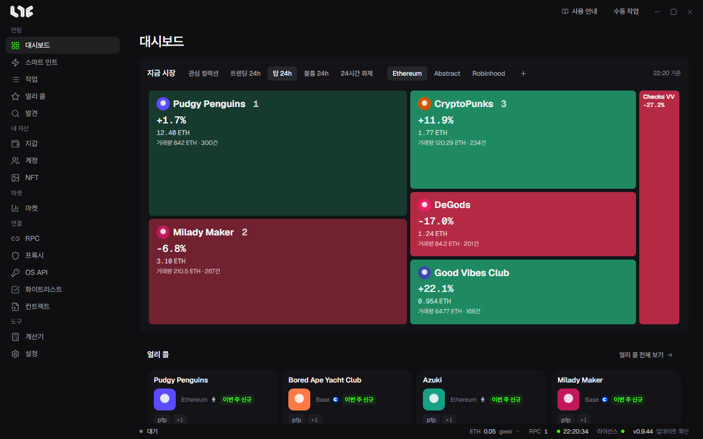

# 화면 구성

앱 화면은 왼쪽 메뉴, 위쪽 막대, 가운데 작업 영역, 아래 상태줄로 나뉩니다.

## 왼쪽 메뉴

메뉴는 다섯 묶음입니다. 위에서 아래로 쓰는 순서와 비슷합니다.

| 묶음 | 메뉴 | 하는 일 |
|---|---|---|
| 민팅 | 대시보드 | 지금 시장과 얼리 콜을 한눈에 봅니다. 앱을 켜면 처음 나오는 화면입니다. |
| | 스마트 민트 | 링크나 주소로 민팅 작업을 만듭니다. |
| | 작업 | 작업을 만들고, 시작하고, 멈춥니다. 실행 중인 작업이 있으면 메뉴 옆에 개수가 붙습니다. |
| | 얼리 콜 | 운영자가 고른 민팅 전 프로젝트입니다. |
| | 발견 | 체인에서 새 SeaDrop 드롭을 찾아 모읍니다. |
| 내 자산 | 지갑 | 민팅에 쓸 지갑을 그룹으로 관리합니다. |
| | 계정 | 소셜 작업에 쓰는 Gmail, X, Discord 계정입니다. |
| | NFT | 보유 NFT, 손익, 뷰어입니다. |
| 마켓 | 마켓 | 컬렉션 순위, 차트, 알림, 민트 캘린더입니다. |
| 연결 | RPC | 체인에 거래를 보내는 노드 주소입니다. |
| | 프록시 | 사이트 요청을 여러 IP로 나눌 때 씁니다. |
| | OS API | OpenSea API 키입니다. |
| | 화이트리스트 | 지갑의 화이트리스트 자격을 확인하고 정리합니다. |
| | 컨트랙트 | 번들에 쓰는 EIP-7702 컨트랙트입니다. |
| 도구 | 계산기 | 가스비 계산과 유닉스 시간 변환입니다. |
| | 설정 | 언어, 업데이트, 백업, 발사 엔진 같은 앱 전체 설정입니다. |

## 위쪽 막대

- **사용 안내**: 이 가이드를 브라우저로 엽니다.
- **수동 작업**: 작업 화면으로 가서 **작업 만들기** 창을 바로 엽니다. 어느 화면에 있든 누를 수 있습니다.
- 오른쪽 끝의 세 버튼은 최소화, 전체 화면, 닫기입니다. 닫기는 앱을 완전히 끕니다.

## 아래 상태줄

왼쪽부터 이렇게 읽습니다.

| 칸 | 뜻 |
|---|---|
| 첫 칸 | 앱에서 마지막으로 일어난 일입니다. 아무 일도 없으면 **대기**라고 나오고, 작업이 돌면 실행 중인 개수, 리스팅이나 NFT 보내기가 진행 중이면 그 진행이 나옵니다. 다른 화면에 있어도 결과를 놓치지 않게 해 줍니다. |
| 가스 | 고른 체인의 지금 가스비(gwei)입니다. 누르면 다른 체인을 고릅니다. |
| RPC | 저장한 RPC 개수입니다. 마우스를 올리면 하나하나의 상태가 보입니다. |
| 시계 | 인터넷 시간에 맞춘 시각입니다. 점이 초록이면 PC 시계와 거의 같고, PC 시계와 1.5초 넘게 다르면 차이가 옆에 나옵니다. 누르면 다시 맞춥니다. 작업의 발사 시각은 PC 시계로 세므로 차이가 크면 Windows 시간 동기화를 하세요. |
| 라이선스 | 점이 초록이면 라이선스가 유효합니다. |
| 버전 | 지금 버전과 **업데이트 확인**입니다. |

## 대시보드

대시보드 위쪽의 **지금 시장**은 컬렉션을 타일로 보여 줍니다. 이름 옆 숫자가 순위이고, 초록은 오름, 빨강은 내림입니다. 타일에는 플로어, 24시간 변화, 거래량, 판매 건수가 나오고, 누르면 마켓의 그 컬렉션 화면으로 갑니다.

| 탭 | 고르는 기준 |
|---|---|
| 관심 컬렉션 | 마켓에서 별표한 컬렉션 |
| 트렌딩 24h | 24시간 판매 건수 상위 |
| 탑 24h | 24시간 거래량 상위 |
| 볼륨 24h | 24시간 거래량이 7일 평균보다 많이 늘어난 순 |
| 24시간 화제 | 24시간 플로어 상승률 상위(판매 3건 이상) |

탭 오른쪽의 체인 칩으로 체인을 바꾸고, **+**로 다른 체인을 더합니다.

아래쪽 **얼리 콜**에는 운영자가 고른 프로젝트 카드가 나옵니다. **얼리 콜 전체 보기**를 누르면 [얼리 콜](../tasks/early-calls.md) 화면으로 갑니다.

## 언어

**설정 → 일반 → 언어**에서 English, 한국어, 简体中文 가운데 고릅니다. 바로 바뀌고, 고른 언어는 이 PC에 저장됩니다.
