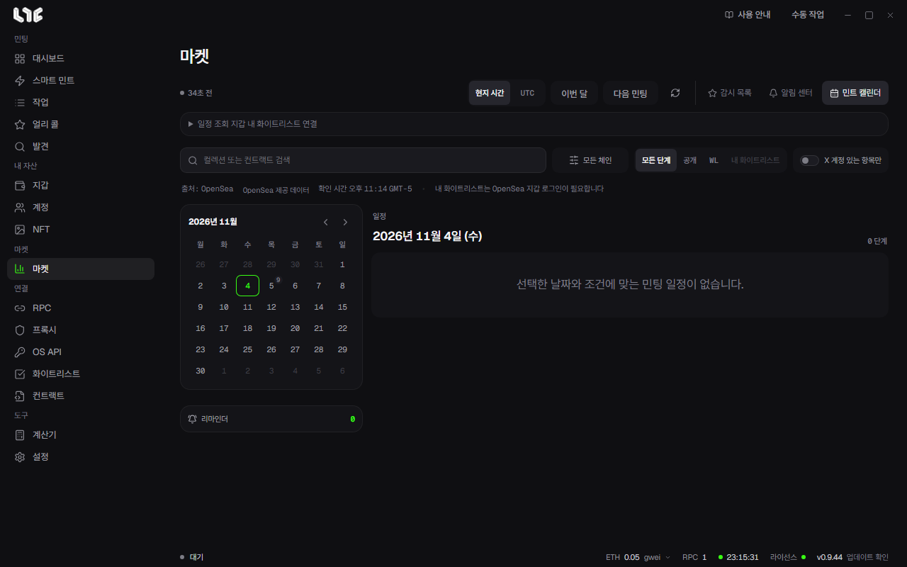

# 민트 캘린더

다가오는 민팅 일정을 달력으로 보고, 시작 전에 알림을 받습니다. **마켓** 툴바의 **민트 캘린더**로 들어갑니다.

OpenSea 민팅 일정은 내 OpenSea API 키로 받습니다. **OS API**에 키를 넣어야 일정이 나옵니다. [OpenSea API 키](../setup/opensea-api.md)

## 툴바와 필터

- **현지 시간, UTC**를 바꿉니다.
- **이번 달**은 오늘로, **다음 민팅**은 가장 가까운 단계로 옮깁니다.
- **컬렉션 또는 컨트랙트 검색**, 체인 선택.
- 단계 필터: **모든 단계, 공개, WL, 내 화이트리스트**.
- **X 계정 있는 항목만**.

## 내 화이트리스트

내 지갑에 자격이 있는 단계만 남깁니다.

1. **일정 조회 지갑** 카드를 펼쳐 지갑을 고릅니다.
2. **내 화이트리스트 연결**을 누릅니다.

자격 확인용 OpenSea 로그인입니다. 거래나 가스비는 없습니다. 연결하면 OpenSea 로그인 메시지에 서명하고 서비스 약관과 개인정보 처리방침에 동의합니다. 앱을 끄면 연결이 해제되고 로그인은 하루 뒤 만료됩니다.

## 달력과 일정

- 왼쪽 달력에 날짜마다 단계 수가 나옵니다. 날짜를 누르면 오른쪽 **일정**이 바뀝니다.
- **일정**에는 시작 시각과 남은 시간, 컬렉션, 체인, 단계, 가격, 지갑당 최대 수량이 나옵니다.
- 행 끝의 종은 **리마인더 설정**입니다.

## 리마인더

시작 전 알림 시점(시작 시각, 5분, 15분, 30분, 1시간, 3시간, 1일 전)과 채널(Windows, Telegram)을 고릅니다. 왼쪽 **리마인더** 카드에서 지웁니다.

## 드롭 상세

행을 누르면 상세가 열립니다.

- 컨트랙트, 총 수량, 유형, 갱신 상태
- 단계별 시작, 종료, 가격, 지갑별 한도
- **온체인 확인**: 컨트랙트에서 일정을 직접 대조합니다. 실패하면 **다시 시도**를 누릅니다
- 출처와 **웹사이트, X, 출처 열기** 링크

마음에 드는 드롭은 **출처 열기**로 민팅 페이지를 연 뒤, 그 링크를 [스마트 민트](../tasks/smart-mint.md)에 넣으면 됩니다.
